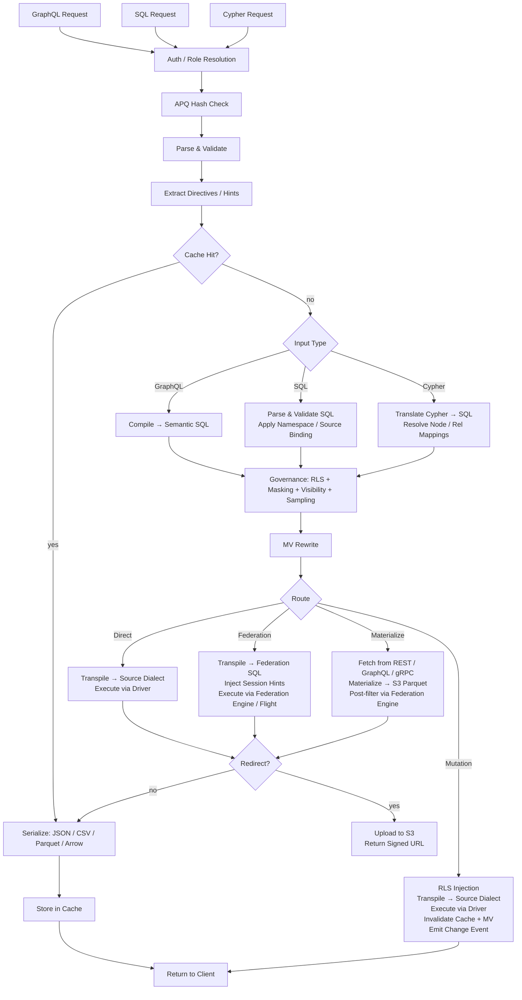
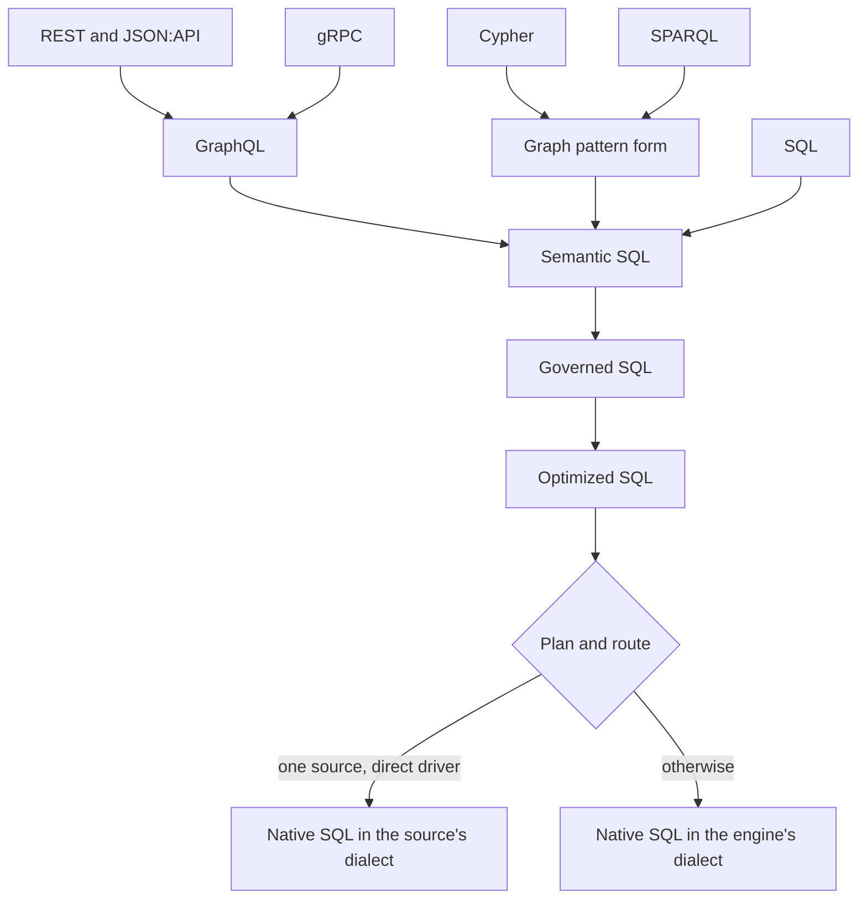

# Arquitectura de Provisa {: #provisa-architecture }

## Visión general {: #overview }

Provisa es una plataforma de virtualización de datos controlada por configuración: federación, métricas, ontología y gobierno desde un único modelo, para equipos pequeños y grandes empresas. Proporciona una API unificada sobre orígenes de datos heterogéneos con gobierno, seguridad y optimización de rendimiento. Los clientes consultan mediante SQL, GraphQL o Cypher; las tres reciben el mismo gobierno.

El modelo es el único lugar donde se añade significado. Para ampliarlo, registre nuevos orígenes de datos o agregados en la capa de virtualización de datos. Eso mantiene una separación limpia, porque nada puede añadir semántica fuera de la plataforma, y es lo que hace posible una gobernanza de datos real. Lo impone el compilador: el catálogo de relaciones aprobadas es la fuente de verdad, sea cual sea el lenguaje de consulta.

Una sola plataforma atiende lecturas operativas y analíticas. Una consulta que toca una fuente va directamente a esa fuente por su driver nativo, y suele volver en menos de 100 ms, y una consulta que une fuentes se ejecuta en el motor de federación que eligió para la escala analítica.

```text
Config YAML → PG Metadata → Federation Catalogs
                               ↓
         Federation engine metadata → Schema Generator → SDL / SQL catalog / Cypher labels / gRPC proto (per role)
                                     ↓
                     Query → Parser → SQL Compiler → Transpiler
                                     ↓
                             Router (Smart Dispatch)
                         /           |            \
                    Federation  Direct PG      Direct MySQL/etc.
                         \           |            /
                              Executor Pool
                                     ↓
                         ┌───── Inline ─────┐     ┌──── Redirect ────┐
                         │  JSON (HTTP)     │     │  CTAS → S3       │
                         │  Arrow (Flight)  │     │  (Parquet, ORC)  │
                         │  Protobuf (gRPC) │     │  Provisa → S3    │
                         └─────────────────-┘     │  (JSON, CSV, …)  │
                                                  └─────────────────-┘
```

## Interfaces de consulta {: #query-interfaces }

Cada interfaz es un transporte distinto, y las cuatro aplican el mismo pipeline de seguridad (RLS, enmascaramiento, muestreo, comprobación de roles). Los clientes nunca hablan directamente con el motor de federación. El lenguaje de consulta (SQL, GraphQL o Cypher) es independiente del transporte, y varios lenguajes pueden llegar por el mismo transporte.

| Port | Transport | Accepted query languages | Use case |
| ------ | ----------- | -------------------------- | ---------- |
| 8001 | HTTP | GraphQL, SQL, Cypher | Web clients, BI tools, curl, REST consumers |
| 8815 | Arrow Flight (gRPC) | SQL (via Arrow Flight SQL) | Data tools (Pandas, DuckDB, Spark, ADBC) |
| 50051 | Protobuf gRPC | Per-role generated proto RPCs | Service-to-service with typed contracts |
| configurable¹ | PostgreSQL wire protocol (pgwire) | SQL | psql, DBeaver, SQLAlchemy, any PG-compatible client |

¹ Defina `PROVISA_PGWIRE_PORT` (p. ej., 5433). Deshabilitado si no está definido o es `0`.

### HTTP (puerto 8001) {: #http-port-8001 }

Múltiples endpoints bajo el mismo puerto, distinguidos por ruta:

| Path | Language | Notes |
| ------ | ---------- | ------- |
| `POST /data/graphql` | GraphQL | Reads and mutations; APQ hash accepted via `extensions.persistedQuery` |
| `POST /data/sql` | SQL | Read-only; no capability gate — governed by object visibility + RLS + masking |
| `POST /data/query` | Cypher | Read-only; standard role |
| `GET /data/nl` | Natural language | Translates to SQL/GraphQL/Cypher based on source type |
| `GET /data/subscribe/{table}` | GraphQL | SSE subscription stream |
| `GET /neo4j/...` | Cypher (Neo4j compat) | Neo4j HTTP API compatibility shim |
| `POST /admin/graphql` | GraphQL | Admin API (superuser/admin role required) |

Todas las rutas devuelven JSON por defecto. `Accept: text/csv`, `application/vnd.apache.parquet`, `application/vnd.apache.arrow.stream` y `application/octet-stream` (binario sin procesar) se admiten mediante negociación de contenido. Los resultados que superan el umbral de tamaño configurado se redirigen automáticamente a una URL firmada de S3.

### Arrow Flight (puerto 8815) {: #arrow-flight-port-8815 }

Transporte columnar nativo de Arrow sobre gRPC. Los clientes envían un ticket JSON:

```json
{"query": "SELECT name, email FROM customers", "role": "analyst"}
```

y reciben RecordBatches de Arrow transmitidos de forma diferida. Cuando el proxy Zaychik de Arrow Flight SQL está disponible, los datos fluyen como un flujo de lotes de registros de Arrow de extremo a extremo:

```text
Client ←(Arrow batches)← Provisa Flight Server ←(Arrow batches)← Zaychik ←(JDBC)← Federation Engine
```

El resultado completo nunca se guarda en la memoria de Provisa: los lotes se reenvían según llegan. Eso convierte Arrow Flight en una vía sin límite, apta para resultados de cualquier tamaño.

### Protobuf gRPC (puerto 50051) {: #protobuf-grpc-port-50051 }

`.proto` autogenerado a partir del esquema de datos, generado por rol. Consultas en flujo (streaming) (un mensaje por fila), mutaciones unarias. Reflexión del servidor habilitada. El rol se transmite mediante la clave de metadatos `x-provisa-role`. La reflexión describe a cada llamante el servicio de su propio rol.

### Protocolo de cable de PostgreSQL / pgwire (puerto configurable) {: #postgresql-wire-protocol-pgwire-configurable-port }

Implementa el protocolo de cable frontend/backend de PostgreSQL usando la biblioteca `buenavista`. Cualquier cliente compatible con PostgreSQL (`psql`, DBeaver, SQLAlchemy con `psycopg2`, JDBC) puede conectarse sin modificaciones. Solo acepta SQL. El pipeline de gobierno completo (RLS, enmascaramiento, permisos de dominio) se aplica de manera idéntica a las conexiones pgwire. Se habilita configurando `PROVISA_PGWIRE_PORT` en un puerto distinto de cero.

## Pipeline de solicitudes {: #request-pipeline }

Se aceptan tres lenguajes de consulta, y los tres confluyen en la gobernanza tras sus propios pasos de análisis y compilación. Los tres pueden además escribir: las mutaciones de GraphQL, `INSERT`, `UPDATE`, `DELETE`, `MERGE` y `TRUNCATE` de SQL y `CREATE`, `SET` y `DELETE` de Cypher se convierten en SQL y pasan por la misma admisión de escrituras. Consultar no tiene en sí ninguna barrera de capacidad. Cualquier identidad autenticada puede consultar en cualquier lenguaje, y los datos se gobiernan solo con la visibilidad de objetos, RLS y el enmascaramiento.

| Interface | Reads | Writes | Query gate |
| --- | --- | --- | --- |
| GraphQL (`/data/graphql`) | Yes | Yes (mutations) | None — data-layer governance only |
| SQL (`/data/sql`) | Yes | No | None — data-layer governance only |
| Cypher (`/data/query`) | Yes | No | None — data-layer governance only |



**Decisiones de enrutamiento:**

| Route | When |
| --- | --- |
| **Cache** | Result cache hit — evaluated first, serves the stored result with no execution |
| **Cheap-count** | `count(*)`-shaped query over an unmaterialized source that exposes an exact native count — routed to the native count call instead of materializing to count |
| **Direct** | Single source + has native driver + has federation connector |
| **Federation** | Multi-source federation, or source has connector but no driver |
| **Materialize** | Source has no federation connector — fetch and cache to S3/PG first |
| **Mutation** | A write: the source's own driver when it has one; otherwise the engine, through a connector that writes the source |

El enrutamiento consume la salida de la etapa de optimización posterior al gobierno, nunca el SQL gobernado previo a la optimización. El gobierno puede AGREGAR orígenes (predicados de subconsulta RLS); la etapa de optimización puede ELIMINARLOS (incorporación de VALUES-CTE para tablas activas, reescrituras de caché de API, poda de ramas de unión). Por lo tanto, una consulta federada que se reduce a un único origen activo tras la incorporación se vuelve a enrutar como directa.

### Consultas de raíz múltiple {: #multi-root-queries }

Las consultas GraphQL con varios campos raíz (p. ej., `{ orders { id } customers { name } }`) se compilan en consultas SQL independientes y se ejecutan por separado. Las solicitudes SQL y Cypher son de raíz única por definición. Los resultados se combinan en una sola respuesta:

- Los campos por debajo del umbral de redirección se devuelven en línea en `data`
- Los campos por encima del umbral se redirigen, con entradas por campo en `redirects`
- Los formatos binarios (Parquet, Arrow) solo se admiten para consultas de raíz única

## Canal de consulta {: #query-pipeline }

Toda lectura pasa por seis etapas, sea cual sea el lenguaje en que la escriba. Cada etapa entrega a la siguiente una sentencia SQL. El lenguaje solo decide por dónde entra la lectura.



### Front-ends {: #front-ends }

Un front-end analiza un lenguaje y nombra lo que lee en los términos del modelo. GraphQL se compila directamente a SQL semántico. Los endpoints REST que describe el documento OpenAPI, los endpoints JSON:API y gRPC construyen una consulta GraphQL a partir de cada petición y la compilan de la misma forma. La única excepción es `page[total]` de JSON:API, el número total de filas, que compone el propio transporte JSON:API. Cypher y SPARQL se analizan en una misma forma de patrón de grafo que comparten ambos lenguajes de grafos, y esa forma se compila a SQL semántico. El SQL que usted escribe sobre las tablas del modelo ya es SQL semántico, así que entra en la etapa siguiente. Ningún front-end decide quién puede leer qué.

### SQL semántico {: #semantic-sql }

El SQL semántico lee el modelo. Sus tablas están calificadas por dominio (`sales.orders`), sus columnas son las que el modelo publica y sus joins son las relaciones declaradas. No dice nada de dónde están los datos.

Una lectura anidada se compila a un único pipeline canónico de CTE, el mismo para todos los motores y construido solo a partir de las relaciones declaradas. Una CTE raíz lee la tabla raíz con su filtro, su orden, su límite y su desplazamiento. Cada nivel a-muchos es una CTE propia. Une su tabla a la CTE del padre por las claves de la relación, toma las primeras filas de cada padre con `ROW_NUMBER() OVER (PARTITION BY ...)` y las agrega en una lista JSON por padre. El `SELECT` final lee la CTE raíz y une cada nivel con un left join por la clave del padre. Las lecturas GraphQL, Cypher y SPARQL que hacen la misma pregunta se compilan a la misma sentencia.

Los compiladores actuales aún no han llegado a esa forma. El compilador GraphQL lee un campo anidado con argumentos mediante un `LEFT JOIN LATERAL` por padre, y el traductor de Cypher escribe una CTE por cada etapa `WITH`. El ejemplo de abajo muestra ambas formas.

### SQL gobernado {: #governed-sql }

La gobernanza trabaja sobre toda la sentencia semántica a la vez. Cada `SELECT` que contiene recibe las reglas de visibilidad, la seguridad a nivel de fila y las máscaras del rol que lee, de modo que cada nivel anidado se filtra en su propia profundidad. Una regla de fila cuya condición es una subconsulta lee otra tabla, así que la gobernanza puede añadir orígenes a una sentencia.

### SQL optimizado {: #optimized-sql }

La etapa optimizada reescribe la sentencia gobernada de formas que valen en cualquier motor. Vuelve a introducir las vistas materializadas donde responden parte de la sentencia, incrusta como `VALUES` las tablas pequeñas y muy leídas, y elimina las ramas de caché de API y de unión que la sentencia no puede alcanzar. Nada aquí sabe qué motor ejecutará la sentencia. Estas reescrituras pueden quitar orígenes. Una lectura federada cuyos demás orígenes quedan todos incrustados se queda con un único origen en vivo.

### Planificar y enrutar {: #plan-and-route }

El enrutamiento lee los orígenes de la sentencia optimizada, nunca los de la gobernada. Por eso una lectura que la optimización redujo a un origen todavía puede ejecutarse en directo. Una sentencia va en directo cuando lee un origen y ese origen tiene un controlador directo. Si no, la ejecuta el motor de federación. La regla tiene una tercera condición: que el origen admita cada construcción de la sentencia. El enrutador aún no la comprueba y decide por el número de orígenes y el controlador. Los casos de caché, réplica y steward están en [Decisiones de enrutamiento](#request-pipeline).

### SQL nativo {: #native-sql }

La etapa nativa escribe la sentencia enrutada en el dialecto del origen para una lectura directa y en el del motor para una federada. Elige la grafía de las funciones de agregado y de objeto JSON, escribe la lista vacía para un padre sin filas, convierte `DISTINCT ON` en `ROW_NUMBER()` donde el dialecto no lo tiene y elige formas propias de cada motor, como un join `LATERAL` por padre o una indicación de materialización de CTE.

### Un ejemplo completo {: #a-worked-example }

Esta lectura GraphQL pide un cliente y sus tres pedidos de mayor importe:

```graphql
{
  customers(where: { name: { eq: "Acme" } }) {
    id
    name
    orders(order_by: { amount: desc }, limit: 3) {
      id
      amount
    }
  }
}
```

En la forma canónica, se compila a este SQL semántico:

```sql
WITH customers AS (
  SELECT c.id, c.name
  FROM sales.customers AS c
  WHERE c.name = 'Acme'
),
customers_orders AS (
  SELECT ranked.customer_id,
         JSON_AGG(JSON_OBJECT('id', ranked.id, 'amount', ranked.amount)
                  ORDER BY ranked.amount DESC, ranked.id) AS orders
  FROM (
    SELECT o.customer_id, o.id, o.amount,
           ROW_NUMBER() OVER (PARTITION BY o.customer_id
                              ORDER BY o.amount DESC, o.id) AS rn
    FROM sales.orders AS o
    JOIN customers AS p ON o.customer_id = p.id
  ) AS ranked
  WHERE ranked.rn <= 3
  GROUP BY ranked.customer_id
)
SELECT customers.id, customers.name, customers_orders.orders
FROM customers
LEFT JOIN customers_orders ON customers_orders.customer_id = customers.id
```

El id del pedido deshace los empates en la clasificación, así que dos pedidos del mismo importe vuelven siempre en el mismo orden. Un cliente sin pedidos no tiene fila en `customers_orders`; la etapa nativa escribe para él la lista vacía.

La misma lectura en Cypher localiza al cliente y lee los tres pedidos mayores en una subconsulta:

```cypher
MATCH (a:Customers)
WHERE a.name = 'Acme'
CALL {
  WITH a
  OPTIONAL MATCH (a)-[:HAS_ORDERS]->(b:Orders)
  RETURN b.id AS id, b.amount AS amount
  ORDER BY b.amount DESC
  LIMIT 3
}
RETURN a.id, a.name, id AS orders__id, amount AS orders__amount
```

En la forma canónica, esta lectura Cypher y la lectura GraphQL se compilan a la sentencia de arriba. En eso se apoya Abrir como consulta: una lectura GraphQL pasa a la página de Cypher y devuelve la misma respuesta.

Hoy el compilador GraphQL escribe el nivel anidado como un lateral join por padre:

```sql
SELECT "t0"."id", "t0"."name", "t1"."id" AS "orders__id", "t1"."amount" AS "orders__amount"
FROM (SELECT * FROM "sales"."customers" "t0" WHERE "t0"."name" = $2 LIMIT 100) "t0"
LEFT JOIN LATERAL (
  SELECT * FROM "sales"."orders" WHERE "customer_id" = "t0"."id" ORDER BY "amount" DESC LIMIT $1
) "t1" ON TRUE
```

Puede ver el SQL semántico de cualquier lectura GraphQL en el panel Provisa de la página GraphQL.

## Rutas de ejecución de federación {: #federation-execution-paths }

| Path | Transport | Via | When used |
| ------ | ----------- | ----- | ----------- |
| REST | federation engine client (HTTP :8080) | Direct query | Default, always available |
| Flight SQL | `adbc-driver-flightsql` (gRPC :8480) | Zaychik proxy → JDBC | When Zaychik is running |
| CTAS | federation engine client (HTTP :8080) | Direct write, Iceberg to S3 | Parquet/ORC redirect |

### Proxy Zaychik de Arrow Flight SQL {: #zaychik-arrow-flight-sql-proxy }

El motor de federación no admite de forma nativa el protocolo Arrow Flight SQL. [Zaychik](https://github.com/Raiffeisen-DGTL/zaychik-trino-proxy) es un proxy Java que implementa la interfaz gRPC de Arrow Flight SQL, traduce las solicitudes a consultas JDBC y transmite los resultados de vuelta como lotes de registros de Arrow.

```text
ADBC client → gRPC :8480 → Zaychik → JDBC :8080 → Federation Engine → results → Arrow batches → client
```

El servidor Flight de Provisa (puerto 8815) se conecta a Zaychik como cliente ADBC, de modo que Arrow se transmite de extremo a extremo y los resultados nunca se materializan.

### Catálogo de resultados Iceberg {: #iceberg-results-catalog }

La redirección CTAS usa un conector Iceberg (catálogo `results`) respaldado por un catálogo JDBC en la instancia de PostgreSQL existente. Iceberg escribe archivos Parquet/ORC directamente en MinIO/S3 mediante el sistema de archivos nativo de S3 (`fs.native-s3.enabled=true`).

## Motores de federación {: #federation-engines }

Provisa elige el motor de federación al arrancar a partir de la variable de entorno `PROVISA_ENGINE`, la configuración guardada desde la UI de administración o el valor predeterminado. Si no hay nada definido, el predeterminado es DuckDB, totalmente dentro del proceso y sin servicios externos. Consulte cómo funciona la selección en [Configuración](configuration.md#federation-engine).

Cada motor es una instancia de `FederationEngine` definida en `provisa/federation/engine.py`. La instancia posee una colección de conectores que determina qué tipos de origen puede leer el motor en vivo (ATTACH) frente a cuáles deben aterrizar primero en el almacén de materialización del motor.

### Clases de driver {: #driver-classes }

| Class | Meaning | Examples |
| ------- | --------- | --------- |
| `BROAD` | Reaches many external source types via native connectors | Trino |
| `PARTIAL` | Reaches a subset (relational, files, cloud object/lake) plus lands everything else | DuckDB, PostgreSQL, ClickHouse, Databricks, Snowflake, BigQuery, Fabric, Synapse |
| `SELF_ONLY` | Reaches only its own store; every other source lands in | SQLAlchemy |

### Motores disponibles {: #available-engines }

| Engine key | Dialect | MPP | External-link mechanism | Auth |
| ----------- | --------- | ----- | ------------------------ | ------ |
| `trino` / `trino-byo` | Trino SQL | Yes | Trino catalogs (broad connector set) | JDBC credentials |
| `pg` | PostgreSQL | No | FDW / pg_duckdb | PostgreSQL credentials |
| `duckdb` | DuckDB | No | Extension-native ATTACH | None (in-process) |
| `clickhouse` / `clickhouse-server` | ClickHouse | Yes (shards) | S3 / IcebergS3 / DeltaLake table engines | ClickHouse credentials |
| `snowflake` | Snowflake | Yes | External stage + external table | `PROVISA_ENGINE_URL` |
| `databricks` | Databricks SQL | Yes | Unity Catalog external tables via REST | Bearer token (`http_path` in `federation_hints`) |
| `bigquery` | BigQuery | Yes (Dremel) | BigQuery external / BigLake tables | `GOOGLE_APPLICATION_CREDENTIALS` service-account key |
| `fabric` | T-SQL | Yes | OneLake shortcuts → OPENROWSET | Azure AD (`az login` / managed identity) |
| `synapse` | T-SQL | Yes | ADLS OPENROWSET / external tables | Azure AD |
| `sqlalchemy` | Any SQLAlchemy dialect | No | None (land-only) | Per-dialect credentials |

### Predeterminado sin configuración: DuckDB {: #zero-config-default-duckdb }

Cuando `PROVISA_ENGINE` no está definido, Provisa usa el motor DuckDB totalmente embebido en proceso. El almacén de materialización de DuckDB es un archivo DuckDB embebido en `$PROVISA_DATA_DIR/materialize.duckdb` (por defecto, `~/.provisa/materialize.duckdb`). No se requiere ninguna base de datos ni servicio externo.

DuckDB permite un solo escritor por archivo, así que `store_connection.py` escribe en el almacén embebido a través de la propia conexión del motor y nunca abre una segunda conexión independiente. Es el único caso en que el motor y el almacén de materialización comparten un descriptor de archivo por diseño.

### Transporte de lectura nativo de Arrow {: #arrow-native-read-transport }

ClickHouse, DuckDB, Snowflake, Databricks, BigQuery, Fabric y Synapse anuncian todos `EngineCapability.ARROW` y `EngineCapability.ARROW_STREAM`. Las consultas contra estos motores devuelven RecordBatches de Arrow directamente: la ruta de serialización por fila se omite por completo. El servidor Flight transmite esos lotes a los clientes sin materializar el resultado completo en la memoria de proceso de Provisa. Para Trino, la transmisión de Arrow depende del proxy Zaychik; para los motores de almacén de datos, la API nativa de Arrow del propio motor (Cloud Fetch para Databricks, Storage Read API para BigQuery, `fetch_arrow_table` para DuckDB y Snowflake) alimenta el flujo Flight.

### Enlaces de datos externos (ATTACH) {: #external-data-links-attach }

Cada motor de almacén de datos puede escanear datos de objetos/lagos en la nube in situ sin aterrizar una copia. Los archivos Parquet, CSV, Iceberg y Delta Lake en S3, GCS o OneLake se adjuntan directamente al motor como si fueran tablas nativas. La estrategia (ATTACH para escanear in situ, o LAND para copiar en el almacén) la determina el `Mechanism` declarado del conector; no existe ramificación específica por motor en el planificador. Un conector `Mechanism.ATTACH_R` activa un escaneo sin copia; un conector `Mechanism.DIRECT` o la ausencia de conector activa un aterrizaje.

Attach aprovisiona automáticamente todos los prerrequisitos en el momento de adjuntar:

| Engine | Object/lake formats | Mechanism | Auto-provisioning |
| -------- | ------------------- | ---------- | ---------------------------------- |
| Databricks | parquet, csv, iceberg, delta_lake | UC external table (`ATTACH_R`) | REST installs Unity Catalog storage credential + external location, then `CREATE TABLE … USING <format> LOCATION …` — live-verified over Cloudflare R2 |
| BigQuery | parquet, csv, json, iceberg, delta_lake | BigQuery external / BigLake table (`ATTACH_R`) | `CREATE OR REPLACE EXTERNAL TABLE … OPTIONS(format=…, uris=[…])` — live-verified |
| ClickHouse | csv, parquet, iceberg, delta_lake | S3 / IcebergS3 / DeltaLake table engine (`ATTACH_R`) | Validation probe executed at attach time — live-verified over Cloudflare R2 |
| Fabric | parquet, csv, iceberg, delta_lake | OneLake shortcut → OPENROWSET (`ATTACH_R`) | REST creates an `AmazonS3Compatible` connection + lakehouse + shortcut; returns the OneLake `BULK` path — live-verified reading R2 through Fabric |
| Snowflake | parquet, csv, json, iceberg, delta_lake | External stage + external table (`ATTACH_R`) | `CREATE STAGE … URL=… CREDENTIALS=…`, then `CREATE OR REPLACE EXTERNAL TABLE … LOCATION=@stage FILE_FORMAT=(TYPE=…)` — implemented; not live-tested (no account available) |

Las credenciales para el almacenamiento en la nube viajan en el `federation_hints` del origen (consulte [Sources](sources.md#warehouses-as-named-sources)). Cualquier tipo de origen que no pueda hacer ATTACH aterriza primero en el almacén de materialización del motor.

### Escrituras de materialización columnar {: #columnar-materialization-writes }

`Connection.bulk_copy` en `provisa/core/database.py` elige la ruta de ingesta masiva más rápida según el dialecto del almacén: `COPY` binario (`copy_records_to_table` de asyncpg) para almacenes PostgreSQL, y una única sentencia preparada `executemany` para el resto de almacenes relacionales. El almacén embebido de DuckDB aterriza a través de `land_duckdb_native` en `store_connection.py`: una única llamada `executemany` para todo el lote, nunca un bucle por fila.

## Redirección de resultados grandes {: #large-result-redirect }

Los resultados que superan un umbral de filas se redirigen a almacenamiento compatible con S3 (MinIO) en lugar de devolverse en línea.

### Modos de redirección {: #redirect-modes }

| Mode | How it works | Data touches Provisa? |
| ------ | ------------- | ---------------------- |
| **CTAS** (Parquet, ORC) | Federation engine writes directly to S3 via `CREATE TABLE AS SELECT` | No |
| **Provisa upload** (JSON, NDJSON, CSV, Arrow IPC) | Provisa serializes and uploads via boto3 | Yes |

En los formatos nativos de CTAS, Provisa nunca toca los datos: el motor de federación escribe los archivos directamente en MinIO/S3. Es la vía preferible para exportaciones analíticas grandes.

### Sin almacén de objetos {: #with-no-object-store }

Un resultado va al almacén de objetos cuando hay uno configurado (un endpoint, o credenciales para AWS S3) y el motor escribe allí él mismo el formato solicitado. Si no, se escribe en un archivo de la carpeta de la organización, `<data directory>/orgs/<org>/results/`. Un almacén configurado en el que escribe el motor pero que no puede alcanzar hace fallar la solicitud por su nombre. El resultado no se escribe en la carpeta en su lugar.

| Motor | Escribe el archivo él mismo | Formatos |
| ------ | ---------------------- | ------- |
| DuckDB | `COPY (query) TO '<file>'` | parquet, csv, json, ndjson |
| PostgreSQL | `COPY (query) TO STDOUT`, transmitido al archivo en el host de Provisa | csv |
| Cualquier otro formato o motor | Provisa lo escribe a partir de las filas | parquet, orc, csv, arrow, json, ndjson |

El identificador tiene las mismas claves que el del almacén de objetos, con `"sink": "local"` y una `redirect_url` de `/data/redirect-file/<name>`, una ruta en el servidor que respondió. Solo el usuario que pidió el resultado puede obtenerlo. Cada obtención compara la identidad propia de la solicitud con el propietario registrado junto al archivo, y responde 403 a cualquier otro y 401 a una solicitud sin identidad.

Un archivo más antiguo que `redirect.ttl` se responde con 404 y se elimina. Un temporizador lo elimina al expirar, como se eliminan los resultados del almacén de objetos. Cada nuevo resultado también barre la carpeta de resultados de la organización, lo que quita los archivos cuyo temporizador terminó con un reinicio.

### Encabezados de redirección {: #redirect-headers }

| Header | Effect |
| -------- | -------- |
| `X-Provisa-Redirect-Format: <mime>` | Redirect in this format (implies force unless threshold set) |
| `X-Provisa-Redirect-Threshold: N` | Only redirect if result exceeds N rows |
| `X-Provisa-Redirect: true` | Force redirect using default format |

Estos encabezados implementan la redirección controlada por el cliente.

**Respuesta:**

```json
{
  "data": {"orders": null},
  "redirect": {
    "redirect_url": "https://minio:9000/provisa-results/results/abc.parquet?...",
    "row_count": 50000,
    "expires_in": 3600,
    "content_type": "application/vnd.apache.parquet"
  }
}
```

### Configuración del servidor {: #server-configuration }

| Env var | Default | Purpose |
| --------- | --------- | --------- |
| `PROVISA_REDIRECT_ENABLED` | `false` | Enable server-side threshold redirect |
| `PROVISA_REDIRECT_THRESHOLD` | `1000` | Default row count threshold |
| `PROVISA_REDIRECT_FORMAT` | `parquet` | Default redirect format |
| `PROVISA_REDIRECT_BUCKET` | `provisa-results` | S3 bucket name |
| `PROVISA_REDIRECT_ENDPOINT` | | S3-compatible endpoint URL |
| `PROVISA_REDIRECT_TTL` | `3600` | Presigned URL TTL (seconds) |

## Árbol de decisión de enrutamiento {: #routing-decision-tree }

```text
Multi-source query? → Federation engine
NoSQL source (MongoDB, Cassandra)? → Federation engine
Uses path columns on non-PG source? → Federation engine
Single RDBMS with driver? → Direct (sub-100ms target)
Single RDBMS without driver? → Federation engine
Steward hint "federated"? → Federation engine (override)
Steward hint "direct"? → Direct (if possible)
Redirect to Parquet/ORC? → Federation engine (CTAS, regardless of source count)
```

## Optimización de consultas de federación {: #federation-query-optimization }

Provisa prepara automáticamente el optimizador basado en costes del motor de federación, para que los planes de consultas entre orígenes se basen en la distribución real de los datos y no en valores fijos por defecto.

### Estadísticas automáticas (`ANALYZE`) {: #automatic-statistics-analyze }

Al registrar un origen, Provisa ejecuta `ANALYZE catalog.schema.table` para cada tabla publicada. Esto recopila:

- Recuento de filas
- Por columna: fracción de nulos, recuento de valores distintos, mín/máx, histogramas (según el conector)

El optimizador usa estos datos para estimar la selectividad de las consultas filtradas. Sin estadísticas, recurre a valores predeterminados fijos (p. ej., 10 % de selectividad para predicados de igualdad), que producen planes de unión deficientes en datos sesgados o de alta cardinalidad. Con estadísticas, las estimaciones son lo suficientemente precisas para tomar decisiones correctas de unión por difusión (broadcast) frente a particionada en la mayoría de las cargas de trabajo.

**Cobertura**: el soporte de estadísticas depende del conector. PostgreSQL, MySQL, Hive, Iceberg y Delta Lake admiten `ANALYZE` por completo; MongoDB y Cassandra lo admiten en parte o nada. Un catálogo cuyo conector no recoge estadísticas se omite, y un `ANALYZE` que falla se registra en el log y se pasa por alto, así que el registro nunca se bloquea.

**Límites de selectividad**: las estadísticas proporcionan estimaciones por columna. Para predicados correlacionados (`WHERE region = 'US' AND city = 'Seattle'`), el optimizador asume independencia entre columnas, lo que puede subestimar el recuento de filas. Esta es una limitación conocida de las estadísticas a nivel de columna en todos los optimizadores basados en costos.

**Orígenes API**: las tablas `api_cache_{table_name}` en PostgreSQL se analizan automáticamente después de cada ciclo de actualización de caché, de modo que el optimizador dispone de estimaciones de filas actuales al unir orígenes respaldados por API con orígenes relacionales.

### Administración: actualizar estadísticas {: #admin-refresh-statistics }

Vuelva a ejecutar la recopilación de estadísticas bajo demanda mediante la API de administración:

```graphql
mutation {
  refreshSourceStatistics(sourceId: "sales-pg") {
    tablesAnalyzed
    failures { table message }
  }
}
```

Útil cuando un origen ha recibido datos nuevos significativos desde su registro.

## Vistas materializadas {: #materialized-views }

Las MV aceleran las consultas costosas calculando sus resultados por adelantado. Las consultas las aprovechan sin ningún cambio.

### Relaciones como sugerencias de MV {: #relationships-as-mv-hints }

Una declaración de relación es un artefacto de gobernanza y también la descripción estructural de la forma de un join. Esa forma (las tablas, las columnas, el tipo de join) es justo lo que necesita el optimizador de MV, así que una relación puede guiar la materialización directamente.

En las **relaciones entre orígenes** esto ocurre automáticamente al arrancar: cada relación con `materialize: true` cuyas patas caen en más de un origen genera una MV `JoinPattern` (`auto-mv-<rel_id>`), sin configuración de MV aparte. Cuando el compilador ve ese join en una consulta, el reescritor coloca el resultado prematerializado sin que quien llama lo note. Las relaciones de un mismo origen no generan nada, porque esos JOIN ya son rápidos con la ejecución directa.

Una **relación respaldada por tabla de unión** materializa todo su recorrido. La tabla asociativa es una tercera pata, así que el patrón lleva el salto de origen, el salto de unión y el discriminador que fija las filas a un tipo de arista, con las columnas propias de la unión en la vista junto a las del destino. Como la unión cuenta como pata, una arista cuya tabla de unión está en un origen distinto del de las dos tablas que enlaza es entre orígenes aunque esas dos compartan origen. El reescritor reconoce los dos saltos como una cadena, en la que el segundo debe partir del alias que introdujo el primero. Por eso una consulta que llega a las mismas dos tablas sin pasar por la unión lee las tablas base, y una vista hecha para un valor del discriminador nunca responde a un recorrido filtrado por otro.

La consecuencia práctica: los stewards que aprueban una relación están decidiendo implícitamente si la unión es una buena candidata para materialización. El acto de gobierno y la sugerencia de optimización son la misma declaración.

### Modos {: #modes }

| Mode | Config | Behavior |
| ------ | -------- | ---------- |
| **Join-pattern** | `join_pattern` in MV config | Rewrites matching JOINs to read from MV table |
| **Custom SQL** | `sql` in MV config | Arbitrary SELECT, optionally exposed in SDL |
| **Auto-materialized relationship** | cross-source relationship (automatic) | Auto-generates a join-pattern MV; no config required |
| **Steward-materialized relationship** | `materialize: true` on same-source relationship | Explicit opt-in for hot same-source join paths |

### Materialización automática {: #auto-materialization }

Los JOIN entre orígenes son las consultas más costosas (siempre federadas). Las relaciones entre orígenes generan automáticamente definiciones de MV en el arranque:

```yaml
relationships:
  - id: orders-to-reviews
    source_table_id: orders        # sales-pg
    target_table_id: product_reviews  # reviews-mongo
    source_column: product_id
    target_column: product_id
    cardinality: one-to-many
    materialize: true              # auto-create MV
    refresh_interval: 600          # refresh every 10 minutes
```

Solo las relaciones entre orígenes generan MV (los JOIN del mismo origen ya son rápidos mediante ejecución directa). La MV comienza en estado `STALE` y el bucle de actualización en segundo plano la actualiza antes de que el optimizador de consultas la utilice.

### Ciclo de vida de actualización {: #refresh-lifecycle }

```text
STALE → (refresh loop picks up) → REFRESHING → FRESH
  ↑                                                |
  └──── mutation hits source table ────────────────┘
```

El bucle de actualización se ejecuta cada 30 segundos, verifica `get_due_for_refresh()` y ejecuta `CREATE TABLE AS SELECT` (primera ejecución) o `DELETE + INSERT` (ejecuciones posteriores) contra la tabla de destino de la MV a través del motor de federación.

## Mapa de módulos {: #module-map }

| Module | Purpose |
| -------- | --------- |
| `api/` | FastAPI app, routers, middleware, lifespan management |
| `api/flight/` | Arrow Flight server (gRPC, port 8815) |
| `api/admin/` | Strawberry GraphQL admin API — config, discovery, views |
| `api/rest/` | Auto-generated REST endpoints from registered tables |
| `api/jsonapi/` | Auto-generated JSON:API endpoints with pagination and error handling |
| `api/data/subscribe.py` | SSE subscriptions — LISTEN/NOTIFY, polling, Debezium CDC |
| `compiler/` | GraphQL/SQL parsers, semantic SQL generator, RLS, masking, sampling, two-stage governance (`stage2.py`) |
| `cypher/` | Cypher → SQL translator, parser, label map, write translator for Cypher mutations |
| `pgwire/` | PostgreSQL wire-protocol server; `catalog.py` intercepts pg_catalog/information_schema for per-role object visibility |
| `vector/` | Vector search — model registry, embedding providers (openai/ollama/huggingface), `cosine_similarity()` translation, HNSW index on a replica's embedding column, declarative embedding generation |
| `compiler/federation.py` | Apollo Federation v2 subgraph support |
| `transpiler/` | Dialect transpilation, routing logic |
| `executor/` | Federated/direct execution, serialization, output formats |
| `executor/drivers/` | Direct source drivers (PostgreSQL, MySQL, DuckDB, Snowflake, Databricks, ClickHouse, …) |
| `executor/trino_flight.py` | ADBC Flight SQL client for the federation engine |
| `executor/ctas_write.py` | CTAS-based redirect (federation engine writes to S3) |
| `executor/redirect.py` | S3 redirect logic, Provisa-side upload |
| `federation/engine.py` | `FederationEngine`, `DriverClass`, `_ENGINE_BUILDERS`, `ENGINE_REGISTRY`, `build_engine` |
| `federation/connector.py` | Connector abstractions — Trino, ClickHouse; `Mechanism`, `WarehouseNativeConnector` |
| `federation/connector_duckdb.py` | DuckDB and PostgreSQL FDW connector definitions |
| `federation/snowflake_connectors.py` | Snowflake external stage + external table ATTACH connectors |
| `federation/databricks_connectors.py` | Databricks UC external table ATTACH connectors |
| `federation/bigquery_connectors.py` | BigQuery external / BigLake ATTACH connectors |
| `federation/databricks_uc.py` | Unity Catalog credential + external location auto-provisioning |
| `federation/databricks_backend.py` | Databricks SQL warehouse execution backend |
| `federation/snowflake_backend.py` | Snowflake execution backend |
| `federation/bigquery_backend.py` | BigQuery execution backend (Storage Read API Arrow transport) |
| `federation/mssql_warehouse_backend.py` | Fabric Warehouse + Synapse execution backends (T-SQL over ODBC) |
| `federation/mssql_warehouse_connectors.py` | OPENROWSET ATTACH connectors for Fabric / Synapse |
| `federation/fabric_shortcuts.py` | OneLake shortcut auto-provisioning (connection → lakehouse → shortcut) |
| `federation/clickhouse_backend.py` | ClickHouse execution backend |
| `federation/duckdb_backend.py` | DuckDB in-process execution backend |
| `federation/pg_backend.py` | PostgreSQL execution backend |
| `federation/store_connection.py` | DuckDB-native materialization store write face |
| `registry/` | Persisted query registry, governance |
| `security/` | Visibility, rights, column masking |
| `cache/` | Redis-backed query result caching (hot tier) |
| `mv/` | Materialized view registry, refresh, SQL rewriter |
| `events/` | Dataset change events and trigger dispatch |
| `webhooks/` | Outbound webhook execution for mutations and events |
| `scheduler/` | APScheduler-based background job management — cron and interval triggers that fire webhooks and mutations, and the polls of live Kafka outputs |
| `apq/` | Apollo APQ wire protocol — Redis-backed query hash cache; separate from result caching |
| `compiler/cursor.py` | Relay-style cursor pagination — `first`/`after`/`last`/`before` arguments and `pageInfo` generation on all list queries |
| `compiler/aggregate_gen.py` | Auto-generated `{table}_aggregate` query types with `count`, `sum`, `avg`, `min`, `max` sub-fields and filtered `nodes` access |
| `compiler/enum_detect.py` | Enum type auto-detection — PostgreSQL native enum types (`pg_enum`) exposed as GraphQL enum types rather than string scalars |
| `compiler/hints.py` | Federation performance hints — query-level routing directives embedded as SQL comments (`/* @provisa route=federated */`) that override automatic routing |
| `compiler/mutation_gen.py` | Mutation compiler; column presets — server-side static or session-variable values applied on insert/update, not exposed in the mutation input type |
| `auth/approval_hook.py` | ABAC approval hook — pluggable external authorization called before query execution; webhook, gRPC, and unix_socket transports; per-table/source/global scope; configurable fallback policy |
| `subscriptions/` | SSE subscription state and delivery |
| `discovery/` | LLM relationship discovery (Claude API) |
| `grpc/` | Proto generation, gRPC server, reflection |
| `api_source/` | REST/GraphQL/gRPC API sources with PG cache |
| `kafka/` | Kafka topic sources, sink, Schema Registry |
| `auth/` | Pluggable auth providers, middleware, role mapping |
| `core/` | Config, models, DB, repositories, secrets; role model supports `parent_role_id` and `flatten_roles()` for recursive role inheritance |
| `hasura_v2/` | Hasura v2 metadata → Provisa config converter |
| `ddn/` | Hasura DDN supergraph → Provisa config converter |
| `mongodb/` | MongoDB source connector |
| `elasticsearch/` | Elasticsearch source connector |
| `cassandra/` | Cassandra source connector |
| `prometheus/` | Prometheus metrics source connector |
| `source_adapters/` | Generic adapter layer for source connections |

## API de administración {: #admin-api }

La API GraphQL de administración de Strawberry está montada en `/admin/graphql` (puerto HTTP 8001). Es independiente del endpoint GraphQL de datos y requiere rol de superusuario o administrador.

| Capability | Description |
| ----------- | ------------- |
| Config download/upload | Export or replace the full Provisa YAML config |
| Relationship editor | Create, update, delete relationship definitions |
| AI FK discovery | Trigger Claude-powered FK candidate analysis |
| Schema introspection | Browse published tables, columns, and roles |
| View management | Register and manage materialized view definitions |

## Configuración de modelos de IA {: #ai-models-configuration }

`GET /admin/ai-models` y `PUT /admin/ai-models` configuran el pipeline de LLM para cada organización.

Los ajustes son **por organización**: lo que elige cada organización se superpone a la configuración del despliegue y se aplica desde la siguiente petición, sin reiniciar.

**Asignaciones de modelo por operación.** Seis operaciones tienen cada una un proveedor y una cadena de modelo configurables:

| Operation | What it drives |
| --------- | -------------- |
| `table_description` | Descripciones de tabla generadas por LLM |
| `column_description` | Descripciones de columna generadas por LLM |
| `relationship_inference` | Descubrimiento de candidatos de clave foránea |
| `sql_generation` | Generación de NL → SQL |
| `table_selection` | Elección de qué tablas incluir en el prompt de NL |
| `mcp_chat` | El bucle de uso de herramientas del panel del asistente de chat |

El campo de proveedor acepta cualquier proveedor compatible con `aisuite` (`anthropic`, `openai`, `groq`, `mistral`, `cohere`, entre otros) o un endpoint local (`ollama`, `lmstudio`). Una cadena de modelo en blanco elimina la anulación de la organización y revierte al valor predeterminado del despliegue.

**Límite de tasa de NL.** Un tope opcional de solicitudes por período aplicado por rol. Las solicitudes que exceden el límite devuelven `429` con `Retry-After`.

**Registro de modelos vectoriales.** Una lista de modelos de embedding (campos: `id`, `provider`, `dimensions`, opcionalmente `api_key_env` y `base_url`, indicador `enabled`). Reemplazo de lista completa: cada entrada debe tener `id`, `provider` y `dimensions`, o la escritura se rechaza con `400`.

**Claves de API.** La clave de API de LLM de cada proveedor se guarda cifrada mediante `provisa.core.org_secrets` (vea más abajo). La respuesta de `GET` solo indica si hay clave para cada proveedor y nunca devuelve el valor. Enviar una cadena vacía para un proveedor borra su clave, así que las llamadas de LLM a ese proveedor vuelven a usar la credencial de la variable de entorno del despliegue.

## Secretos cifrados por organización {: #per-org-encrypted-secrets }

`provisa/core/org_secrets.py` almacena credenciales que nunca deben aparecer en texto plano en la base de datos. Guarda las claves de API de los proveedores de IA (`{vendor}_api_key`) y la clave de Jev (`jev_api_key`).

Los valores se cifran con el `encryption_service` de todo el proceso, de `provisa.encryption.runtime`, el mismo mecanismo que `api_sources.auth`.

Se admiten doce proveedores compatibles con `aisuite`: `anthropic`, `openai`, `cohere`, `groq`, `mistral`, `xai`, `deepseek`, `together`, `fireworks`, `nebius`, `sambanova` e `inception`. Google, AWS y Azure quedan excluidos porque requieren configuración más allá de una simple clave de API (IDs de proyecto, roles de IAM, región). Los proveedores de endpoint local (`ollama`, `lmstudio`) no tienen clave y quedan excluidos por la misma razón.

Pasar `value=None` a `write_org_secret` elimina la fila. Los llamadores que leen un secreto lo consumen de inmediato (p. ej., para construir un cliente LLM) y no deben reflejarlo en ninguna respuesta de la API.

## Endpoints REST y JSON:API autogenerados {: #auto-generated-rest-jsonapi-endpoints }

Las tablas registradas se exponen como endpoints REST y JSON:API junto con la interfaz GraphQL.

| Interface | Mount path | Spec |
| ----------- | ----------- | ------ |
| REST | `/rest/<table-id>` | Simple GET/POST with query parameters |
| JSON:API | `/jsonapi/<table-id>` | [jsonapi.org](https://jsonapi.org) compliant — pagination, relationships, error objects |

Estos endpoints aplican el mismo pipeline de seguridad (RLS, enmascaramiento, verificaciones de rol) que el endpoint GraphQL.

## Suscripciones {: #subscriptions }

Las suscripciones SSE se sirven en `GET /data/subscribe/{table}`. Tres modos de entrega:

| Mode | Mechanism | When used |
| ------ | ----------- | ----------- |
| **LISTEN/NOTIFY** | PostgreSQL `LISTEN` on a channel | PG sources with mutation activity |
| **Polling** | Re-execute query on interval | Non-PG sources, or when CDC unavailable |
| **Debezium CDC** | Kafka topic from Debezium connector | High-frequency change streams |

El cliente recibe `text/event-stream` con un evento JSON por cada fila modificada o diferencia.

## Sistema de eventos y webhooks {: #event-webhook-system }

Las mutaciones de base de datos (INSERT/UPDATE/DELETE) pueden desencadenar eventos salientes mediante los módulos `events/` y `webhooks/`.

```text
Mutation executed → EventDispatcher → match event trigger rules
                                          ↓
                               WebhookExecutor → HTTP POST to configured URL
```

Los disparadores de eventos se definen en la configuración y se emparejan por tabla, tipo de operación y filtro de fila opcional. Las cargas útiles de webhook incluyen el tipo de operación, la fila modificada y el contexto de rol.

## Servicios en segundo plano {: #background-services }

Cuatro bucles en segundo plano se inician durante el ciclo de vida de la aplicación (`api/app.py`):

| Service | Interval | Purpose |
| --------- | ---------- | --------- |
| MV refresh loop | 30 s | Polls `get_due_for_refresh()`, executes CTAS or DELETE+INSERT on stale MVs |
| Hot replication evaluation | `replication.hot_interval` | Promotes a table whose statement count passed its threshold and requests its replica; demotes one that fell below half. Runs in the one process holding the scheduler lock |
| Hot table loader | Configurable | Loads small reference tables into in-memory cache for sub-millisecond access |
| API source poller | Per-source interval | Re-fetches and re-caches remote REST/GraphQL/gRPC sources |

### Tablas activas y tablas replicadas cuando están ocupadas {: #hot-tables-and-replicated-when-busy-tables }

| Tier | Storage | Promotion criteria | Access latency |
| ------ | --------- | ------------------- | ---------------- |
| Hot | In-process memory | Row count < threshold, or is a relationship target | <1 ms |
| Replicated when busy | Replica in the engine's store | `replicate` is Default or Hot-N and the governed statements reading the table passed its threshold | The engine's own read of its store |
| Cold | Remote source | Default | 50–500 ms |

Una tabla está como mucho en uno de los dos: una tabla que gestiona el nivel activo no se replica por estar ocupada.

## Importación de metadatos (Hasura v2 / DDN) {: #metadata-import-hasura-v2-ddn }

Los despliegues existentes de Hasura pueden convertirse a configuración de Provisa sin reescritura manual.

| Module | Input | Output |
| -------- | ------- | -------- |
| `hasura_v2/` | Hasura v2 `metadata.yaml` | Provisa `config.yaml` |
| `ddn/` | Hasura DDN supergraph JSON | Provisa `config.yaml` |

Ambos convertidores mapean tablas rastreadas, relaciones, permisos y esquemas remotos. El resultado es una configuración de Provisa completa lista para su despliegue.

## Apollo Federation

`compiler/federation.py` expone Provisa como un subgrafo de Apollo Federation v2. El SDL del subgrafo se autogenera a partir del esquema publicado con directivas `@key` en las columnas de clave primaria y anotaciones `@external`/`@provides` en las relaciones entre subgrafos. Provisa responde a las consultas `_entities` y `_service` requeridas por el gateway de federación.

## Paginación basada en cursor {: #cursor-based-pagination }

Todas las consultas de lista admiten paginación por cursor de estilo Relay mediante `compiler/cursor.py`. Los clientes pasan argumentos `first`/`after` (hacia adelante) o `last`/`before` (hacia atrás). El compilador codifica la posición de la fila como un cursor opaco en base64 e inyecta las cláusulas `WHERE`/`LIMIT` apropiadas. Cada consulta de lista devuelve un objeto `pageInfo`:

| Field | Type | Description |
| ------- | ------ | ------------- |
| `hasNextPage` | Boolean | True if more results exist after this page |
| `hasPreviousPage` | Boolean | True if results exist before this page |
| `startCursor` | String | Cursor of the first node in this page |
| `endCursor` | String | Cursor of the last node in this page |

## Consultas de agregación {: #aggregate-queries }

Cada tabla registrada obtiene un campo raíz `{table}_aggregate` autogenerado (`compiler/aggregate_gen.py`). El tipo de agregación expone `count`, `sum`, `avg`, `min`, `max` por columna numérica, y `nodes` para acceso filtrado a filas con selección de campos completa (mismo RLS/enmascaramiento que la consulta base). Un agregado sobre una tabla, desde cualquier superficie (SQL o compilada), se responde desde una vista materializada fresca que lo preagrega, sin declarar nada: una vista cuyo SQL es un `GROUP BY` de una sola tabla con `SUM`, `COUNT`, `MIN` y `MAX` con nombre sirve los agregados que agrupan por un subconjunto de sus columnas de agrupación y filtran solo por ellas. Cada agregado se vuelve a agregar sobre los almacenados (`COUNT` como la suma de los conteos almacenados, `AVG` a partir de una suma y un conteo almacenados de la misma columna); lo que la vista no puede responder exactamente queda para la tabla. La reescritura se ejecuta después del gobierno, así que un filtro de filas sobre una de las columnas de agrupación de la vista se traslada a la vista, y un filtro de filas sobre cualquier otra columna, o una máscara sobre una columna sumada, deja la lectura a la tabla.

## Consultas persistidas automáticas (APQ) {: #automatic-persisted-queries-apq }

`apq/cache.py` implementa el protocolo de cable APQ de Apollo. Cuando un cliente envía solo un hash de consulta (`extensions.persistedQuery`), Provisa lo busca en Redis. Si no lo encuentra, devuelve un error `PersistedQueryNotFound`; el cliente reintenta con el cuerpo completo de la consulta, que Provisa almacena. Esto es independiente de la caché de resultados (`cache/`).

## Roles heredados {: #inherited-roles }

Un rol nombra como máximo un padre mediante `parent_role_id`. En la construcción en tiempo de ejecución, `security/inheritance.py` recorre la cadena de cada rol desde el hijo hacia arriba y la pliega en las propias copias de los datos cargados de la construcción, de modo que cada búsqueda posterior sigue indexada por el id del rol actuante. Las capacidades y el acceso a dominios son la unión de la cadena. El `visible_to` de una columna, cada entrada de su lista de máscaras, y el `visible_to` de una métrica, función o webhook, rigen para un rol cuando lo nombran a él o a un ancestro. Los permisos de escritura de una tabla se resuelven por operación del mismo modo: un rol sin permiso para una operación toma el del ancestro más cercano, con el propio primero. La RLS se resuelve por tabla con el hijo teniendo precedencia: el rol más cercano en la cadena que tenga una regla para la tabla — su propia regla de tabla antes que su regla de dominio — suministra el único predicado que se ejecuta; la regla de un ancestro nunca se combina con ella. Un rol hereda el límite de tasa de su padre cuando no establece ninguno. Un padre debe existir, no puede ser el propio rol y no puede cerrar un ciclo; un rol del que heredan otros roles no puede eliminarse hasta que se les reasigne un nuevo padre.

## Gancho de aprobación ABAC {: #abac-approval-hook }

`auth/approval_hook.py` es un gancho de autorización enchufable invocado antes de la ejecución de la consulta, después de RLS y enmascaramiento. Se integra con motores de políticas externos (OPA, servicios ABAC personalizados).

| Setting | Description |
| --------- | ------------- |
| Transport | `webhook` (HTTP POST), `grpc`, or `unix_socket` |
| Scope | Per-table, per-source, or global |
| Fallback policy | `allow` or `deny` when the hook endpoint is unreachable |

## Detección automática de tipos enumerados {: #enum-type-auto-detection }

`compiler/enum_detect.py` examina los tipos enum nativos de PostgreSQL (`pg_enum`) al generar el esquema. Una columna de un tipo enum de PostgreSQL definido por el usuario pasa a ser un tipo enum de GraphQL, y sus valores pasan a ser miembros del enum en lugar de escalares de cadena.

## Disparadores programados {: #scheduled-triggers }

`scheduler/jobs.py` usa APScheduler para ejecutar trabajos en segundo plano definidos como disparadores cron o de intervalo. Cada trabajo puede hacer POST a una URL de webhook o ejecutar una mutación contra el endpoint de datos; la salida Kafka en vivo de una tabla (`live.outputs`) se sondea en el mismo planificador. Los disparadores se configuran mediante la API de administración (mutaciones `scheduledTrigger`) o la clave `scheduled_triggers` en la configuración YAML.

## Sugerencias de rendimiento de federación {: #federation-performance-hints }

`compiler/hints.py` analiza las sugerencias de steward incorporadas en las consultas como comentarios, usando la sintaxis de comentarios de Provisa. El formato de la sugerencia varía según el lenguaje de consulta:

```graphql
# @provisa route=federated
{ orders { id amount } }
```

```sql
/* @provisa route=federated */
SELECT id, amount FROM orders
```

```cypher
// @provisa route=federated
MATCH (o:Order) RETURN o.id, o.amount
```

| Hint | Effect |
| ------ | -------- |
| `route=federated` | Force federation through the federation engine, bypassing direct-driver routing |
| `route=direct` | Force direct-driver execution |
| `cache=true` | Activar la caché de respuestas para esta consulta (forma de comentario SQL: `-- @provisa cache=true`) |
| `cache_ttl=N` | Activarla y conservar el resultado en caché N segundos (`-- @provisa cache_ttl=N`) |

La caché de respuestas se activa por solicitud: GraphQL usa la directiva `@cached(ttl: Int)`, SQL y Cypher el comentario `cache`/`cache_ttl`, y gRPC los metadatos de llamada `x-provisa-cache` / `x-provisa-cache-ttl`. La indicación se aplica en cada transporte que lleva el lenguaje (Cypher sobre HTTP, Bolt y Arrow Flight; GraphQL sobre HTTP y Arrow Flight). Una solicitud sin ella nunca lee ni escribe la caché, y ninguna forma lee datos más recientes de lo que permiten los ajustes de origen y tabla del operador. Consulte [Caché](configuration.md#per-request-opt-in).

## Permisos de escritura y presets en mutaciones {: #write-grants-and-presets-in-mutations }

Los `write_grants` de una tabla indican, por rol y operación, qué columnas puede nombrar una escritura, qué filas puede tocar y qué valores establece el propio permiso. `compiler/write_admission.py` admite cada escritura en la etapa de gobierno, así que GraphQL, SQL, Cypher y las demás superficies obtienen la misma respuesta: el derecho `write`, el permiso del rol para la operación, las columnas, los presets añadidos a la sentencia, el predicado `rows` combinado con AND en el `WHERE` y el `check` evaluado sobre las filas nuevas antes de que nada llegue a un origen. Los presets provienen de una variable de sesión, un literal o el momento de la escritura. La sentencia no puede suministrar una columna con preset, de modo que los presets no están en el tipo de entrada de mutación de GraphQL generado.

## Explorador de esquemas GraphQL Voyager {: #graphql-voyager-schema-explorer }

La UI de administración (`provisa-ui/src/pages/SchemaExplorer.tsx`) incrusta GraphQL Voyager como visualización interactiva del esquema. Dibuja el esquema limitado al rol como un diagrama entidad-relación que se puede desplazar, ampliar y recorrer con clics, con las tablas como nodos y las relaciones como aristas. El esquema que muestra siempre está filtrado por el rol seleccionado en ese momento.

## Orden de aplicación de la seguridad {: #security-enforcement-order }

Consultar no tiene barrera de capacidad; la gobernanza sale por completo de controles en la capa de datos. Una petición de SQL en bruto se rechaza (HTTP 403) para cualquier tabla fuera del ámbito de objetos del rol antes de que se ejecute la gobernanza.

1. **Visibilidad de objetos**: el esquema por rol oculta las tablas/columnas no autorizadas; las tablas fuera de alcance en SQL sin procesar se rechazan
2. **Aplicación de relaciones**: los recorridos deben existir en el catálogo de relaciones aprobado, a menos que el rol tenga `ignore_relationships`: entre los roles de sistema precargados, solo `modeler` lo tiene. En el modo de alta seguridad la capacidad se ignora y ningún recorrido escapa del catálogo
3. **RLS**: inyección de cláusula WHERE por tabla y por rol
4. **Enmascaramiento de columnas**: transformación de datos por columna y por rol
5. **Límite de filas (LIMIT)**: tope de recuento de filas para roles sin `full_results`; el muestreo estadístico aleatorio es una función de consulta de usuario independiente

Las cuatro interfaces de consulta (HTTP, Flight, gRPC, pgwire) aplican el mismo pipeline de gobierno de Etapa 2; ninguna ruta de cliente puede evitarlo sin evitar el servidor.

## Límites de escalabilidad {: #scalability-limits }

Provisa es una capa fina de compilación y enrutamiento, y añade milisegundos de un solo dígito a la latencia de las consultas. Las vías en las que Provisa serializa los datos del resultado sí están limitadas por la memoria del proceso. Dos vías no tienen límite alguno:

| Path | Memory bound? | Suitable for |
| ------ | -------------- | ------------- |
| JSON inline (HTTP) | Yes | Small-medium results |
| **Arrow Flight streaming (gRPC :8815)** | **No** | **Unbounded — streaming via Zaychik or warehouse Arrow API** |
| Protobuf gRPC inline (:50051) | Yes | Medium results, service-to-service |
| Redirect: Provisa upload (JSON, CSV, NDJSON, Arrow IPC) | Yes | Medium results, file download |
| **Redirect: CTAS (Parquet, ORC)** | **No** | **Unbounded — federation engine writes to S3** |

### Sondeo de umbral {: #threshold-probing }

Para la redirección basada en umbral, Provisa inyecta `LIMIT threshold + 1` en la consulta como sonda. Si el resultado tiene menos filas, se devuelve en línea (resultado completo, sin trabajo desperdiciado). Si el resultado alcanza el límite, la sonda se descarta y la consulta completa se vuelve a ejecutar mediante CTAS o carga de Provisa. Esto evita `SELECT COUNT(*)` (que algunos orígenes no optimizan) y funciona en cualquier origen.

Para cargas de trabajo analíticas grandes, use una de las siguientes opciones:

- **Arrow Flight** (puerto 8815) para transmisión a herramientas de datos: los lotes fluyen a través de Provisa sin materializarse
- **Redirección a Parquet/ORC** para exportaciones basadas en archivos: el motor de federación escribe directamente en S3, Provisa devuelve una URL prefirmada

## Infraestructura {: #infrastructure }

| Service | Image | Port | Purpose |
| --------- | ------- | ------ | --------- |
| Provisa API | (host process) | 8001 | HTTP/REST endpoint |
| Provisa Flight | (host process) | 8815 | Arrow Flight gRPC server |
| Provisa gRPC | (host process) | 50051 | Protobuf gRPC server |
| Federation Engine | `trinodb/trino` (default) or external warehouse | 8080 / varies | Query federation engine — Trino for the embedded stack; Snowflake/Databricks/BigQuery/Fabric/Synapse/DuckDB for warehouse targets |
| Zaychik | `provisa-zaychik` (built from source) | 8480 | Arrow Flight SQL proxy for Trino; not required for warehouse engines |
| PostgreSQL | `postgres:16` | 5432 | Config metadata + Iceberg catalog |
| MongoDB | `mongo:7` | 27017 | Demo NoSQL data source |
| MinIO | `minio/minio` | 9000/9001 | S3-compatible object storage |
| Redis | `redis:7-alpine` | 6379 | Query result cache |
| PgBouncer | `edoburu/pgbouncer` | 6432 | Connection pooling for PG |
| Kafka | `confluentinc/cp-kafka:7.6.0` | 9092 | Streaming data sources |
| Schema Registry | `confluentinc/cp-schema-registry:7.6.0` | 8081 | Avro/Protobuf schema management |
