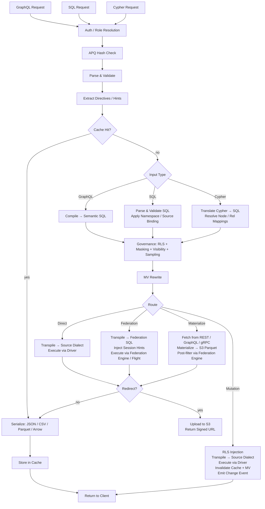
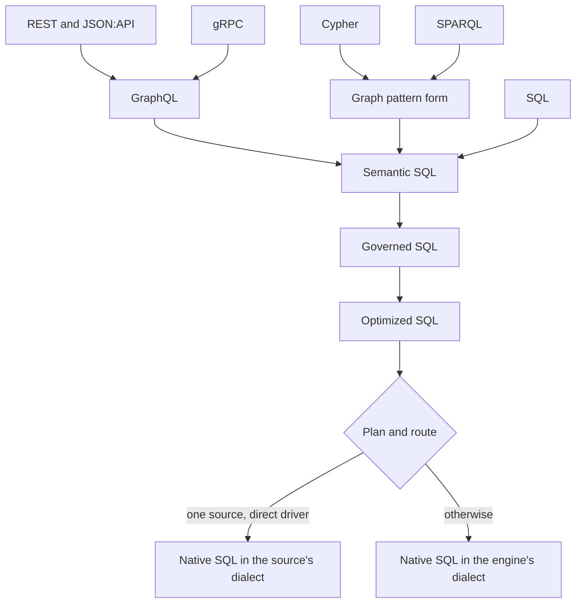

# ארכיטקטורת Provisa {: #provisa-architecture }

## סקירה כללית {: #overview }

Provisa היא פלטפורמת וירטואליזציית נתונים מבוססת קונפיגורציה: איחוד, מדדים, אונטולוגיה וממשל ממודל אחד, לצוותים קטנים ולארגונים גדולים. היא מספקת API אחיד מעל מקורות נתונים הטרוגניים עם ממשל, אבטחה ואופטימיזציית ביצועים. לקוחות שולחים שאילתות דרך SQL, GraphQL, או Cypher; על שלושתם חל אותו ממשל בדיוק.

המודל הוא המקום היחיד שבו מתווספת משמעות. כדי להוסיף לו, רושמים מקורות נתונים חדשים או צבירות בשכבת וירטואליזציית הנתונים. זה שומר על הפרדה נקייה, כי שום דבר לא יכול להוסיף סמנטיקה מחוץ לפלטפורמה, וזה מה שמאפשר ממשל נתונים אמיתי. המהדר אוכף זאת: קטלוג הקשרים המאושרים הוא מקור האמת, בכל שפת שאילתה.

פלטפורמה אחת משרתת קריאות תפעוליות ואנליטיות. שאילתה שנוגעת במקור אחד הולכת ישירות למקור הזה דרך מנהל ההתקן הטבעי שלו, ובדרך כלל חוזרת תוך פחות מ-100 ms, ושאילתה שמצרפת מקורות רצה במנוע הפדרציה שבחרתם לקנה מידה אנליטי.

```text
Config YAML → PG Metadata → Federation Catalogs
                               ↓
         Federation engine metadata → Schema Generator → SDL / SQL catalog / Cypher labels / gRPC proto (per role)
                                     ↓
                     Query → Parser → SQL Compiler → Transpiler
                                     ↓
                             Router (Smart Dispatch)
                         /           |            \
                    Federation  Direct PG      Direct MySQL/etc.
                         \           |            /
                              Executor Pool
                                     ↓
                         ┌───── Inline ─────┐     ┌──── Redirect ────┐
                         │  JSON (HTTP)     │     │  CTAS → S3       │
                         │  Arrow (Flight)  │     │  (Parquet, ORC)  │
                         │  Protobuf (gRPC) │     │  Provisa → S3    │
                         └─────────────────-┘     │  (JSON, CSV, …)  │
                                                  └─────────────────-┘
```

## ממשקי שאילתה {: #query-interfaces }

כל ממשק הוא ערוץ העברה נפרד, וכל הארבעה מחילים את אותו צינור אבטחה (RLS, מיסוך, דגימה, בדיקות תפקיד). לקוחות לעולם לא מדברים עם מנוע הפדרציה ישירות. שפת השאילתה (SQL, GraphQL או Cypher) בלתי תלויה בערוץ ההעברה, וכמה שפות יכולות להגיע דרך אותו ערוץ.

| פורט | הובלה | שפות שאילתה מתקבלות | שימוש |
| ------ | ----------- | -------------------------- | ---------- |
| 8001 | HTTP | GraphQL, SQL, Cypher | לקוחות ווב, כלי BI, curl, צרכני REST |
| 8815 | Arrow Flight (gRPC) | SQL (דרך Arrow Flight SQL) | כלי נתונים (Pandas, DuckDB, Spark, ADBC) |
| 50051 | Protobuf gRPC | RPC-ים מיוצרים לפי תפקיד | תקשורת שירות-לשירות עם חוזים מוקלדים |
| ניתן להגדרה¹ | פרוטוקול חוט PostgreSQL (pgwire) | SQL | psql, DBeaver, SQLAlchemy, כל לקוח תואם PG |

¹ יש להגדיר `PROVISA_PGWIRE_PORT` (למשל 5433). מושבת כאשר לא מוגדר או `0`.

### HTTP (פורט 8001) {: #http-port-8001 }

מספר נקודות קצה תחת אותו פורט, מובחנות לפי נתיב:

| נתיב | שפה | הערות |
| ------ | ---------- | ------- |
| `POST /data/graphql` | GraphQL | קריאות וכתיבות; hash של APQ מתקבל דרך `extensions.persistedQuery` |
| `POST /data/sql` | SQL | לקריאה בלבד; אין שער יכולת — הממשל נשען על נראות אובייקטים + RLS + מיסוך |
| `POST /data/query` | Cypher | לקריאה בלבד; תפקיד סטנדרטי |
| `GET /data/nl` | שפה טבעית | מתורגם ל-SQL/GraphQL/Cypher בהתאם לסוג המקור |
| `GET /data/subscribe/{table}` | GraphQL | זרם מנוי SSE |
| `GET /neo4j/...` | Cypher (תאימות Neo4j) | שכבת תאימות ל-Neo4j HTTP API |
| `POST /admin/graphql` | GraphQL | API ניהול (נדרש תפקיד superuser/admin) |

כל הנתיבים מחזירים JSON כברירת מחדל. `Accept: text/csv`, `application/vnd.apache.parquet`, `application/vnd.apache.arrow.stream`, ו-`application/octet-stream` (בינארי גולמי) נתמכים דרך משא ומתן תוכן (content negotiation). תוצאות החורגות מסף הגודל המוגדר מנותבות באופן אוטומטי לכתובת S3 חתומה.

### Arrow Flight (פורט 8815) {: #arrow-flight-port-8815 }

הובלה עמודתית (columnar) טבעית של Arrow דרך gRPC. לקוחות שולחים כרטיס (ticket) בפורמט JSON:

```json
{"query": "SELECT name, email FROM customers", "role": "analyst"}
```

ומקבלים Arrow RecordBatches שנשלחים בזרימה עצלה (lazily). כאשר ה-proxy של Zaychik Flight SQL זמין, הנתונים זורמים כזרם של Arrow record batches מקצה לקצה:

```text
Client ←(Arrow batches)← Provisa Flight Server ←(Arrow batches)← Zaychik ←(JDBC)← Federation Engine
```

התוצאה המלאה לעולם לא מוחזקת בזיכרון של Provisa: האצוות מועברות הלאה כשהן מגיעות. זה הופך את Arrow Flight לנתיב בלתי מוגבל, שמתאים לתוצאות בכל גודל.

### Protobuf gRPC (פורט 50051) {: #protobuf-grpc-port-50051 }

`.proto` מיוצר אוטומטית מסכמת הנתונים, מיוצר לפי תפקיד. שאילתות זרימה (הודעה אחת לכל שורה), מוטציות יחידניות (unary). Server reflection מופעל. התפקיד מועבר דרך מפתח metadata בשם `x-provisa-role`. הרפלקציה מתארת לכל קורא את השירות של התפקיד שלו.

### פרוטוקול חוט PostgreSQL / pgwire (פורט ניתן להגדרה) {: #postgresql-wire-protocol-pgwire-configurable-port }

מיישם את פרוטוקול החוט frontend/backend של PostgreSQL באמצעות הספרייה `buenavista`. כל לקוח תואם PostgreSQL (`psql`, DBeaver, SQLAlchemy עם `psycopg2`, JDBC) יכול להתחבר ללא שינוי. מקבל SQL בלבד. צינור הממשל המלא (RLS, מיסוך, הרשאות תחום) חל באופן זהה על חיבורי pgwire. מופעל על ידי הגדרת `PROVISA_PGWIRE_PORT` לפורט שאינו אפס.

## צינור הבקשות (Request Pipeline) {: #request-pipeline }

מתקבלות שלוש שפות שאילתה, ושלושתן נפגשות בממשל אחרי שלבי הניתוח וההידור שלהן. שלושתן יכולות גם לכתוב: מוטציות GraphQL, `INSERT`, `UPDATE`, `DELETE`, `MERGE` ו-`TRUNCATE` של SQL, ו-`CREATE`, `SET` ו-`DELETE` של Cypher מתורגמים ל-SQL ועוברים את אותה קבלת כתיבה. לשאילתה עצמה אין שער של יכולות. כל זהות מאומתת רשאית לשאול בכל שפה, והנתונים מנוהלים רק על ידי נראות אובייקטים, RLS ומיסוך.

| ממשק | קריאות | כתיבות | שער שאילתה |
| --- | --- | --- | --- |
| GraphQL (`/data/graphql`) | כן | כן (מוטציות) | אין — רק ממשל ברמת הנתונים |
| SQL (`/data/sql`) | כן | לא | אין — רק ממשל ברמת הנתונים |
| Cypher (`/data/query`) | כן | לא | אין — רק ממשל ברמת הנתונים |



**החלטות ניתוב:**

| נתיב | מתי |
| --- | --- |
| **Cache** | פגיעה במטמון תוצאות — נבדק ראשון, מגיש את התוצאה השמורה ללא ביצוע |
| **Cheap-count** | שאילתה בצורת `count(*)` מעל מקור שאינו ממומש (unmaterialized) שחושף ספירה טבעית מדויקת — מנותבת לקריאת הספירה הטבעית במקום מימוש לשם ספירה |
| **Direct** | מקור יחיד + יש דרייבר טבעי + יש קונקטור פדרציה |
| **Federation** | פדרציה מרובת מקורות, או שלמקור יש קונקטור אך אין דרייבר |
| **Materialize** | למקור אין קונקטור פדרציה — יש להביא (fetch) ולשמור במטמון ל-S3/PG תחילה |
| **Mutation** | כתיבה: הדרייבר של המקור עצמו כשיש לו; אחרת המנוע, דרך מחבר שכותב למקור |

הניתוב צורך את הפלט של שלב האופטימיזציה שלאחר הממשל, לעולם לא את ה-SQL המנוהל שלפני האופטימיזציה. הממשל עשוי להוסיף מקורות (תת-שאילתות תנאי RLS); שלב האופטימיזציה עשוי להסיר אותם (שילוב VALUES-CTE לטבלה חמה, שכתוב מטמון API, גיזום ענפי union). שאילתה פדרטיבית שמצטמצמת למקור חי יחיד לאחר השילוב מנותבת מחדש כישירה.

### שאילתות מרובות-שורש (Multi-Root) {: #multi-root-queries }

שאילתות GraphQL עם מספר שדות שורש (למשל `{ orders { id } customers { name } }`) מהודרות לשאילתות SQL נפרדות ומבוצעות באופן עצמאי. בקשות SQL ו-Cypher הן שורש-יחיד מטבען. התוצאות ממוזגות לתגובה אחת:

- שדות מתחת לסף ההפניה מוחזרים inline תחת `data`
- שדות מעל הסף מופנים (redirected), עם ערכים לכל שדה תחת `redirects`
- פורמטים בינאריים (Parquet, Arrow) נתמכים רק עבור שאילתות שורש-יחיד

## צינור השאילתה {: #query-pipeline }

כל קריאה עוברת חמישה שלבים. GraphQL, Cypher, SPARQL, gRPC ו-SQL הם נקודות כניסה, לא שלבים — כל אחד מהם מקמפל או ממיר ל-SQL סמנטי לפני שהפייפליין מתחיל.



### ממשקי קצה {: #front-ends }

ממשק קצה מפענח שפה ומכנה את מה שהיא קוראת במונחי המודל. GraphQL מהודר ישירות ל-SQL סמנטי. נקודות הקצה של REST שמסמך ה-OpenAPI מתאר, נקודות הקצה של JSON:API ו-gRPC בונים מכל בקשה שאילתת GraphQL ומהדרים אותה באותה דרך. החריג היחיד הוא `page[total]` של JSON:API, מספר השורות הכולל, שתעבורת ה-JSON:API מרכיבה בעצמה. Cypher ו-SPARQL מפוענחים לצורת תבנית גרף אחת, המשותפת לשתי שפות הגרף, והצורה הזו מהודרת ל-SQL סמנטי. SQL שאתם כותבים מול טבלאות המודל הוא כבר SQL סמנטי, ולכן הוא נכנס בשלב הבא. אף ממשק קצה לא מחליט מי רשאי לקרוא מה.

### SQL סמנטי {: #semantic-sql }

SQL סמנטי קורא את המודל. הטבלאות שלו מסווגות לפי דומיין (`sales.orders`), העמודות שלו הן אלה שהמודל מפרסם, וה-joins שלו הם הקשרים המוצהרים. הוא אינו אומר דבר על המקום שבו הנתונים נמצאים.

קריאה מקוננת מהודרת לצינור CTE קנוני אחד, זהה לכל מנוע ובנוי מהקשרים המוצהרים בלבד. CTE שורש קורא את טבלת השורש עם הסינון, הסדר, המגבלה וההיסט שלה. כל רמת יחיד-לרבים היא CTE משלה. היא מצרפת את הטבלה שלה ל-CTE של ההורה לפי מפתחות הקשר, לוקחת את השורות הראשונות של כל הורה באמצעות `ROW_NUMBER() OVER (PARTITION BY ...)`, ומצרפת אותן לרשימת JSON אחת לכל הורה. ה-`SELECT` הסופי קורא את ה-CTE של השורש ומצרף כל רמה ב-left join לפי מפתח ההורה. קריאות GraphQL, ‏Cypher ו-SPARQL ששואלות את אותה שאלה מהודרות לאותו משפט.

מתרגם ה-Cypher כותב CTE אחד לכל שלב `WITH`; יישור הצורות הללו לפייפליין הקנוני הוא עבודה עתידית. עד שתסתיים, קריאות Cypher ו-GraphQL שקולות לא תמיד מקמפלות לאותו SQL סמנטי. מהדר ה-GraphQL כותב שדות מקוננים עם ארגומנטים כ-`LEFT JOIN LATERAL` לכל הורה. שתי הצורות הנוכחיות מופיעות בדוגמה שלהלן.

### SQL מנוהל {: #governed-sql }

הממשל עובד על המשפט הסמנטי כולו בבת אחת. כל `SELECT` שבו מקבל את כללי הנראות, את האבטחה ברמת השורה ואת המסכות של התפקיד הקורא, כך שכל רמה מקוננת מסוננת בעומק שלה. כלל שורות שהתנאי שלו הוא תת-שאילתה קורא טבלה נוספת, ולכן הממשל יכול להוסיף מקורות למשפט.

### SQL ממוטב {: #optimized-sql }

שלב המיטוב כותב מחדש את המשפט המנוהל בדרכים שנכונות בכל מנוע. הוא מחזיר views ממומשים למקום שבו הם עונים על חלק מהמשפט, מטמיע טבלאות קטנות ונקראות הרבה כ-`VALUES`, ומסיר ענפי מטמון API וענפי union שהמשפט לא יכול להגיע אליהם. שום דבר כאן אינו יודע איזה מנוע יריץ את המשפט. השכתובים האלה יכולים להסיר מקורות. קריאה מפודרלת שכל שאר המקורות שלה הוטמעו נשארת עם מקור חי אחד.

### תכנון וניתוב {: #plan-and-route }

מנוע הפדרציה הוא ברירת המחדל; הניתוב קורא את המקורות הממוטבים, לא המנוהלים. משפט רץ ישירות על המקור שלו רק כשהוא עובר את כל ששת השערים בסדר. השער הראשון שנכשל בו מציין את הסיבה.

| שער | מה הוא בודק |
|---|---|
| `one_source` | קורא מקור אחד לאחר האופטימיזציה, או מקורות החולקים מסד נתונים פיזי |
| `dialect_supports` | הניב של אותו מקור תומך בכל מבנה שבמשפט |
| `access_path` | קיים מנהל התקן ישיר, קורא API או פונקציית קוד עבור המקור |
| `colocated_login` | מקורות הנחשבים כמסד נתונים אחד חולקים את אותה תעודת כניסה |
| `not_forced` | לא חל שום רצפת מפעיל, עמודה מזויפת, או תנאי המחייב את המנוע |
| `trusted_to_answer` | מקור שאינו SQL יכול לענות על מערך הנתונים המלא ללא סינון נוסף בתהליך |

המקרים של מטמון, רפליקה וסטיוארד מופיעים ב[צינור הבקשות (Request Pipeline)](#request-pipeline).

### SQL מקומי {: #native-sql }

השלב המקומי כותב את המשפט המנותב בניב של המקור לקריאה ישירה ובניב של המנוע לקריאה מפודרלת. הוא בוחר את הכתיב של פונקציות הצבירה והאובייקט של JSON, כותב את הרשימה הריקה להורה בלי שורות, הופך `DISTINCT ON` ל-`ROW_NUMBER()` היכן שאין לניב את הראשון, ובוחר צורות ייחודיות למנוע כמו join מסוג `LATERAL` לכל הורה או רמז למימוש CTE.

### דוגמה מלאה {: #a-worked-example }

קריאת ה-GraphQL הזו מבקשת לקוח אחד ואת שלוש ההזמנות הגדולות שלו:

```graphql
{
  customers(where: { name: { eq: "Acme" } }) {
    id
    name
    orders(order_by: { amount: desc }, limit: 3) {
      id
      amount
    }
  }
}
```

בצורה הקנונית היא מהודרת ל-SQL הסמנטי הזה:

```sql
WITH customers AS (
  SELECT c.id, c.name
  FROM sales.customers AS c
  WHERE c.name = 'Acme'
),
customers_orders AS (
  SELECT ranked.customer_id,
         JSON_AGG(JSON_OBJECT('id', ranked.id, 'amount', ranked.amount)
                  ORDER BY ranked.amount DESC, ranked.id) AS orders
  FROM (
    SELECT o.customer_id, o.id, o.amount,
           ROW_NUMBER() OVER (PARTITION BY o.customer_id
                              ORDER BY o.amount DESC, o.id) AS rn
    FROM sales.orders AS o
    JOIN customers AS p ON o.customer_id = p.id
  ) AS ranked
  WHERE ranked.rn <= 3
  GROUP BY ranked.customer_id
)
SELECT customers.id, customers.name, customers_orders.orders
FROM customers
LEFT JOIN customers_orders ON customers_orders.customer_id = customers.id
```

מזהה ההזמנה מכריע בשוויון בדירוג, כך ששתי הזמנות באותו סכום חוזרות תמיד באותו סדר. ללקוח בלי הזמנות אין שורה ב-`customers_orders`; השלב המקומי כותב עבורו את הרשימה הריקה.

אותה קריאה ב-Cypher מוצאת את הלקוח וקוראת את שלוש ההזמנות הגדולות בתת-שאילתה:

```cypher
MATCH (a:Customers)
WHERE a.name = 'Acme'
CALL {
  WITH a
  OPTIONAL MATCH (a)-[:HAS_ORDERS]->(b:Orders)
  RETURN b.id AS id, b.amount AS amount
  ORDER BY b.amount DESC
  LIMIT 3
}
RETURN a.id, a.name, id AS orders__id, amount AS orders__amount
```

בצורה הקנונית, קריאת ה-Cypher הזו וקריאת ה-GraphQL מהודרות למשפט שלמעלה. על זה נשענת האפשרות "פתח כשאילתה": קריאת GraphQL עוברת לדף ה-Cypher ומחזירה את אותה תשובה.

היום מהדר ה-GraphQL כותב במקום זאת את הרמה המקוננת כ-lateral join לכל הורה:

```sql
SELECT "t0"."id", "t0"."name", "t1"."id" AS "orders__id", "t1"."amount" AS "orders__amount"
FROM (SELECT * FROM "sales"."customers" "t0" WHERE "t0"."name" = $2 LIMIT 100) "t0"
LEFT JOIN LATERAL (
  SELECT * FROM "sales"."orders" WHERE "customer_id" = "t0"."id" ORDER BY "amount" DESC LIMIT $1
) "t1" ON TRUE
```

את ה-SQL הסמנטי של כל קריאת GraphQL אפשר לראות בפאנל Provisa של דף ה-GraphQL.

## נתיבי ביצוע פדרציה {: #federation-execution-paths }

| נתיב | הובלה | דרך | מתי בשימוש |
| ------ | ----------- | ----- | ----------- |
| REST | לקוח מנוע פדרציה (HTTP :8080) | שאילתה ישירה | ברירת מחדל, תמיד זמין |
| Flight SQL | `adbc-driver-flightsql` (gRPC :8480) | proxy של Zaychik ← JDBC | כאשר Zaychik פועל |
| CTAS | לקוח מנוע פדרציה (HTTP :8080) | כתיבה ישירה, Iceberg ל-S3 | הפניית Parquet/ORC |

### ה-proxy של Zaychik ל-Arrow Flight SQL {: #zaychik-arrow-flight-sql-proxy }

מנוע הפדרציה אינו תומך באופן טבעי בפרוטוקול Arrow Flight SQL. [Zaychik](https://github.com/Raiffeisen-DGTL/zaychik-trino-proxy) הוא proxy בשפת Java שמיישם את ממשק ה-gRPC של Arrow Flight SQL, מתרגם בקשות לשאילתות JDBC, ומזרים תוצאות בחזרה כ-Arrow record batches.

```text
ADBC client → gRPC :8480 → Zaychik → JDBC :8080 → Federation Engine → results → Arrow batches → client
```

שרת ה-Flight של Provisa (פורט 8815) מתחבר ל-Zaychik כלקוח ADBC, כך ש-Arrow זורם מקצה לקצה והתוצאות אף פעם אינן ממומשות.

### קטלוג תוצאות Iceberg {: #iceberg-results-catalog }

הפניית CTAS משתמשת בקונקטור Iceberg (קטלוג `results`) הנתמך על ידי קטלוג JDBC על גבי מופע PostgreSQL הקיים. Iceberg כותב קבצי Parquet/ORC ישירות ל-MinIO/S3 דרך מערכת הקבצים הטבעית של S3 (`fs.native-s3.enabled=true`).

## מנועי פדרציה {: #federation-engines }

Provisa בוחר מנוע פדרציה בעת ההפעלה ממשתנה הסביבה `PROVISA_ENGINE`, מהתצורה שנשמרה בממשק הניהול או מברירת המחדל. כששום דבר לא מוגדר, ברירת המחדל היא DuckDB, כולה בתוך התהליך ובלי שירות חיצוני. איך הבחירה עובדת, ראו ב-[Configuration](configuration.md#federation-engine).

כל מנוע הוא מופע `FederationEngine` המוגדר ב-`provisa/federation/engine.py`. המופע מחזיק אוסף קונקטורים שקובע אילו סוגי מקורות המנוע יכול לקרוא באופן חי (ATTACH) לעומת אילו חייבים תחילה לנחות (land) במאגר המימוש (materialization store) של המנוע.

### מחלקות דרייבר {: #driver-classes }

| מחלקה | משמעות | דוגמאות |
| ------- | --------- | --------- |
| `BROAD` | מגיעה לסוגי מקורות חיצוניים רבים דרך קונקטורים טבעיים | Trino |
| `PARTIAL` | מגיעה לקבוצת משנה (יחסיים, קבצים, אחסון ענן/lake) בנוסף לנחיתה של כל השאר | DuckDB, PostgreSQL, ClickHouse, Databricks, Snowflake, BigQuery, Fabric, Synapse |
| `SELF_ONLY` | מגיעה רק למאגר שלה עצמה; כל מקור אחר נוחת פנימה | SQLAlchemy |

### מנועים זמינים {: #available-engines }

| מפתח מנוע | דיאלקט | MPP | מנגנון קישור חיצוני | אימות |
| ----------- | --------- | ----- | ------------------------ | ------ |
| `trino` / `trino-byo` | Trino SQL | כן | קטלוגי Trino (מערך קונקטורים רחב) | פרטי גישה JDBC |
| `pg` | PostgreSQL | לא | FDW / pg_duckdb | פרטי גישה PostgreSQL |
| `duckdb` | DuckDB | לא | ATTACH טבעי לתוסף | אין (תוך-תהליכי) |
| `clickhouse` / `clickhouse-server` | ClickHouse | כן (shards) | מנועי טבלה S3 / IcebergS3 / DeltaLake | פרטי גישה ClickHouse |
| `snowflake` | Snowflake | כן | external stage + external table | `PROVISA_ENGINE_URL` |
| `databricks` | Databricks SQL | כן | טבלאות חיצוניות של Unity Catalog דרך REST | Bearer token (`http_path` תחת `federation_hints`) |
| `bigquery` | BigQuery | כן (Dremel) | טבלאות BigQuery external / BigLake | מפתח חשבון שירות `GOOGLE_APPLICATION_CREDENTIALS` |
| `fabric` | T-SQL | כן | OneLake shortcuts ← OPENROWSET | Azure AD (`az login` / זהות מנוהלת) |
| `synapse` | T-SQL | כן | ADLS OPENROWSET / טבלאות חיצוניות | Azure AD |
| `sqlalchemy` | כל דיאלקט SQLAlchemy | לא | אין (נחיתה בלבד) | פרטי גישה לפי דיאלקט |

### ברירת מחדל ללא קונפיגורציה: DuckDB {: #zero-config-default-duckdb }

כאשר `PROVISA_ENGINE` אינו מוגדר, Provisa משתמשת במנוע DuckDB המוטמע (embedded) תוך-תהליכי במלואו. מאגר המימוש של DuckDB הוא קובץ DuckDB מוטמע ב-`$PROVISA_DATA_DIR/materialize.duckdb` (ברירת מחדל `~/.provisa/materialize.duckdb`). אין צורך במסד נתונים או שירות חיצוני.

DuckDB מתיר כותב יחיד לכל קובץ, ולכן `store_connection.py` כותב למחסן המוטמע דרך החיבור של המנוע עצמו ולעולם לא פותח חיבור שני ועצמאי. זה המקרה היחיד שבו המנוע ומחסן המטריאליזציה חולקים ידית קובץ מעצם התכנון.

### הובלת קריאה טבעית ל-Arrow {: #arrow-native-read-transport }

ClickHouse, DuckDB, Snowflake, Databricks, BigQuery, Fabric ו-Synapse כולם מכריזים על `EngineCapability.ARROW` ו-`EngineCapability.ARROW_STREAM`. שאילתות מול מנועים אלו מחזירות Arrow RecordBatches ישירות; נתיב הסדרת השורות (row-serialization) עוקף לחלוטין. שרת ה-Flight מזרים את ה-batches הללו ללקוחות מבלי לממש את התוצאה המלאה בזיכרון התהליך של Provisa. עבור Trino, זרימת Arrow נשענת על ה-proxy של Zaychik; עבור מנועי מחסן הנתונים, ה-API הטבעי של Arrow של המנוע עצמו (Cloud Fetch עבור Databricks, Storage Read API עבור BigQuery, `fetch_arrow_table` עבור DuckDB ו-Snowflake) מזין את זרם ה-Flight.

### קישורי נתונים חיצוניים (ATTACH) {: #external-data-links-attach }

כל מנוע מחסן נתונים יכול לסרוק נתוני ענן/lake במקום, מבלי לנחות עותק. קבצי Parquet, CSV, Iceberg ו-Delta Lake על S3, GCS או OneLake מתחברים (attach) ישירות למנוע כאילו היו טבלאות טבעיות. האסטרטגיה (ATTACH (סריקה במקום) או LAND (העתקה למאגר)) נקבעת על ידי ה-`Mechanism` המוצהר של הקונקטור; אין הסתעפות ספציפית-למנוע בתכנן (planner). קונקטור מסוג `Mechanism.ATTACH_R` מפעיל סריקת zero-copy; קונקטור מסוג `Mechanism.DIRECT` או קונקטור שאינו קיים מפעיל נחיתה (land).

ה-Attach מקצה אוטומטית מראש את כל התנאים ההכרחיים בזמן ה-attach:

| מנוע | פורמטי אובייקט/lake | מנגנון | הקצאה אוטומטית |
| -------- | ------------------- | ---------- | ---------------------------------- |
| Databricks | parquet, csv, iceberg, delta_lake | טבלה חיצונית UC (`ATTACH_R`) | REST מתקין storage credential + external location של Unity Catalog, ואז `CREATE TABLE … USING <format> LOCATION …` — אומת בפועל מול Cloudflare R2 |
| BigQuery | parquet, csv, json, iceberg, delta_lake | טבלה חיצונית BigQuery / BigLake (`ATTACH_R`) | `CREATE OR REPLACE EXTERNAL TABLE … OPTIONS(format=…, uris=[…])` — אומת בפועל |
| ClickHouse | csv, parquet, iceberg, delta_lake | מנוע טבלה S3 / IcebergS3 / DeltaLake (`ATTACH_R`) | בדיקת אימות מתבצעת בזמן ה-attach — אומת בפועל מול Cloudflare R2 |
| Fabric | parquet, csv, iceberg, delta_lake | OneLake shortcut ← OPENROWSET (`ATTACH_R`) | REST יוצר חיבור `AmazonS3Compatible` + lakehouse + shortcut; מחזיר את נתיב ה-`BULK` של OneLake — אומת בפועל בקריאת R2 דרך Fabric |
| Snowflake | parquet, csv, json, iceberg, delta_lake | external stage + טבלה חיצונית (`ATTACH_R`) | `CREATE STAGE … URL=… CREDENTIALS=…`, ואז `CREATE OR REPLACE EXTERNAL TABLE … LOCATION=@stage FILE_FORMAT=(TYPE=…)` — ממומש; לא נבדק בפועל (אין חשבון זמין) |

פרטי גישה לאחסון ענן עוברים בתוך `federation_hints` של המקור (ראו [Sources](sources.md#warehouses-as-named-sources)). כל סוג מקור שאינו יכול לבצע ATTACH נוחת תחילה במאגר המימוש של המנוע.

### כתיבות מימוש עמודתי {: #columnar-materialization-writes }

`Connection.bulk_copy` ב-`provisa/core/database.py` בוחר את נתיב ההזנה הכמותית (bulk-ingest) המהיר ביותר לפי דיאלקט המאגר: `COPY` בינארי (asyncpg `copy_records_to_table`) עבור מאגרי PostgreSQL, ופקודת `executemany` מוכנה (prepared) יחידה עבור כל שאר המאגרים היחסיים. המאגר המוטמע של DuckDB נוחת דרך `land_duckdb_native` ב-`store_connection.py`: קריאת `executemany` אחת עבור כל האצווה, לעולם לא לולאה לכל שורה.

## הפניית תוצאות גדולות {: #large-result-redirect }

תוצאות החורגות מסף שורות מופנות לאחסון תואם S3 (MinIO) במקום להיות מוחזרות inline.

### מצבי הפניה {: #redirect-modes }

| מצב | איך זה עובד | הנתונים נוגעים ב-Provisa? |
| ------ | ------------- | ---------------------- |
| **CTAS** (Parquet, ORC) | מנוע הפדרציה כותב ישירות ל-S3 דרך `CREATE TABLE AS SELECT` | לא |
| **העלאת Provisa** (JSON, NDJSON, CSV, Arrow IPC) | Provisa מסדרת (serializes) ומעלה דרך boto3 | כן |

בפורמטים שנתמכים ב-CTAS באופן מקורי, Provisa לעולם לא נוגע בנתונים: מנוע הפדרציה כותב את הקבצים ישירות ל-MinIO/S3. זה הנתיב המועדף לייצוא אנליטי גדול.

### ללא מאגר אובייקטים {: #with-no-object-store }

תוצאה הולכת למאגר האובייקטים כשאחד מוגדר (נקודת קצה, או אישורים ל-AWS S3) והמנוע כותב אליו בעצמו את הפורמט המבוקש. אחרת היא נכתבת לקובץ בתיקיית הארגון, `<data directory>/orgs/<org>/results/`. מאגר מוגדר שהמנוע כותב אליו אך אינו יכול להגיע אליו מכשיל את הבקשה בשמו. התוצאה אינה נכתבת לתיקייה במקומו.

| מנוע | כותב את הקובץ בעצמו | פורמטים |
| ------ | ---------------------- | ------- |
| DuckDB | `COPY (query) TO '<file>'` | parquet, csv, json, ndjson |
| PostgreSQL | `COPY (query) TO STDOUT`, מוזרם לקובץ במארח של Provisa | csv |
| כל פורמט או מנוע אחר | Provisa כותבת אותו מהשורות | parquet, orc, csv, arrow, json, ndjson |

לידית יש אותם מפתחות כמו לזו של מאגר האובייקטים, עם `"sink": "local"` ו-`redirect_url` של `/data/redirect-file/<name>`, נתיב בשרת שענה. רק המשתמש שביקש את התוצאה רשאי להביא אותה. כל הבאה משווה את הזהות של הבקשה עצמה לבעלים שנרשם לצד הקובץ, ועונה 403 לכל אחד אחר ו-401 לבקשה ללא זהות.

קובץ ישן מ-`redirect.ttl` נענה ב-404 ונמחק. טיימר מוחק אותו בתפוגתו, כפי שנמחקות התוצאות של מאגר האובייקטים. כל תוצאה חדשה גם מנקה את תיקיית התוצאות של הארגון, מה שמסיר קבצים שאתחול סיים את הטיימר שלהם.

### כותרות הפניה {: #redirect-headers }

| כותרת | אפקט |
| -------- | -------- |
| `X-Provisa-Redirect-Format: <mime>` | הפניה בפורמט זה (מרמז על כפייה אלא אם נקבע סף) |
| `X-Provisa-Redirect-Threshold: N` | להפנות רק אם התוצאה חורגת מ-N שורות |
| `X-Provisa-Redirect: true` | לכפות הפניה בפורמט ברירת המחדל |

כותרות אלו מיישמות הפניה הנשלטת על ידי הלקוח.

**תגובה:**

```json
{
  "data": {"orders": null},
  "redirect": {
    "redirect_url": "https://minio:9000/provisa-results/results/abc.parquet?...",
    "row_count": 50000,
    "expires_in": 3600,
    "content_type": "application/vnd.apache.parquet"
  }
}
```

### קונפיגורציית שרת {: #server-configuration }

| משתנה סביבה | ברירת מחדל | מטרה |
| --------- | --------- | --------- |
| `PROVISA_REDIRECT_ENABLED` | `false` | הפעלת הפניית סף בצד השרת |
| `PROVISA_REDIRECT_THRESHOLD` | `1000` | סף ספירת שורות ברירת מחדל |
| `PROVISA_REDIRECT_FORMAT` | `parquet` | פורמט הפניה ברירת מחדל |
| `PROVISA_REDIRECT_BUCKET` | `provisa-results` | שם bucket ב-S3 |
| `PROVISA_REDIRECT_ENDPOINT` | | כתובת נקודת קצה תואמת S3 |
| `PROVISA_REDIRECT_TTL` | `3600` | TTL של כתובת חתומה מראש (בשניות) |

## עץ החלטת ניתוב {: #routing-decision-tree }

```text
Multi-source query? → Federation engine
NoSQL source (MongoDB, Cassandra)? → Federation engine
Uses path columns on non-PG source? → Federation engine
Single RDBMS with driver? → Direct (sub-100ms target)
Single RDBMS without driver? → Federation engine
Steward hint "federated"? → Federation engine (override)
Steward hint "direct"? → Direct (if possible)
Redirect to Parquet/ORC? → Federation engine (CTAS, regardless of source count)
```

## אופטימיזציית שאילתות פדרציה {: #federation-query-optimization }

Provisa מזין אוטומטית את המייעל מבוסס העלות של מנוע הפדרציה, כך שתוכניות שאילתה חוצות מקורות מבוססות על ההתפלגות האמיתית של הנתונים ולא על ברירות מחדל קבועות.

### סטטיסטיקות אוטומטיות (`ANALYZE`) {: #automatic-statistics-analyze }

בעת רישום מקור, Provisa מריצה `ANALYZE catalog.schema.table` עבור כל טבלה שפורסמה. זה אוסף:

- ספירת שורות
- לכל עמודה: שיעור ערכי null, ספירת ערכים ייחודיים, מינימום/מקסימום, היסטוגרמות (תלוי קונקטור)

האופטימיזטור משתמש בנתונים אלו כדי להעריך סלקטיביות עבור שאילתות מסוננות. ללא סטטיסטיקות, הוא נופל חזרה לברירות מחדל קבועות (למשל, 10% סלקטיביות עבור תנאי שוויון) שמייצרות תוכניות join גרועות על נתונים מוטים או עתירי-קרדינליות. עם סטטיסטיקות, ההערכות מדויקות מספיק כדי לקבל החלטות נכונות בין broadcast join לבין partitioned join עבור רוב העומסים.

**כיסוי**: התמיכה בסטטיסטיקות תלויה במחבר. PostgreSQL, MySQL, Hive, Iceberg ו-Delta Lake תומכים ב-`ANALYZE` במלואו; MongoDB ו-Cassandra תומכים חלקית או בכלל לא. קטלוג שהמחבר שלו לא אוסף סטטיסטיקות מדולג, ו-`ANALYZE` שנכשל נרשם ביומן ומדולג, כך שהרישום לעולם לא נחסם.

**מגבלות סלקטיביות**: הסטטיסטיקות מספקות הערכות לכל עמודה. עבור תנאים מתואמים (`WHERE region = 'US' AND city = 'Seattle'`), האופטימיזטור מניח אי-תלות בין עמודות, מה שעלול לגרום להערכת חסר בספירת השורות. זוהי מגבלה ידועה של סטטיסטיקות ברמת עמודה בכל האופטימיזטורים מבוססי-עלות.

**מקורות API**: טבלאות `api_cache_{table_name}` ב-PostgreSQL מנותחות אוטומטית לאחר כל מחזור רענון מטמון, כך שלאופטימיזטור יש הערכות שורות עדכניות בעת חיבור מקורות מבוססי-API עם מקורות יחסיים.

### ניהול: רענון סטטיסטיקות {: #admin-refresh-statistics }

הרצה חוזרת של איסוף סטטיסטיקות לפי דרישה דרך ה-API הניהולי:

```graphql
mutation {
  refreshSourceStatistics(sourceId: "sales-pg") {
    tablesAnalyzed
    failures { table message }
  }
}
```

שימושי כאשר מקור קיבל נתונים חדשים משמעותיים מאז הרישום.

## Materialized Views

Materialized Views מאיצות שאילתות יקרות בכך שהן מחשבות את התוצאות שלהן מראש. השאילתות משתמשות בהן בלי שום שינוי.

### קשרים כרמזים ל-MV {: #relationships-as-mv-hints }

הצהרת קשר היא תוצר של ממשל, והיא גם התיאור המבני של צורת join. הצורה הזו (הטבלאות, העמודות, סוג ה-join) היא בדיוק מה שמייעל ה-MV צריך, ולכן קשר יכול להוביל מטריאליזציה ישירות.

ב**קשרים חוצי מקורות** זה קורה אוטומטית בעת ההפעלה: כל קשר עם `materialize: true` שהרגליים שלו נמצאות ביותר ממקור אחד יוצר MV מסוג `JoinPattern` (`auto-mv-<rel_id>`), בלי תצורת MV נפרדת. כשהמהדר רואה את ה-join הזה בשאילתה, הכותב-מחדש מציב במקומו את התוצאה הממומשת מראש בלי שהקורא ירגיש. קשרים בתוך אותו מקור לא יוצרים כלום, כי ה-JOINs האלה כבר מהירים בביצוע ישיר.

**קשר שמבוסס על טבלת קישור** מממש את כל המעבר שלו. הטבלה המקשרת היא רגל שלישית, ולכן התבנית נושאת את הקפיצה מהמקור, את הקפיצה דרך טבלת הקישור ואת הערך המבחין שמקבע את השורות לסוג קשת אחד, כשהעמודות של טבלת הקישור נוחתות בתצוגה לצד אלה של היעד. מכיוון שטבלת הקישור נחשבת לרגל, קשת שטבלת הקישור שלה נמצאת במקור אחר משתי הטבלאות שהיא מקשרת היא חוצת מקורות, גם כששתיהן באותו מקור. הכותב-מחדש מזהה את שתי הקפיצות כשרשרת, שבה השנייה חייבת לצאת מהכינוי שהראשונה הציגה. לכן שאילתה שמגיעה לאותן שתי טבלאות בלי לעבור דרך טבלת הקישור קוראת את טבלאות הבסיס, ותצוגה שנבנתה לערך מבחין אחד לעולם לא עונה על מעבר שמסונן לערך אחר.

המשמעות המעשית: stewards שמאשרים קשר, למעשה מחליטים אם ה-join הוא מועמד טוב למימוש. פעולת הממשל ורמז האופטימיזציה הם אותה הצהרה בדיוק.

### מצבים {: #modes }

| מצב | קונפיגורציה | התנהגות |
| ------ | -------- | ---------- |
| **Join-pattern** | `join_pattern` בקונפיגורציית MV | שוכתב JOINs תואמים לקרוא מטבלת ה-MV |
| **SQL מותאם אישית** | `sql` בקונפיגורציית MV | SELECT שרירותי, נחשף אופציונלית ב-SDL |
| **קשר ממומש אוטומטית** | קשר חוצה-מקור (אוטומטי) | מייצר אוטומטית MV מסוג join-pattern; אין צורך בקונפיגורציה |
| **קשר ממומש על ידי steward** | `materialize: true` על קשר בתוך אותו מקור | הצטרפות מפורשת עבור נתיבי join חמים בתוך אותו מקור |

### מימוש אוטומטי {: #auto-materialization }

JOINs חוצי-מקור הם השאילתות היקרות ביותר (תמיד פדרטיביות). קשרים חוצי-מקור מייצרים אוטומטית הגדרות MV באתחול:

```yaml
relationships:
  - id: orders-to-reviews
    source_table_id: orders        # sales-pg
    target_table_id: product_reviews  # reviews-mongo
    source_column: product_id
    target_column: product_id
    cardinality: one-to-many
    materialize: true              # auto-create MV
    refresh_interval: 600          # refresh every 10 minutes
```

רק קשרים חוצי-מקור מייצרים MVs (JOINs בתוך אותו מקור כבר מהירים דרך ביצוע ישיר). ה-MV מתחיל במצב `STALE` ומתרענן על ידי לולאת הרענון ברקע לפני שהוא משמש את אופטימיזטור השאילתות.

### מחזור חיים של רענון {: #refresh-lifecycle }

```text
STALE → (refresh loop picks up) → REFRESHING → FRESH
  ↑                                                |
  └──── mutation hits source table ────────────────┘
```

לולאת הרענון פועלת כל 30 שניות, בודקת `get_due_for_refresh()`, ומבצעת `CREATE TABLE AS SELECT` (בהרצה ראשונה) או `DELETE + INSERT` (בהרצות הבאות) מול טבלת היעד של ה-MV דרך מנוע הפדרציה.

## מפת מודולים {: #module-map }

| מודול | מטרה |
| -------- | --------- |
| `api/` | אפליקציית FastAPI, נתבים (routers), middleware, ניהול מחזור חיים (lifespan) |
| `api/flight/` | שרת Arrow Flight (gRPC, פורט 8815) |
| `api/admin/` | API ניהול GraphQL מבוסס Strawberry — קונפיגורציה, גילוי, תצוגות |
| `api/rest/` | נקודות קצה REST מיוצרות אוטומטית מטבלאות רשומות |
| `api/jsonapi/` | נקודות קצה JSON:API מיוצרות אוטומטית עם pagination וטיפול בשגיאות |
| `api/data/subscribe.py` | מנויי SSE — LISTEN/NOTIFY, polling, Debezium CDC |
| `compiler/` | פרסרים ל-GraphQL/SQL, מחולל SQL סמנטי, RLS, מיסוך, דגימה, ממשל דו-שלבי (`stage2.py`) |
| `cypher/` | מתרגם Cypher ← SQL, פרסר, מפת תוויות, מתרגם כתיבה עבור מוטציות Cypher |
| `pgwire/` | שרת פרוטוקול חוט PostgreSQL; `catalog.py` מיירט את pg_catalog/information_schema עבור נראות אובייקטים לפי תפקיד |
| `vector/` | חיפוש וקטורי — רישום מודלים, ספקי הטמעה (openai/ollama/huggingface), תרגום `cosine_similarity()`, אינדקס HNSW על עמודת ההטמעה של רפליקה, יצירת הטמעות דקלרטיבית |
| `compiler/federation.py` | תמיכת subgraph ב-Apollo Federation v2 |
| `transpiler/` | תרגום דיאלקט, לוגיקת ניתוב |
| `executor/` | ביצוע פדרטיבי/ישיר, סדרות, פורמטי פלט |
| `executor/drivers/` | דרייברים ישירים למקורות (PostgreSQL, MySQL, DuckDB, Snowflake, Databricks, ClickHouse, …) |
| `executor/trino_flight.py` | לקוח ADBC Flight SQL עבור מנוע הפדרציה |
| `executor/ctas_write.py` | הפניה מבוססת CTAS (מנוע הפדרציה כותב ל-S3) |
| `executor/redirect.py` | לוגיקת הפניית S3, העלאה בצד Provisa |
| `federation/engine.py` | `FederationEngine`, `DriverClass`, `_ENGINE_BUILDERS`, `ENGINE_REGISTRY`, `build_engine` |
| `federation/connector.py` | הפשטות קונקטור — Trino, ClickHouse; `Mechanism`, `WarehouseNativeConnector` |
| `federation/connector_duckdb.py` | הגדרות קונקטור DuckDB ו-PostgreSQL FDW |
| `federation/snowflake_connectors.py` | קונקטורי ATTACH ל-external stage + external table של Snowflake |
| `federation/databricks_connectors.py` | קונקטורי ATTACH לטבלה חיצונית של Databricks UC |
| `federation/bigquery_connectors.py` | קונקטורי ATTACH ל-BigQuery external / BigLake |
| `federation/databricks_uc.py` | הקצאה אוטומטית של credential + external location של Unity Catalog |
| `federation/databricks_backend.py` | backend ביצוע Databricks SQL warehouse |
| `federation/snowflake_backend.py` | backend ביצוע Snowflake |
| `federation/bigquery_backend.py` | backend ביצוע BigQuery (הובלת Arrow דרך Storage Read API) |
| `federation/mssql_warehouse_backend.py` | backend-ים לביצוע Fabric Warehouse + Synapse (T-SQL דרך ODBC) |
| `federation/mssql_warehouse_connectors.py` | קונקטורי ATTACH ל-OPENROWSET עבור Fabric / Synapse |
| `federation/fabric_shortcuts.py` | הקצאה אוטומטית של OneLake shortcut (חיבור ← lakehouse ← shortcut) |
| `federation/clickhouse_backend.py` | backend ביצוע ClickHouse |
| `federation/duckdb_backend.py` | backend ביצוע DuckDB תוך-תהליכי |
| `federation/pg_backend.py` | backend ביצוע PostgreSQL |
| `federation/store_connection.py` | פני כתיבה של מאגר המימוש הטבעי ל-DuckDB |
| `registry/` | רישום שאילתות מתמידות (persisted), ממשל |
| `security/` | נראות, הרשאות, מיסוך עמודות |
| `cache/` | מטמון תוצאות שאילתה מבוסס Redis (שכבה חמה) |
| `mv/` | רישום Materialized Views, רענון, שכתוב SQL |
| `events/` | אירועי שינוי ערכת נתונים ושליחת טריגרים |
| `webhooks/` | ביצוע webhook יוצא עבור מוטציות ואירועים |
| `scheduler/` | ניהול משימות רקע מבוסס APScheduler — טריגרי cron ומרווח שמפעילים webhooks ומוטציות, ואת הדגימות של פלטי Kafka חיים |
| `apq/` | פרוטוקול חוט APQ של Apollo — מטמון hash שאילתה מבוסס Redis; נפרד ממטמון התוצאות |
| `compiler/cursor.py` | pagination בסגנון Relay מבוסס cursor — פרמטרים `first`/`after`/`last`/`before` ויצירת `pageInfo` בכל שאילתות הרשימה |
| `compiler/aggregate_gen.py` | סוגי שאילתת `{table}_aggregate` מיוצרים אוטומטית עם שדות משנה `count`, `sum`, `avg`, `min`, `max` וגישת `nodes` מסוננת |
| `compiler/enum_detect.py` | זיהוי אוטומטי של סוג enum — סוגי enum טבעיים של PostgreSQL (`pg_enum`) נחשפים כסוגי enum ב-GraphQL במקום כ-string scalars |
| `compiler/hints.py` | רמזי ביצועים לפדרציה — הנחיות ניתוב ברמת השאילתה, מוטמעות כתגובות SQL (`-- @provisa route=federated`) שדורסות את הניתוב האוטומטי |
| `compiler/mutation_gen.py` | מהדר מוטציות; presets עמודה — ערכים סטטיים בצד השרת או ערכי משתנה-session המוחלים בהוספה/עדכון, ואינם נחשפים בסוג הקלט של המוטציה |
| `auth/approval_hook.py` | hook אישור ABAC — hook הרשאה חיצוני שניתן לחיבור, מופעל לפני ביצוע השאילתה; הובלות webhook, gRPC ו-unix_socket; היקף לכל טבלה/מקור/גלובלי; מדיניות נפילה חזרה (fallback) הניתנת להגדרה |
| `subscriptions/` | מצב ומסירה של מנויי SSE |
| `discovery/` | גילוי קשרים מבוסס LLM (Claude API) |
| `grpc/` | יצירת proto, שרת gRPC, reflection |
| `api_source/` | מקורות API של REST/GraphQL/gRPC עם מטמון PG |
| `kafka/` | מקורות topic של Kafka, sink, Schema Registry |
| `auth/` | ספקי אימות ניתנים לחיבור, middleware, מיפוי תפקידים |
| `core/` | קונפיגורציה, מודלים, DB, repositories, סודות; מודל התפקידים תומך ב-`parent_role_id` וב-`flatten_roles()` עבור ירושת תפקידים רקורסיבית |
| `hasura_v2/` | ממיר metadata של Hasura v2 ← קונפיגורציית Provisa |
| `ddn/` | ממיר supergraph של Hasura DDN ← קונפיגורציית Provisa |
| `mongodb/` | קונקטור מקור MongoDB |
| `elasticsearch/` | קונקטור מקור Elasticsearch |
| `cassandra/` | קונקטור מקור Cassandra |
| `prometheus/` | קונקטור מקור מדדי Prometheus |
| `source_adapters/` | שכבת מתאם גנרית לחיבורי מקור |

## API ניהול {: #admin-api }

ה-API הניהולי מבוסס Strawberry GraphQL מותקן תחת `/admin/graphql` (פורט HTTP 8001). הוא נפרד מנקודת הקצה של GraphQL הנתונים ודורש תפקיד superuser או admin.

| יכולת | תיאור |
| ----------- | ------------- |
| הורדה/העלאה של קונפיגורציה | ייצוא או החלפה של קובץ ה-YAML המלא של Provisa |
| עורך קשרים | יצירה, עדכון, מחיקה של הגדרות קשר |
| גילוי FK מבוסס AI | הפעלת ניתוח מועמדי FK מבוסס Claude |
| בדיקת סכמה (introspection) | עיון בטבלאות, עמודות ותפקידים שפורסמו |
| ניהול תצוגות | רישום וניהול הגדרות Materialized View |

## קונפיגורציית מודלי AI {: #ai-models-configuration }

`GET /admin/ai-models` ו-`PUT /admin/ai-models` מגדירים את צינור ה-LLM עבור כל ארגון.

ההגדרות הן **ברמת הארגון**: הבחירות של כל ארגון יושבות מעל תצורת הפריסה וחלות מהבקשה הבאה, בלי הפעלה מחדש.

**הקצאות מודל לפי פעולה.** לשש פעולות יש כל אחת ספק ומחרוזת מודל הניתנים להגדרה:

| פעולה | מה היא מניעה |
| --------- | -------------- |
| `table_description` | תיאורי טבלה מיוצרים על ידי LLM |
| `column_description` | תיאורי עמודה מיוצרים על ידי LLM |
| `relationship_inference` | גילוי מועמדי FK |
| `sql_generation` | יצירת SQL מ-NL |
| `table_selection` | בחירת אילו טבלאות לכלול ב-prompt של NL |
| `mcp_chat` | לולאת השימוש בכלים של לוח עוזר הצ'אט |

שדה הספק מקבל כל ספק תואם `aisuite` (`anthropic`, `openai`, `groq`, `mistral`, `cohere`, ואחרים) או נקודת קצה מקומית (`ollama`, `lmstudio`). מחרוזת מודל ריקה מסירה את הדריסה של הארגון וחוזרת לברירת המחדל של הפריסה.

**הגבלת קצב NL.** תקרה אופציונלית של בקשות-לתקופה המוחלת לפי תפקיד. בקשות עודפות מחזירות `429` עם `Retry-After`.

**רישום מודלים וקטורי.** רשימה של מודלי הטמעה (שדות: `id`, `provider`, `dimensions`, אופציונלי `api_key_env` ו-`base_url`, דגל `enabled`). החלפת רשימה מלאה: לכל רשומה חייבים להיות `id`, `provider`, ו-`dimensions` אחרת הכתיבה נדחית עם `400`.

**מפתחות API.** מפתח ה-API של ה-LLM של כל ספק נשמר מוצפן דרך `provisa.core.org_secrets` (ראו בהמשך). תשובת ה-`GET` אומרת רק אם מוגדר מפתח לכל ספק ולעולם לא מחזירה את הערך. שליחת מחרוזת ריקה עבור ספק מוחקת את המפתח שלו, כך שקריאות LLM לספק הזה חוזרות לפרטי ההתחברות ממשתנה הסביבה של הפריסה.

## סודות מוצפנים לפי ארגון {: #per-org-encrypted-secrets }

`provisa/core/org_secrets.py` שומר פרטי גישה שאסור שיופיעו כטקסט גלוי במסד הנתונים. הוא מחזיק את מפתחות ה-API של ספקי ה-AI (`{vendor}_api_key`) ואת מפתח Jev (`jev_api_key`).

הערכים מוצפנים עם ה-`encryption_service` של כל התהליך מתוך `provisa.encryption.runtime`, אותו מנגנון כמו `api_sources.auth`.

נתמכים שנים עשר ספקים תואמי `aisuite`: `anthropic`, `openai`, `cohere`, `groq`, `mistral`, `xai`, `deepseek`, `together`, `fireworks`, `nebius`, `sambanova`, ו-`inception`. Google, AWS ו-Azure אינם כלולים משום שהם דורשים קונפיגורציה מעבר למפתח API פשוט (מזהי פרויקט, תפקידי IAM, אזור). ספקי נקודת קצה מקומית (`ollama`, `lmstudio`) אין להם מפתח, ואינם כלולים מאותה סיבה.

העברת `value=None` ל-`write_org_secret` מוחקת את השורה. קוראים שקוראים סוד צורכים אותו מיידית (לדוגמה כדי לבנות לקוח LLM) ואסור להם להדהד אותו בשום תגובת API.

## נקודות קצה REST ו-JSON:API מיוצרות אוטומטית {: #auto-generated-rest-jsonapi-endpoints }

טבלאות רשומות נחשפות כנקודות קצה REST ו-JSON:API לצד ממשק ה-GraphQL.

| ממשק | נתיב חיבור | מפרט |
| ----------- | ----------- | ------ |
| REST | `/rest/<table-id>` | GET/POST פשוט עם פרמטרי שאילתה |
| JSON:API | `/jsonapi/<table-id>` | תואם [jsonapi.org](https://jsonapi.org) — pagination, קשרים, אובייקטי שגיאה |

נקודות קצה אלו מיישמות את אותו צינור אבטחה (RLS, מיסוך, בדיקות תפקיד) כמו נקודת הקצה של GraphQL.

## מנויים (Subscriptions) {: #subscriptions }

מנויי SSE מוגשים תחת `GET /data/subscribe/{table}`. שלושה מצבי מסירה:

| מצב | מנגנון | מתי בשימוש |
| ------ | ----------- | ----------- |
| **LISTEN/NOTIFY** | `LISTEN` של PostgreSQL על ערוץ | מקורות PG עם פעילות מוטציות |
| **Polling** | הרצה חוזרת של השאילתה במרווח זמן | מקורות שאינם PG, או כאשר CDC אינו זמין |
| **Debezium CDC** | topic של Kafka מקונקטור Debezium | זרמי שינוי בתדירות גבוהה |

הלקוח מקבל `text/event-stream` עם אירוע JSON אחד לכל שורה שהשתנתה או הפרש (diff).

## מערכת אירועים ו-Webhook {: #event-webhook-system }

מוטציות מסד נתונים (INSERT/UPDATE/DELETE) יכולות להפעיל אירועים יוצאים דרך המודולים `events/` ו-`webhooks/`.

```text
Mutation executed → EventDispatcher → match event trigger rules
                                          ↓
                               WebhookExecutor → HTTP POST to configured URL
```

טריגרי אירועים מוגדרים בקונפיגורציה ומותאמים לפי טבלה, סוג פעולה, ופילטר שורה אופציונלי. עומסי (payloads) ה-webhook כוללים את סוג הפעולה, השורה שהשתנתה, והקשר התפקיד.

## שירותי רקע {: #background-services }

ארבע לולאות רקע מופעלות במהלך מחזור החיים (lifespan) של האפליקציה (`api/app.py`):

| שירות | מרווח | מטרה |
| --------- | ---------- | --------- |
| לולאת רענון MV | 30 שניות | סורקת את `get_due_for_refresh()`, מבצעת CTAS או DELETE+INSERT על MVs לא-עדכניים |
| הערכת שכפול חם | `replication.hot_interval` | מקדם טבלה שמספר ההצהרות שלה חצה את הסף שלה ומבקש את העותק שלה; מוריד טבלה שירדה מתחת למחצית. רץ בתהליך היחיד שמחזיק את נעילת המתזמן |
| טוען טבלאות חמות (Hot) | ניתן להגדרה | טוען טבלאות ייחוס קטנות למטמון בזיכרון עבור גישה תת-מילישניתית |
| poller למקור API | מרווח לפי מקור | מביא ושומר מחדש במטמון מקורות REST/GraphQL/gRPC מרוחקים |

### טבלאות חמות וטבלאות שמשוכפלות בעומס {: #hot-tables-and-replicated-when-busy-tables }

| שכבה | אחסון | קריטריון קידום | זמן גישה |
| ------ | --------- | ------------------- | ---------------- |
| Hot | זיכרון תוך-תהליכי | ספירת שורות < סף, או שהיא יעד קשר | < 1 מ"ש |
| משוכפלת בעומס | עותק במאגר של המנוע | `replicate` הוא Default או Hot-N וההצהרות המנוהלות שקוראות את הטבלה חצו את הסף שלה | הקריאה של המנוע עצמו מהמאגר שלו |
| Cold | מקור מרוחק | ברירת מחדל | 50–500 מ"ש |

טבלה נמצאת לכל היותר באחד מהשניים: טבלה שהשכבה החמה מנהלת אינה משוכפלת בגלל עומס.

## ייבוא Metadata (Hasura v2 / DDN) {: #metadata-import-hasura-v2-ddn }

פריסות Hasura קיימות ניתנות להמרה לקונפיגורציית Provisa ללא שכתוב ידני.

| מודול | קלט | פלט |
| -------- | ------- | -------- |
| `hasura_v2/` | `metadata.yaml` של Hasura v2 | `config.yaml` של Provisa |
| `ddn/` | JSON של supergraph מסוג Hasura DDN | `config.yaml` של Provisa |

שני הממירים ממפים טבלאות מנוטרות, קשרים, הרשאות, וסכמות מרוחקות. התוצאה היא קונפיגורציית Provisa מלאה המוכנה לפריסה.

## Apollo Federation

`compiler/federation.py` חושף את Provisa כ-subgraph של Apollo Federation v2. ה-SDL של ה-subgraph מיוצר אוטומטית מהסכמה שפורסמה עם הנחיות `@key` על עמודות מפתח ראשי והערות `@external`/`@provides` על קשרים חוצי-subgraph. Provisa מגיבה לשאילתות `_entities` ו-`_service` הנדרשות על ידי שער הפדרציה (federation gateway).

## Pagination מבוסס Cursor {: #cursor-based-pagination }

כל שאילתות הרשימה תומכות ב-pagination בסגנון Relay מבוסס cursor דרך `compiler/cursor.py`. לקוחות מעבירים פרמטרים `first`/`after` (קדימה) או `last`/`before` (אחורה). המהדר מקודד את מיקום השורה כ-cursor אטום בבסיס 64 (base64) ומזריק את פסוקיות ה-`WHERE`/`LIMIT` המתאימות. כל שאילתת רשימה מחזירה אובייקט `pageInfo`:

| שדה | סוג | תיאור |
| ------- | ------ | ------------- |
| `hasNextPage` | Boolean | אמת אם קיימות עוד תוצאות אחרי עמוד זה |
| `hasPreviousPage` | Boolean | אמת אם קיימות תוצאות לפני עמוד זה |
| `startCursor` | String | cursor של הצומת הראשון בעמוד זה |
| `endCursor` | String | cursor של הצומת האחרון בעמוד זה |

## שאילתות צבירה (Aggregate) {: #aggregate-queries }

כל טבלה רשומה מקבלת שדה שורש `{table}_aggregate` מיוצר אוטומטית (`compiler/aggregate_gen.py`). סוג הצבירה חושף `count`, `sum`, `avg`, `min`, `max` לכל עמודה מספרית, ו-`nodes` לגישת שורות מסוננת עם בחירת שדות מלאה (אותו RLS/מיסוך כמו השאילתה הבסיסית). צבירה על טבלה אחת, מכל משטח (SQL או מקומפל), נענית מתצוגה ממומשת עדכנית שצוברת אותה מראש, ללא שום הצהרה: תצוגה שה-SQL שלה הוא `GROUP BY` על טבלה אחת של `SUM`, `COUNT`, `MIN` ו-`MAX` בעלי שם משרתת את הצבירות שמקבצות לפי תת-קבוצה של עמודות הקיבוץ שלה ומסננות רק עליהן. כל צבירה נצברת מחדש על אלו השמורות (`COUNT` כסכום הספירות השמורות, `AVG` מסכום וספירה שמורים של אותה עמודה); מה שהתצוגה אינה יכולה לענות במדויק נשאר לטבלה. השכתוב רץ אחרי הממשל, כך שמסנן שורות על אחת מעמודות הקיבוץ של התצוגה מועבר לתצוגה, ומסנן שורות על כל עמודה אחרת, או מסכה על עמודה מסוכמת, משאיר את הקריאה לטבלה.

## שאילתות מתמידות אוטומטיות (APQ) {: #automatic-persisted-queries-apq }

`apq/cache.py` מיישם את פרוטוקול החוט APQ של Apollo. כאשר לקוח שולח רק hash של שאילתה (`extensions.persistedQuery`), Provisa מחפשת אותו ב-Redis. בהיעדר התאמה, היא מחזירה שגיאת `PersistedQueryNotFound`; הלקוח מנסה שוב עם גוף השאילתה המלא, ש-Provisa שומרת. זה נפרד ממטמון התוצאות (`cache/`).

## תפקידים בירושה {: #inherited-roles }

תפקיד נוקב לכל היותר בהורה אחד דרך `parent_role_id`. בבניית ה-runtime, `security/inheritance.py` עובר על שרשרת כל תפקיד מהצאצא כלפי מעלה ומקפל אותה לתוך העותקים של הבנייה עצמה של הנתונים שנטענו, כך שכל חיפוש מאוחר יותר נשאר ממופתח לפי מזהה התפקיד הפועל. היכולות והגישה לתחומים הם האיחוד של השרשרת. ה-`visible_to` של עמודה, כל רשומה ברשימת המסכות שלה, וה-`visible_to` של מטריקה, פונקציה או webhook חלים על תפקיד כשהם נוקבים בו או באב קדמון שלו. הרשאות הכתיבה של טבלה נפתרות לכל פעולה באותו אופן: תפקיד ללא הרשאה לפעולה לוקח את זו של האב הקדמון הקרוב ביותר, כשהשלו קודמת. RLS נפתר לכל טבלה כשהצאצא קודם: התפקיד הקרוב ביותר בשרשרת שיש לו כלל לטבלה, כלל הטבלה שלו לפני כלל התחום שלו, מספק את הפרדיקט היחיד שרץ; כלל של אב קדמון לעולם אינו משולב איתו. תפקיד יורש את מגבלת הקצב של הורהו כשאינו מגדיר מגבלה משלו. הורה חייב להתקיים, אינו יכול להיות התפקיד עצמו ואינו יכול לסגור מעגל; תפקיד שתפקידים אחרים יורשים ממנו אינו ניתן למחיקה עד שהם מקבלים הורה אחר.

## Hook אישור ABAC {: #abac-approval-hook }

`auth/approval_hook.py` הוא hook הרשאה הניתן לחיבור, המופעל לפני ביצוע השאילתה, אחרי RLS ומיסוך. הוא משתלב עם מנועי מדיניות חיצוניים (OPA, שירותי ABAC מותאמים אישית).

| הגדרה | תיאור |
| --------- | ------------- |
| הובלה | `webhook` (HTTP POST), `grpc`, או `unix_socket` |
| היקף | לכל טבלה, לכל מקור, או גלובלי |
| מדיניות נפילה חזרה | `allow` או `deny` כאשר נקודת הקצה של ה-hook אינה נגישה |

## זיהוי אוטומטי של סוג Enum {: #enum-type-auto-detection }

`compiler/enum_detect.py` בוחן את טיפוסי ה-enum המקוריים של PostgreSQL (`pg_enum`) כשהסכמה נוצרת. עמודה מטיפוס enum של PostgreSQL שהמשתמש הגדיר הופכת לטיפוס enum של GraphQL, והערכים שלה הופכים לחברי enum במקום סקלרים של מחרוזת.

## טריגרים מתוזמנים {: #scheduled-triggers }

`scheduler/jobs.py` משתמש ב-APScheduler כדי להריץ משימות רקע המוגדרות כטריגרי cron או מרווח. כל משימה יכולה לשלוח POST לכתובת webhook או לבצע מוטציה מול נקודת הקצה של הנתונים; פלט ה-Kafka החי של טבלה (`live.outputs`) נדגם על אותו מתזמן. הטריגרים מוגדרים דרך ה-API הניהולי (מוטציות `scheduledTrigger`) או המפתח `scheduled_triggers` בקונפיגורציית ה-YAML.

## רמזי ביצועים לפדרציה {: #federation-performance-hints }

`compiler/hints.py` מפרסר רמזי steward המוטמעים בשאילתות כתגובות (comments), באמצעות תחביר ההערות של Provisa. פורמט הרמז משתנה לפי שפת השאילתה:

```graphql
# @provisa route=federated
{ orders { id amount } }
```

```sql
-- @provisa route=federated
SELECT id, amount FROM orders
```

```cypher
// @provisa route=federated
MATCH (o:Order) RETURN o.id, o.amount
```

| רמז | אפקט |
| ------ | -------- |
| `route=federated` | כפייה על פדרציה דרך מנוע הפדרציה, תוך עקיפת הניתוב הישיר בדרייבר |
| `route=direct` | כפייה על ביצוע ישיר בדרייבר |
| `cache=true` | צירוף השאילתה למטמון התגובות (צורת הערת SQL: `-- @provisa cache=true`) |
| `cache_ttl=N` | צירוף ושמירת התוצאה במטמון למשך N שניות (`-- @provisa cache_ttl=N`) |

מטמון התגובות הוא בהצטרפות לפי בקשה: GraphQL משתמש בהנחיה `@cached(ttl: Int)`, SQL ו-Cypher בהערה `cache`/`cache_ttl`, ו-gRPC במטא-נתוני הקריאה `x-provisa-cache` / `x-provisa-cache-ttl`. הרמז חל בכל תעבורה שנושאת את השפה (Cypher על גבי HTTP, Bolt ו-Arrow Flight; GraphQL על גבי HTTP ו-Arrow Flight). בקשה ללא רמז לעולם אינה קוראת מהמטמון או כותבת אליו, ואף צורה אינה קוראת נתונים עדכניים יותר ממה שהגדרות המקור והטבלה של המפעיל מתירות. ראו [מטמון](configuration.md#per-request-opt-in).

## הרשאות כתיבה ו-presets במוטציות {: #write-grants-and-presets-in-mutations }

ה-`write_grants` של טבלה מציינים, לכל תפקיד ופעולה, אילו עמודות כתיבה רשאית לנקוב בהן, באילו שורות היא רשאית לגעת, ואילו ערכים ההרשאה עצמה קובעת. `compiler/write_admission.py` מאשר כל כתיבה בשלב הממשל, כך ש-GraphQL, SQL, Cypher והמשטחים האחרים מקבלים אותה תשובה: הזכות `write`, ההרשאה של התפקיד לפעולה, העמודות, ה-presets שמתווספים להצהרה, הפרדיקט `rows` שמצורף ב-AND ל-`WHERE`, וה-`check` שמוערך על השורות החדשות לפני שמשהו מגיע למקור. ה-presets מגיעים ממשתנה הפעלה, מערך מילולי או מרגע הכתיבה. ההצהרה אינה רשאית לספק עמודת preset, ולכן ה-presets אינם מופיעים בטיפוס הקלט של המוטציה ב-GraphQL שנוצר.

## סייר סכמה GraphQL Voyager {: #graphql-voyager-schema-explorer }

ממשק הניהול (`provisa-ui/src/pages/SchemaExplorer.tsx`) מטמיע את GraphQL Voyager ככלי אינטראקטיבי להצגת הסכמה. הוא מצייר את הסכמה המוגבלת לתפקיד כתרשים ישויות-קשרים שאפשר להזיז, להגדיל וללחוץ עליו, עם טבלאות כצמתים וקשרים כקשתות. הסכמה שמוצגת תמיד מסוננת לפי התפקיד שנבחר כרגע.

## סדר אכיפת אבטחה {: #security-enforcement-order }

לשאילתות אין שער של יכולות; הממשל מגיע כולו מבקרות בשכבת הנתונים. בקשת SQL גולמי נדחית (HTTP 403) עבור כל טבלה שמחוץ לתחום האובייקטים של התפקיד, לפני שהממשל רץ.

1. **נראות אובייקטים**: הסכמה לפי תפקיד מסתירה טבלאות/עמודות לא מורשות; טבלאות מחוץ להיקף ב-SQL גולמי נדחות
2. **אכיפת קשרים**: מעברים (traversals) חייבים להתקיים בקטלוג הקשרים המאושר, אלא אם התפקיד מחזיק ב-`ignore_relationships`. מבין תפקידי המערכת הזרועים (seeded), רק `modeler` מחזיק בכך. במצב אבטחה גבוהה, היכולת מתעלמת ואף מעבר אינו בורח מהקטלוג
3. **RLS**: הזרקת פסוקית WHERE לכל טבלה לכל תפקיד
4. **מיסוך עמודות**: טרנספורמציית נתונים לכל עמודה לכל תפקיד
5. **תקרת שורות (LIMIT)**: תקרת ספירת שורות עבור תפקידים ללא `full_results`; דגימה סטטיסטית אקראית היא תכונת שאילתת משתמש נפרדת

כל ארבעת ממשקי השאילתה (HTTP, Flight, gRPC, pgwire) אוכפים את אותו צינור ממשל שלב 2; אף נתיב לקוח אינו יכול לעקוף אותו מבלי לעקוף את השרת.

## מגבלות קנה מידה {: #scalability-limits }

Provisa היא שכבה דקה של הידור וניתוב, והיא מוסיפה לזמן התגובה של שאילתה אלפיות שנייה בודדות. עם זאת, נתיבים שבהם Provisa מסדר את נתוני התוצאה מוגבלים בזיכרון התהליך. לשני נתיבים אין שום גבול:

| נתיב | מוגבל בזיכרון? | מתאים ל |
| ------ | -------------- | ------------- |
| JSON inline (HTTP) | כן | תוצאות קטנות-בינוניות |
| **זרימת Arrow Flight (gRPC :8815)** | **לא** | **בלתי מוגבל — זרימה דרך Zaychik או Arrow API של מחסן הנתונים** |
| Protobuf gRPC inline (:50051) | כן | תוצאות בינוניות, שירות-לשירות |
| הפניה: העלאת Provisa (JSON, CSV, NDJSON, Arrow IPC) | כן | תוצאות בינוניות, הורדת קובץ |
| **הפניה: CTAS (Parquet, ORC)** | **לא** | **בלתי מוגבל — מנוע הפדרציה כותב ל-S3** |

### בדיקת סף (Threshold Probing) {: #threshold-probing }

עבור הפניה מבוססת סף, Provisa מזריקה `LIMIT threshold + 1` לתוך השאילתה כבדיקה (probe). אם לתוצאה יש פחות שורות, היא מוחזרת inline (תוצאה מלאה, ללא בזבוז עבודה). אם התוצאה מגיעה לגבול, הבדיקה נזרקת והשאילתה המלאה מבוצעת מחדש דרך CTAS או העלאת Provisa. זה נמנע מ-`SELECT COUNT(*)` (שחלק מהמקורות אינם מייעלים) ופועל על כל מקור.

עבור עומסי עבודה אנליטיים גדולים, יש להשתמש באחד מהבאים:

- **Arrow Flight** (פורט 8815) עבור זרימה לכלי נתונים; batches זורמים דרך Provisa מבלי לממש
- **הפניית Parquet/ORC** עבור ייצוא מבוסס קובץ: מנוע הפדרציה כותב ישירות ל-S3, ו-Provisa מחזירה כתובת חתומה מראש (presigned URL)

## תשתית {: #infrastructure }

| שירות | תמונה (Image) | פורט | מטרה |
| --------- | ------- | ------ | --------- |
| Provisa API | (תהליך host) | 8001 | נקודת קצה HTTP/REST |
| Provisa Flight | (תהליך host) | 8815 | שרת Arrow Flight gRPC |
| Provisa gRPC | (תהליך host) | 50051 | שרת Protobuf gRPC |
| מנוע פדרציה | `trinodb/trino` (ברירת מחדל) או מחסן נתונים חיצוני | 8080 / משתנה | מנוע פדרציית שאילתות — Trino עבור המחסנית המוטמעת; Snowflake/Databricks/BigQuery/Fabric/Synapse/DuckDB עבור יעדי מחסן נתונים |
| Zaychik | `provisa-zaychik` (נבנה מקוד המקור) | 8480 | proxy של Arrow Flight SQL עבור Trino; לא נדרש עבור מנועי מחסן נתונים |
| PostgreSQL | `postgres:16` | 5432 | metadata קונפיגורציה + קטלוג Iceberg |
| MongoDB | `mongo:7` | 27017 | מקור נתונים NoSQL להדגמה |
| MinIO | `minio/minio` | 9000/9001 | אחסון אובייקטים תואם S3 |
| Redis | `redis:7-alpine` | 6379 | מטמון תוצאות שאילתה |
| PgBouncer | `edoburu/pgbouncer` | 6432 | pooling חיבורים עבור PG |
| Kafka | `confluentinc/cp-kafka:7.6.0` | 9092 | מקורות נתונים זורמים |
| Schema Registry | `confluentinc/cp-schema-registry:7.6.0` | 8081 | ניהול סכמת Avro/Protobuf |
