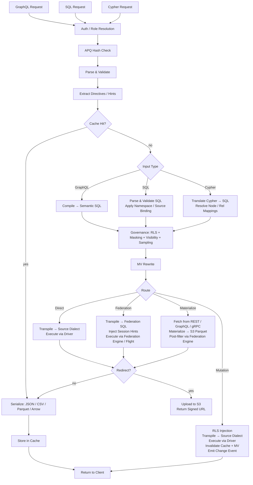
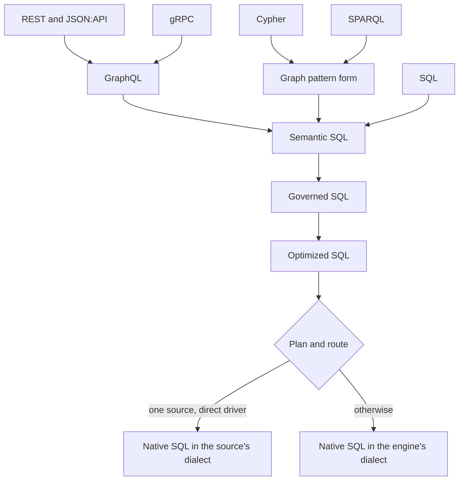

# Architettura di Provisa {: #provisa-architecture }

## Panoramica {: #overview }

Provisa è una piattaforma di data virtualization guidata dalla configurazione: federazione, metriche, ontologia e governance da un unico modello, per piccoli team e grandi aziende. Fornisce un'API unificata su fonti dati eterogenee, con governance, sicurezza e ottimizzazione delle prestazioni integrate. I client interrogano tramite SQL, GraphQL o Cypher; a tutte e tre si applica la stessa governance.

Il modello è l'unico posto in cui si aggiunge significato. Per ampliarlo, registrate nuove origini di dati o aggregati nel livello di virtualizzazione dei dati. Questo mantiene una separazione pulita, perché nulla può aggiungere semantica fuori dalla piattaforma, ed è ciò che rende possibile una vera governance dei dati. Lo impone il compilatore: il catalogo delle relazioni approvate è la fonte di verità, qualunque sia il linguaggio di query.

Un'unica piattaforma serve letture operative e analitiche. Una query che tocca una sola sorgente va diretta a quella sorgente con il suo driver nativo, e di solito torna in meno di 100 ms, mentre una query che unisce sorgenti gira nel motore di federazione scelto per la scala analitica.

```text
Config YAML → PG Metadata → Federation Catalogs
                               ↓
         Federation engine metadata → Schema Generator → SDL / SQL catalog / Cypher labels / gRPC proto (per role)
                                     ↓
                     Query → Parser → SQL Compiler → Transpiler
                                     ↓
                             Router (Smart Dispatch)
                         /           |            \
                    Federation  Direct PG      Direct MySQL/etc.
                         \           |            /
                              Executor Pool
                                     ↓
                         ┌───── Inline ─────┐     ┌──── Redirect ────┐
                         │  JSON (HTTP)     │     │  CTAS → S3       │
                         │  Arrow (Flight)  │     │  (Parquet, ORC)  │
                         │  Protobuf (gRPC) │     │  Provisa → S3    │
                         └─────────────────-┘     │  (JSON, CSV, …)  │
                                                  └─────────────────-┘
```

## Interfacce di query {: #query-interfaces }

Ogni interfaccia è un trasporto a sé, e tutte e quattro applicano la stessa pipeline di sicurezza (RLS, mascheramento, campionamento, controlli di ruolo). I client non parlano mai direttamente con il motore di federazione. Il linguaggio di query (SQL, GraphQL o Cypher) è indipendente dal trasporto, e più linguaggi possono arrivare sullo stesso trasporto.

| Port | Transport | Accepted query languages | Use case |
| ------ | ----------- | -------------------------- | ---------- |
| 8001 | HTTP | GraphQL, SQL, Cypher | Web clients, BI tools, curl, REST consumers |
| 8815 | Arrow Flight (gRPC) | SQL (via Arrow Flight SQL) | Data tools (Pandas, DuckDB, Spark, ADBC) |
| 50051 | Protobuf gRPC | Per-role generated proto RPCs | Service-to-service with typed contracts |
| configurable¹ | PostgreSQL wire protocol (pgwire) | SQL | psql, DBeaver, SQLAlchemy, any PG-compatible client |

¹ Impostare `PROVISA_PGWIRE_PORT` (es. 5433). Disabilitato se non impostato o `0`.

### HTTP (Port 8001)

Più endpoint sotto la stessa porta, distinti per path:

| Path | Language | Notes |
| ------ | ---------- | ------- |
| `POST /data/graphql` | GraphQL | Reads and mutations; APQ hash accepted via `extensions.persistedQuery` |
| `POST /data/sql` | SQL | Read-only; no capability gate — governed by object visibility + RLS + masking |
| `POST /data/query` | Cypher | Read-only; standard role |
| `GET /data/nl` | Natural language | Translates to SQL/GraphQL/Cypher based on source type |
| `GET /data/subscribe/{table}` | GraphQL | SSE subscription stream |
| `GET /neo4j/...` | Cypher (Neo4j compat) | Neo4j HTTP API compatibility shim |
| `POST /admin/graphql` | GraphQL | Admin API (superuser/admin role required) |

Tutti i path restituiscono JSON per impostazione predefinita. `Accept: text/csv`, `application/vnd.apache.parquet`, `application/vnd.apache.arrow.stream` e `application/octet-stream` (dati binari grezzi) sono supportati tramite content negotiation. I risultati che superano la soglia di dimensione configurata vengono reindirizzati automaticamente a un URL S3 firmato.

### Arrow Flight (Port 8815)

Trasporto Arrow colonnare nativo su gRPC. I client inviano un ticket JSON:

```json
{"query": "SELECT name, email FROM customers", "role": "analyst"}
```

e ricevono RecordBatch Arrow, trasmessi in streaming in modalità lazy. Quando il proxy Zaychik Arrow Flight SQL è disponibile, i dati fluiscono come un flusso continuo end-to-end di Arrow record batch:

```text
Client ←(Arrow batches)← Provisa Flight Server ←(Arrow batches)← Zaychik ←(JDBC)← Federation Engine
```

Il risultato completo non viene mai tenuto nella memoria di Provisa: i batch vengono inoltrati man mano che arrivano. Questo fa di Arrow Flight un percorso senza limiti, adatto a risultati di qualsiasi dimensione.

### Protobuf gRPC (Port 50051)

File `.proto` generato automaticamente dallo schema dati, per ruolo. Query in streaming (un messaggio per riga), mutazioni unarie. Server reflection abilitata. Ruolo tramite la chiave dei metadati `x-provisa-role`. La reflection descrive a ogni chiamante il servizio del proprio ruolo.

### Protocollo wire PostgreSQL / pgwire (porta configurabile) {: #postgresql-wire-protocol-pgwire-configurable-port }

Implementa il protocollo wire frontend/backend di PostgreSQL usando la libreria `buenavista`. Qualsiasi client compatibile con PostgreSQL (`psql`, DBeaver, SQLAlchemy con `psycopg2`, JDBC) può connettersi senza modifiche. Accetta solo SQL. La pipeline di governance completa (RLS, mascheramento, permessi di dominio) si applica in modo identico alle connessioni pgwire. Abilitato impostando `PROVISA_PGWIRE_PORT` su una porta diversa da zero.

## Pipeline delle richieste {: #request-pipeline }

Sono accettati tre linguaggi di query, e tutti e tre confluiscono nella governance dopo i propri passi di parsing e compilazione. Tutti e tre possono anche scrivere: le mutation GraphQL, gli `INSERT`, `UPDATE`, `DELETE`, `MERGE` e `TRUNCATE` SQL, e i `CREATE`, `SET` e `DELETE` Cypher diventano SQL e passano dalla stessa ammissione delle scritture. L'interrogazione in sé non ha alcun cancello di capacità. Qualsiasi identità autenticata può interrogare in qualsiasi linguaggio, e i dati sono governati solo da visibilità degli oggetti, RLS e mascheramento.

| Interface | Reads | Writes | Query gate |
| --- | --- | --- | --- |
| GraphQL (`/data/graphql`) | Yes | Yes (mutations) | None — data-layer governance only |
| SQL (`/data/sql`) | Yes | No | None — data-layer governance only |
| Cypher (`/data/query`) | Yes | No | None — data-layer governance only |



**Decisioni di routing:**

| Route | When |
| --- | --- |
| **Cache** | Result cache hit — evaluated first, serves the stored result with no execution |
| **Cheap-count** | `count(*)`-shaped query over an unmaterialized source that exposes an exact native count — routed to the native count call instead of materializing to count |
| **Direct** | Single source + has native driver + has federation connector |
| **Federation** | Multi-source federation, or source has connector but no driver |
| **Materialize** | Source has no federation connector — fetch and cache to S3/PG first |
| **Mutation** | A write: the source's own driver when it has one; otherwise the engine, through a connector that writes the source |

Il routing utilizza l'output dello stage di ottimizzazione post-governance, mai l'SQL governato pre-ottimizzazione. La governance può AGGIUNGERE origini (predicati subquery RLS); lo stage di ottimizzazione può RIMUOVERLE (inlining di CTE VALUES per hot table, riscritture della cache API, pruning dei rami union). Una query federata che, dopo l'inlining, si riduce a un'unica origine attiva viene quindi rieseguita come diretta.

### Query multi-root {: #multi-root-queries }

Le query GraphQL con più campi root (es. `{ orders { id } customers { name } }`) vengono compilate in query SQL separate ed eseguite indipendentemente. Le richieste SQL e Cypher sono per definizione single-root. I risultati vengono uniti in un'unica risposta:

- I campi sotto la soglia di redirect vengono restituiti inline in `data`
- I campi sopra la soglia vengono reindirizzati, con voci per campo in `redirects`
- I formati binari (Parquet, Arrow) sono supportati solo per query single-root

## Pipeline di query {: #query-pipeline }

Ogni lettura attraversa sei stadi, qualunque sia il linguaggio in cui la scrivete. Ogni stadio passa al successivo un'istruzione SQL. Il linguaggio decide solo dove la lettura entra.



### Front-end {: #front-ends }

Un front-end analizza un linguaggio e nomina ciò che legge nei termini del modello. GraphQL si compila direttamente in SQL semantico. Gli endpoint REST descritti dal documento OpenAPI, gli endpoint JSON:API e gRPC costruiscono da ogni richiesta una query GraphQL e la compilano allo stesso modo. L'unica eccezione è `page[total]` di JSON:API, il numero totale di righe, che il trasporto JSON:API compone da sé. Cypher e SPARQL vengono analizzati in un'unica forma di pattern di grafo, condivisa dai due linguaggi di grafo, e quella forma si compila in SQL semantico. L'SQL che scrivete sulle tabelle del modello è già SQL semantico, quindi entra allo stadio successivo. Nessun front-end decide chi può leggere cosa.

### SQL semantico {: #semantic-sql }

L'SQL semantico legge il modello. Le sue tabelle sono qualificate per dominio (`sales.orders`), le sue colonne sono quelle che il modello pubblica e i suoi join sono le relazioni dichiarate. Non dice nulla su dove si trovano i dati.

Una lettura annidata si compila in un'unica pipeline canonica di CTE, uguale per ogni motore e costruita solo dalle relazioni dichiarate. Una CTE radice legge la tabella radice con il suo filtro, il suo ordinamento, il suo limite e il suo offset. Ogni livello verso-molti è una CTE a sé. Unisce la sua tabella alla CTE del genitore sulle chiavi della relazione, prende le prime righe di ogni genitore con `ROW_NUMBER() OVER (PARTITION BY ...)` e le aggrega in una lista JSON per genitore. Il `SELECT` finale legge la CTE radice e fa un left join di ogni livello sulla chiave del genitore. Le letture GraphQL, Cypher e SPARQL che pongono la stessa domanda si compilano nella stessa istruzione.

I compilatori attuali non hanno ancora raggiunto quella forma. Il compilatore GraphQL legge un campo annidato con argomenti tramite un `LEFT JOIN LATERAL` per genitore, e il traduttore Cypher scrive una CTE per ogni stadio `WITH`. L'esempio qui sotto mostra entrambe le forme.

### SQL governato {: #governed-sql }

La governance lavora sull'intera istruzione semantica in una volta. Ogni `SELECT` che contiene riceve le regole di visibilità, la sicurezza a livello di riga e le maschere del ruolo che legge, così ogni livello annidato viene filtrato alla propria profondità. Una regola di riga la cui condizione è una sottoquery legge un'altra tabella, quindi la governance può aggiungere sorgenti a un'istruzione.

### SQL ottimizzato {: #optimized-sql }

Lo stadio di ottimizzazione riscrive l'istruzione governata in modi validi su ogni motore. Reinserisce le viste materializzate dove rispondono a una parte dell'istruzione, incorpora come `VALUES` le tabelle piccole e molto lette, ed elimina i rami di cache API e di unione che l'istruzione non può raggiungere. Niente qui sa quale motore eseguirà l'istruzione. Queste riscritture possono rimuovere sorgenti. Una lettura federata le cui altre sorgenti sono tutte incorporate resta con un'unica sorgente live.

### Pianificare e instradare {: #plan-and-route }

L'instradamento legge le sorgenti dell'istruzione ottimizzata, mai quelle dell'istruzione governata. Una lettura che l'ottimizzazione ha ristretto a una sorgente può quindi comunque andare in diretta. Un'istruzione va in diretta quando legge una sorgente e quella sorgente ha un driver diretto. Altrimenti la esegue il motore di federazione. La regola ha una terza condizione: che la sorgente supporti ogni costrutto dell'istruzione. Il router non la verifica ancora e decide in base al numero di sorgenti e al driver. I casi di cache, replica e steward sono in [Decisioni di instradamento](#request-pipeline).

### SQL nativo {: #native-sql }

Lo stadio nativo scrive l'istruzione instradata nel dialetto della sorgente per una lettura diretta e in quello del motore per una federata. Sceglie la grafia delle funzioni di aggregazione e di oggetto JSON, scrive la lista vuota per un genitore senza righe, trasforma `DISTINCT ON` in `ROW_NUMBER()` dove il dialetto non lo ha, e sceglie forme specifiche del motore come un join `LATERAL` per genitore o un suggerimento di materializzazione delle CTE.

### Un esempio completo {: #a-worked-example }

Questa lettura GraphQL chiede un cliente e i suoi tre ordini più grandi:

```graphql
{
  customers(where: { name: { eq: "Acme" } }) {
    id
    name
    orders(order_by: { amount: desc }, limit: 3) {
      id
      amount
    }
  }
}
```

Nella forma canonica si compila in questo SQL semantico:

```sql
WITH customers AS (
  SELECT c.id, c.name
  FROM sales.customers AS c
  WHERE c.name = 'Acme'
),
customers_orders AS (
  SELECT ranked.customer_id,
         JSON_AGG(JSON_OBJECT('id', ranked.id, 'amount', ranked.amount)
                  ORDER BY ranked.amount DESC, ranked.id) AS orders
  FROM (
    SELECT o.customer_id, o.id, o.amount,
           ROW_NUMBER() OVER (PARTITION BY o.customer_id
                              ORDER BY o.amount DESC, o.id) AS rn
    FROM sales.orders AS o
    JOIN customers AS p ON o.customer_id = p.id
  ) AS ranked
  WHERE ranked.rn <= 3
  GROUP BY ranked.customer_id
)
SELECT customers.id, customers.name, customers_orders.orders
FROM customers
LEFT JOIN customers_orders ON customers_orders.customer_id = customers.id
```

L'id dell'ordine risolve i pareggi nella classifica, così due ordini dello stesso importo tornano sempre nello stesso ordine. Un cliente senza ordini non ha righe in `customers_orders`; lo stadio nativo scrive per lui la lista vuota.

La stessa lettura in Cypher trova il cliente e legge i tre ordini più grandi in una sottoquery:

```cypher
MATCH (a:Customers)
WHERE a.name = 'Acme'
CALL {
  WITH a
  OPTIONAL MATCH (a)-[:HAS_ORDERS]->(b:Orders)
  RETURN b.id AS id, b.amount AS amount
  ORDER BY b.amount DESC
  LIMIT 3
}
RETURN a.id, a.name, id AS orders__id, amount AS orders__amount
```

Nella forma canonica, questa lettura Cypher e la lettura GraphQL si compilano nell'istruzione qui sopra. È ciò che permette ad Apri come query di passare una lettura GraphQL alla pagina Cypher e ottenere la stessa risposta.

Oggi il compilatore GraphQL scrive invece il livello annidato come un lateral join per genitore:

```sql
SELECT "t0"."id", "t0"."name", "t1"."id" AS "orders__id", "t1"."amount" AS "orders__amount"
FROM (SELECT * FROM "sales"."customers" "t0" WHERE "t0"."name" = $2 LIMIT 100) "t0"
LEFT JOIN LATERAL (
  SELECT * FROM "sales"."orders" WHERE "customer_id" = "t0"."id" ORDER BY "amount" DESC LIMIT $1
) "t1" ON TRUE
```

L'SQL semantico di qualsiasi lettura GraphQL è visibile nel pannello Provisa della pagina GraphQL.

## Percorsi di esecuzione della federazione {: #federation-execution-paths }

| Path | Transport | Via | When used |
| ------ | ----------- | ----- | ----------- |
| REST | federation engine client (HTTP :8080) | Direct query | Default, always available |
| Flight SQL | `adbc-driver-flightsql` (gRPC :8480) | Zaychik proxy → JDBC | When Zaychik is running |
| CTAS | federation engine client (HTTP :8080) | Direct write, Iceberg to S3 | Parquet/ORC redirect |

### Proxy Arrow Flight SQL Zaychik {: #zaychik-arrow-flight-sql-proxy }

Il motore di federazione non supporta nativamente il protocollo Arrow Flight SQL. [Zaychik](https://github.com/Raiffeisen-DGTL/zaychik-trino-proxy) è un proxy Java che implementa l'interfaccia gRPC di Arrow Flight SQL, traduce le richieste in query JDBC e restituisce i risultati in streaming come Arrow record batch.

```text
ADBC client → gRPC :8480 → Zaychik → JDBC :8080 → Federation Engine → results → Arrow batches → client
```

Il Provisa Flight Server (porta 8815) si connette a Zaychik come client ADBC, così Arrow scorre end-to-end e i risultati non vengono mai materializzati.

### Catalogo dei risultati Iceberg {: #iceberg-results-catalog }

Il redirect CTAS utilizza un connettore Iceberg (catalogo `results`) basato su un catalogo JDBC sull'istanza PostgreSQL esistente. Iceberg scrive file Parquet/ORC direttamente su MinIO/S3 tramite il file system S3 nativo (`fs.native-s3.enabled=true`).

## Motori di federazione {: #federation-engines }

Provisa sceglie il motore di federazione all'avvio dalla variabile d'ambiente `PROVISA_ENGINE`, dalla configurazione salvata nella UI di amministrazione o dal valore predefinito. Se non è impostato nulla, il predefinito è DuckDB, tutto nel processo e senza servizi esterni. Come funziona la scelta è spiegato in [Configuration](configuration.md#federation-engine).

Ogni motore è un'istanza `FederationEngine`, definita in `provisa/federation/engine.py`. L'istanza possiede una collezione di connettori che determina quali tipi di origine il motore può leggere live (ATTACH) e quali devono prima atterrare nello store di materializzazione del motore.

### Classi di driver {: #driver-classes }

| Class | Meaning | Examples |
| ------- | --------- | --------- |
| `BROAD` | Reaches many external source types via native connectors | Trino |
| `PARTIAL` | Reaches a subset (relational, files, cloud object/lake) plus lands everything else | DuckDB, PostgreSQL, ClickHouse, Databricks, Snowflake, BigQuery, Fabric, Synapse |
| `SELF_ONLY` | Reaches only its own store; every other source lands in | SQLAlchemy |

### Motori disponibili {: #available-engines }

| Engine key | Dialect | MPP | External-link mechanism | Auth |
| ----------- | --------- | ----- | ------------------------ | ------ |
| `trino` / `trino-byo` | Trino SQL | Yes | Trino catalogs (broad connector set) | JDBC credentials |
| `pg` | PostgreSQL | No | FDW / pg_duckdb | PostgreSQL credentials |
| `duckdb` | DuckDB | No | Extension-native ATTACH | None (in-process) |
| `clickhouse` / `clickhouse-server` | ClickHouse | Yes (shards) | S3 / IcebergS3 / DeltaLake table engines | ClickHouse credentials |
| `snowflake` | Snowflake | Yes | External stage + external table | `PROVISA_ENGINE_URL` |
| `databricks` | Databricks SQL | Yes | Unity Catalog external tables via REST | Bearer token (`http_path` in `federation_hints`) |
| `bigquery` | BigQuery | Yes (Dremel) | BigQuery external / BigLake tables | `GOOGLE_APPLICATION_CREDENTIALS` service-account key |
| `fabric` | T-SQL | Yes | OneLake shortcuts → OPENROWSET | Azure AD (`az login` / managed identity) |
| `synapse` | T-SQL | Yes | ADLS OPENROWSET / external tables | Azure AD |
| `sqlalchemy` | Any SQLAlchemy dialect | No | None (land-only) | Per-dialect credentials |

### Predefinito senza configurazione: DuckDB {: #zero-config-default-duckdb }

Quando `PROVISA_ENGINE` non è impostata, Provisa usa il motore DuckDB completamente embedded, in-process. Lo store di materializzazione di DuckDB è un file DuckDB embedded in `$PROVISA_DATA_DIR/materialize.duckdb` (predefinito: `~/.provisa/materialize.duckdb`). Non è richiesto alcun database o servizio esterno.

DuckDB consente un solo scrittore per file, quindi `store_connection.py` scrive nello store incorporato tramite la connessione stessa del motore e non apre mai una seconda connessione indipendente. È l'unico caso in cui motore e store di materializzazione condividono un handle di file per progetto.

### Trasporto di lettura Arrow-nativo {: #arrow-native-read-transport }

ClickHouse, DuckDB, Snowflake, Databricks, BigQuery, Fabric e Synapse riportano tutti `EngineCapability.ARROW` e `EngineCapability.ARROW_STREAM`. Le query verso questi motori restituiscono direttamente RecordBatch Arrow; il percorso di serializzazione riga per riga viene completamente bypassato. Il Flight Server trasmette in streaming questi batch ai client senza materializzare il risultato completo nella memoria di processo di Provisa. Per Trino, lo streaming Arrow si appoggia al proxy Zaychik; per i motori warehouse, l'API Arrow-nativa propria di ciascun motore (Cloud Fetch per Databricks, Storage Read API per BigQuery, `fetch_arrow_table` per DuckDB e Snowflake) alimenta lo stream Flight.

### Collegamenti a dati esterni (ATTACH) {: #external-data-links-attach }

Ogni motore warehouse può scansionare dati cloud object/lake sul posto, senza atterrare una copia. File Parquet, CSV, Iceberg e Delta Lake su S3, GCS o OneLake vengono collegati direttamente al motore come se fossero tabelle native. La strategia (ATTACH (scan sul posto) o LAND (copia nello store)) è determinata dal `Mechanism` dichiarato del connettore; non esiste branching specifico per motore nel planner. Un connettore `Mechanism.ATTACH_R` innesca uno scan senza copia; un connettore `Mechanism.DIRECT` o l'assenza di connettore innesca un landing.

Attach provisiona automaticamente tutti i prerequisiti al momento dell'attach:

| Engine | Object/lake formats | Mechanism | Auto-provisioning |
| -------- | ------------------- | ---------- | ---------------------------------- |
| Databricks | parquet, csv, iceberg, delta_lake | UC external table (`ATTACH_R`) | REST installs Unity Catalog storage credential + external location, then `CREATE TABLE … USING <format> LOCATION …` — live-verified over Cloudflare R2 |
| BigQuery | parquet, csv, json, iceberg, delta_lake | BigQuery external / BigLake table (`ATTACH_R`) | `CREATE OR REPLACE EXTERNAL TABLE … OPTIONS(format=…, uris=[…])` — live-verified |
| ClickHouse | csv, parquet, iceberg, delta_lake | S3 / IcebergS3 / DeltaLake table engine (`ATTACH_R`) | Validation probe executed at attach time — live-verified over Cloudflare R2 |
| Fabric | parquet, csv, iceberg, delta_lake | OneLake shortcut → OPENROWSET (`ATTACH_R`) | REST creates an `AmazonS3Compatible` connection + lakehouse + shortcut; returns the OneLake `BULK` path — live-verified reading R2 through Fabric |
| Snowflake | parquet, csv, json, iceberg, delta_lake | External stage + external table (`ATTACH_R`) | `CREATE STAGE … URL=… CREDENTIALS=…`, then `CREATE OR REPLACE EXTERNAL TABLE … LOCATION=@stage FILE_FORMAT=(TYPE=…)` — implemented; not live-tested (no account available) |

Le credenziali per lo storage cloud vengono passate in `federation_hints` dell'origine (vedere [Sources](sources.md#warehouses-as-named-sources)). Qualsiasi tipo di origine che non può eseguire ATTACH atterra prima nello store di materializzazione del motore.

### Scritture di materializzazione colonnari {: #columnar-materialization-writes }

`Connection.bulk_copy` in `provisa/core/database.py` seleziona il percorso di bulk ingest più veloce in base al dialetto dello store: `COPY` binario (`copy_records_to_table` di asyncpg) per gli store PostgreSQL, e una singola istruzione `executemany` preparata per tutti gli altri store relazionali. Lo store DuckDB embedded atterra i dati tramite `land_duckdb_native` in `store_connection.py`: una singola chiamata `executemany` per l'intero batch, mai un ciclo riga per riga.

## Redirect dei risultati di grandi dimensioni {: #large-result-redirect }

I risultati che superano una soglia di righe vengono reindirizzati, anziché inline, a storage compatibile S3 (MinIO).

### Modalità di redirect {: #redirect-modes }

| Mode | How it works | Data touches Provisa? |
| ------ | ------------- | ---------------------- |
| **CTAS** (Parquet, ORC) | Federation engine writes directly to S3 via `CREATE TABLE AS SELECT` | No |
| **Provisa upload** (JSON, NDJSON, CSV, Arrow IPC) | Provisa serializes and uploads via boto3 | Yes |

Per i formati nativi CTAS, Provisa non tocca mai i dati: il motore di federazione scrive i file direttamente su MinIO/S3. È il percorso da preferire per le esportazioni analitiche grandi.

### Senza object store {: #with-no-object-store }

Un risultato va nell'object store quando ne è configurato uno (un endpoint, o credenziali per AWS S3) e il motore vi scrive da sé il formato richiesto. Altrimenti viene scritto in un file nella cartella dell'organizzazione, `<data directory>/orgs/<org>/results/`. Uno store configurato su cui il motore scrive ma che non riesce a raggiungere fa fallire la richiesta per nome. Il risultato non viene scritto nella cartella al suo posto.

| Engine | Writes the file itself | Formats |
| ------ | ---------------------- | ------- |
| DuckDB | `COPY (query) TO '<file>'` | parquet, csv, json, ndjson |
| PostgreSQL | `COPY (query) TO STDOUT`, streamed into the file on Provisa's host | csv |
| Any other format or engine | Provisa writes it from the rows | parquet, orc, csv, arrow, json, ndjson |

L'handle ha le stesse chiavi di quello dell'object store, con `"sink": "local"` e un `redirect_url` pari a `/data/redirect-file/<name>`, un percorso sul server che ha risposto. Solo l'utente che ha chiesto il risultato può recuperarlo. Ogni recupero confronta l'identità propria della richiesta con il proprietario registrato accanto al file, e risponde 403 a chiunque altro e 401 a una richiesta senza identità.

Un file più vecchio di `redirect.ttl` riceve 404 e viene eliminato. Un timer lo elimina alla scadenza, come vengono eliminati i risultati dell'object store. Ogni nuovo risultato ripulisce anche la cartella dei risultati dell'organizzazione, rimuovendo i file il cui timer è stato interrotto da un riavvio.

### Header di redirect {: #redirect-headers }

| Header | Effect |
| -------- | -------- |
| `X-Provisa-Redirect-Format: <mime>` | Redirect in this format (implies force unless threshold set) |
| `X-Provisa-Redirect-Threshold: N` | Only redirect if result exceeds N rows |
| `X-Provisa-Redirect: true` | Force redirect using default format |

Questi header implementano un redirect controllato lato client.

**Risposta:**

```json
{
  "data": {"orders": null},
  "redirect": {
    "redirect_url": "https://minio:9000/provisa-results/results/abc.parquet?...",
    "row_count": 50000,
    "expires_in": 3600,
    "content_type": "application/vnd.apache.parquet"
  }
}
```

### Configurazione lato server {: #server-configuration }

| Env var | Default | Purpose |
| --------- | --------- | --------- |
| `PROVISA_REDIRECT_ENABLED` | `false` | Enable server-side threshold redirect |
| `PROVISA_REDIRECT_THRESHOLD` | `1000` | Default row count threshold |
| `PROVISA_REDIRECT_FORMAT` | `parquet` | Default redirect format |
| `PROVISA_REDIRECT_BUCKET` | `provisa-results` | S3 bucket name |
| `PROVISA_REDIRECT_ENDPOINT` | | S3-compatible endpoint URL |
| `PROVISA_REDIRECT_TTL` | `3600` | Presigned URL TTL (seconds) |

## Albero decisionale di routing {: #routing-decision-tree }

```text
Multi-source query? → Federation engine
NoSQL source (MongoDB, Cassandra)? → Federation engine
Uses path columns on non-PG source? → Federation engine
Single RDBMS with driver? → Direct (sub-100ms target)
Single RDBMS without driver? → Federation engine
Steward hint "federated"? → Federation engine (override)
Steward hint "direct"? → Direct (if possible)
Redirect to Parquet/ORC? → Federation engine (CTAS, regardless of source count)
```

## Ottimizzazione delle query di federazione {: #federation-query-optimization }

Provisa prepara automaticamente l'ottimizzatore basato sui costi del motore di federazione, così i piani delle query tra origini si basano sulla distribuzione reale dei dati e non su valori predefiniti fissi.

### Statistiche automatiche (`ANALYZE`) {: #automatic-statistics-analyze }

Alla registrazione di un'origine, Provisa esegue `ANALYZE catalog.schema.table` per ogni tabella pubblicata. Questo cattura:

- Numero di righe
- Per colonna: frazione di NULL, conteggio distinto, min/max, istogrammi (dipendente dal connettore)

L'ottimizzatore usa questi valori per stimare la selettività delle query filtrate. Senza statistiche, ricade su valori predefiniti fissi (es. 10% di selettività per i predicati di uguaglianza), il che porta a piani di join scadenti su dati distorti o ad alta cardinalità. Con le statistiche, le stime sono sufficientemente precise da prendere decisioni corrette tra join broadcast e partizionati per la maggior parte dei workload.

**Copertura**: il supporto per le statistiche dipende dal connettore. PostgreSQL, MySQL, Hive, Iceberg e Delta Lake supportano pienamente `ANALYZE`; MongoDB e Cassandra in parte o per niente. Un catalogo il cui connettore non raccoglie statistiche viene saltato, e un `ANALYZE` che fallisce viene registrato nel log e superato, così la registrazione non viene mai bloccata.

**Limiti della selettività**: le statistiche forniscono stime per colonna. Con predicati correlati (`WHERE region = 'US' AND city = 'Seattle'`), l'ottimizzatore assume l'indipendenza delle colonne, il che può sottostimare il numero di righe. Questa è una limitazione nota delle statistiche per colonna in tutti gli ottimizzatori cost-based.

**Origini API**: le tabelle `api_cache_{table_name}` in PostgreSQL vengono analizzate automaticamente dopo ogni ciclo di refresh della cache, così l'ottimizzatore dispone di stime di riga aggiornate quando unisce origini basate su API con origini relazionali.

### Amministrazione: aggiornamento delle statistiche {: #admin-refresh-statistics }

Rieseguire la raccolta delle statistiche su richiesta tramite l'Admin API:

```graphql
mutation {
  refreshSourceStatistics(sourceId: "sales-pg") {
    tablesAnalyzed
    failures { table message }
  }
}
```

Utile quando un'origine ha ricevuto dati nuovi significativi dopo la registrazione.

## Viste materializzate {: #materialized-views }

Le viste materializzate (MV) accelerano le query costose calcolandone i risultati in anticipo. Le query le usano senza alcuna modifica.

### Relazioni come hint per le MV {: #relationships-as-mv-hints }

Una dichiarazione di relazione è un artefatto di governance e anche la descrizione strutturale della forma di un join. Quella forma (le tabelle, le colonne, il tipo di join) è esattamente ciò che serve all'ottimizzatore di MV, quindi una relazione può guidare direttamente la materializzazione.

Per le **relazioni tra origini diverse** questo avviene automaticamente all'avvio: ogni relazione con `materialize: true` i cui rami stanno in più di un'origine genera una MV `JoinPattern` (`auto-mv-<rel_id>`), senza configurazione di MV a parte. Quando il compilatore vede quel join in una query, il rewriter sostituisce il risultato prematerializzato senza che chi chiama se ne accorga. Le relazioni nella stessa origine non generano nulla, perché quei JOIN sono già veloci con l'esecuzione diretta.

Una **relazione basata su tabella di giunzione** materializza l'intero attraversamento. La tabella associativa è una terza gamba, quindi il pattern porta il salto di origine, il salto di giunzione e il discriminatore che fissa le righe a un tipo di arco, con le colonne proprie della giunzione nella vista accanto a quelle della destinazione. Poiché la giunzione conta come gamba, un arco la cui giunzione sta in un'origine diversa dalle due tabelle che collega è tra origini diverse anche quando quelle due condividono l'origine. Il rewriter riconosce i due salti come una catena, in cui il secondo deve partire dall'alias introdotto dal primo. Così una query che raggiunge le stesse due tabelle senza passare dalla giunzione legge le tabelle di base, e una vista costruita per un valore del discriminatore non risponde mai a un attraversamento filtrato su un altro.

La conseguenza pratica: gli steward che approvano una relazione decidono implicitamente anche se il join è un buon candidato per la materializzazione. L'atto di governance e l'hint di ottimizzazione sono un'unica dichiarazione.

### Modalità {: #modes }

| Mode | Config | Behavior |
| ------ | -------- | ---------- |
| **Join-pattern** | `join_pattern` in MV config | Rewrites matching JOINs to read from MV table |
| **Custom SQL** | `sql` in MV config | Arbitrary SELECT, optionally exposed in SDL |
| **Auto-materialized relationship** | cross-source relationship (automatic) | Auto-generates a join-pattern MV; no config required |
| **Steward-materialized relationship** | `materialize: true` on same-source relationship | Explicit opt-in for hot same-source join paths |

### Materializzazione automatica {: #auto-materialization }

I JOIN cross-source sono le query più costose (sempre federate). Le relazioni cross-source generano automaticamente definizioni MV all'avvio:

```yaml
relationships:
  - id: orders-to-reviews
    source_table_id: orders        # sales-pg
    target_table_id: product_reviews  # reviews-mongo
    source_column: product_id
    target_column: product_id
    cardinality: one-to-many
    materialize: true              # auto-create MV
    refresh_interval: 600          # refresh every 10 minutes
```

Solo le relazioni cross-source generano MV (i JOIN all'interno della stessa origine sono già veloci con l'esecuzione diretta). La MV parte nello stato `STALE` e viene aggiornata dal loop di refresh in background prima di essere usata dall'ottimizzatore di query.

### Ciclo di vita del refresh {: #refresh-lifecycle }

```text
STALE → (refresh loop picks up) → REFRESHING → FRESH
  ↑                                                |
  └──── mutation hits source table ────────────────┘
```

Il loop di refresh gira ogni 30 secondi, controlla `get_due_for_refresh()` ed esegue `CREATE TABLE AS SELECT` (prima esecuzione) o `DELETE + INSERT` (esecuzioni successive) sulla tabella target della MV tramite il motore di federazione.

## Mappa dei moduli {: #module-map }

| Module | Purpose |
| -------- | --------- |
| `api/` | FastAPI app, routers, middleware, lifespan management |
| `api/flight/` | Arrow Flight server (gRPC, port 8815) |
| `api/admin/` | Strawberry GraphQL admin API — config, discovery, views |
| `api/rest/` | Auto-generated REST endpoints from registered tables |
| `api/jsonapi/` | Auto-generated JSON:API endpoints with pagination and error handling |
| `api/data/subscribe.py` | SSE subscriptions — LISTEN/NOTIFY, polling, Debezium CDC |
| `compiler/` | GraphQL/SQL parsers, semantic SQL generator, RLS, masking, sampling, two-stage governance (`stage2.py`) |
| `cypher/` | Cypher → SQL translator, parser, label map, write translator for Cypher mutations |
| `pgwire/` | PostgreSQL wire-protocol server; `catalog.py` intercepts pg_catalog/information_schema for per-role object visibility |
| `vector/` | Vector search — model registry, embedding providers (openai/ollama/huggingface), `cosine_similarity()` translation, HNSW index on a replica's embedding column, declarative embedding generation |
| `compiler/federation.py` | Apollo Federation v2 subgraph support |
| `transpiler/` | Dialect transpilation, routing logic |
| `executor/` | Federated/direct execution, serialization, output formats |
| `executor/drivers/` | Direct source drivers (PostgreSQL, MySQL, DuckDB, Snowflake, Databricks, ClickHouse, …) |
| `executor/trino_flight.py` | ADBC Flight SQL client for the federation engine |
| `executor/ctas_write.py` | CTAS-based redirect (federation engine writes to S3) |
| `executor/redirect.py` | S3 redirect logic, Provisa-side upload |
| `federation/engine.py` | `FederationEngine`, `DriverClass`, `_ENGINE_BUILDERS`, `ENGINE_REGISTRY`, `build_engine` |
| `federation/connector.py` | Connector abstractions — Trino, ClickHouse; `Mechanism`, `WarehouseNativeConnector` |
| `federation/connector_duckdb.py` | DuckDB and PostgreSQL FDW connector definitions |
| `federation/snowflake_connectors.py` | Snowflake external stage + external table ATTACH connectors |
| `federation/databricks_connectors.py` | Databricks UC external table ATTACH connectors |
| `federation/bigquery_connectors.py` | BigQuery external / BigLake ATTACH connectors |
| `federation/databricks_uc.py` | Unity Catalog credential + external location auto-provisioning |
| `federation/databricks_backend.py` | Databricks SQL warehouse execution backend |
| `federation/snowflake_backend.py` | Snowflake execution backend |
| `federation/bigquery_backend.py` | BigQuery execution backend (Storage Read API Arrow transport) |
| `federation/mssql_warehouse_backend.py` | Fabric Warehouse + Synapse execution backends (T-SQL over ODBC) |
| `federation/mssql_warehouse_connectors.py` | OPENROWSET ATTACH connectors for Fabric / Synapse |
| `federation/fabric_shortcuts.py` | OneLake shortcut auto-provisioning (connection → lakehouse → shortcut) |
| `federation/clickhouse_backend.py` | ClickHouse execution backend |
| `federation/duckdb_backend.py` | DuckDB in-process execution backend |
| `federation/pg_backend.py` | PostgreSQL execution backend |
| `federation/store_connection.py` | DuckDB-native materialization store write face |
| `registry/` | Persisted query registry, governance |
| `security/` | Visibility, rights, column masking |
| `cache/` | Redis-backed query result caching (hot tier) |
| `mv/` | Materialized view registry, refresh, SQL rewriter |
| `events/` | Dataset change events and trigger dispatch |
| `webhooks/` | Outbound webhook execution for mutations and events |
| `scheduler/` | APScheduler-based background job management — cron and interval triggers that fire webhooks and mutations, and the polls of live Kafka outputs |
| `apq/` | Apollo APQ wire protocol — Redis-backed query hash cache; separate from result caching |
| `compiler/cursor.py` | Relay-style cursor pagination — `first`/`after`/`last`/`before` arguments and `pageInfo` generation on all list queries |
| `compiler/aggregate_gen.py` | Auto-generated `{table}_aggregate` query types with `count`, `sum`, `avg`, `min`, `max` sub-fields and filtered `nodes` access |
| `compiler/enum_detect.py` | Enum type auto-detection — PostgreSQL native enum types (`pg_enum`) exposed as GraphQL enum types rather than string scalars |
| `compiler/hints.py` | Federation performance hints — query-level routing directives embedded as SQL comments (`/* @provisa route=federated */`) that override automatic routing |
| `compiler/mutation_gen.py` | Mutation compiler; column presets — server-side static or session-variable values applied on insert/update, not exposed in the mutation input type |
| `auth/approval_hook.py` | ABAC approval hook — pluggable external authorization called before query execution; webhook, gRPC, and unix_socket transports; per-table/source/global scope; configurable fallback policy |
| `subscriptions/` | SSE subscription state and delivery |
| `discovery/` | LLM relationship discovery (Claude API) |
| `grpc/` | Proto generation, gRPC server, reflection |
| `api_source/` | REST/GraphQL/gRPC API sources with PG cache |
| `kafka/` | Kafka topic sources, sink, Schema Registry |
| `auth/` | Pluggable auth providers, middleware, role mapping |
| `core/` | Config, models, DB, repositories, secrets; role model supports `parent_role_id` and `flatten_roles()` for recursive role inheritance |
| `hasura_v2/` | Hasura v2 metadata → Provisa config converter |
| `ddn/` | Hasura DDN supergraph → Provisa config converter |
| `mongodb/` | MongoDB source connector |
| `elasticsearch/` | Elasticsearch source connector |
| `cassandra/` | Cassandra source connector |
| `prometheus/` | Prometheus metrics source connector |
| `source_adapters/` | Generic adapter layer for source connections |

## Admin API

L'Admin API GraphQL Strawberry è montata su `/admin/graphql` (porta HTTP 8001). È separata dall'endpoint dati GraphQL e richiede il ruolo superuser o admin.

| Capability | Description |
| ----------- | ------------- |
| Config download/upload | Export or replace the full Provisa YAML config |
| Relationship editor | Create, update, delete relationship definitions |
| AI FK discovery | Trigger Claude-powered FK candidate analysis |
| Schema introspection | Browse published tables, columns, and roles |
| View management | Register and manage materialized view definitions |

## Configurazione dei modelli AI {: #ai-models-configuration }

`GET /admin/ai-models` e `PUT /admin/ai-models` configurano la pipeline LLM per ciascun org.

Le impostazioni sono **per organizzazione**: le scelte di ogni organizzazione si sovrappongono alla configurazione del deployment e valgono dalla richiesta successiva, senza riavvio.

**Assegnazioni dei modelli per operazione.** Sei operazioni hanno ciascuna un vendor e una stringa modello configurabili:

| Operation | What it drives |
| --------- | -------------- |
| `table_description` | LLM-generated table descriptions |
| `column_description` | LLM-generated column descriptions |
| `relationship_inference` | FK candidate discovery |
| `sql_generation` | NL → SQL generation |
| `table_selection` | Choosing which tables to include in the NL prompt |
| `mcp_chat` | Il ciclo di uso degli strumenti del pannello dell'assistente di chat |

Il campo vendor accetta qualsiasi vendor compatibile con `aisuite` (`anthropic`, `openai`, `groq`, `mistral`, `cohere` e altri) o un endpoint locale (`ollama`, `lmstudio`). Una stringa modello vuota rimuove l'override dell'org e ripristina il default del deployment.

**Rate limit NL.** Un limite opzionale di richieste per periodo applicato per ruolo. Le richieste in eccesso restituiscono `429` con `Retry-After`.

**Registro dei modelli vettoriali.** Un elenco di modelli di embedding (campi: `id`, `provider`, `dimensions`, opzionali `api_key_env` e `base_url`, flag `enabled`). Sostituzione dell'intero elenco: ogni voce deve avere `id`, `provider` e `dimensions` altrimenti la scrittura viene rifiutata con `400`.

**Chiavi API.** La chiave API LLM di ogni fornitore viene salvata cifrata tramite `provisa.core.org_secrets` (vedi sotto). La risposta di `GET` dice solo se per ogni fornitore è impostata una chiave e non restituisce mai il valore. Inviare una stringa vuota per un fornitore ne cancella la chiave, così le chiamate LLM verso quel fornitore tornano alla credenziale della variabile d'ambiente del deployment.

## Segreti crittografati per organizzazione {: #per-org-encrypted-secrets }

`provisa/core/org_secrets.py` memorizza credenziali che non devono mai comparire in chiaro nel database. Contiene le chiavi API dei fornitori di IA (`{vendor}_api_key`) e la chiave Jev (`jev_api_key`).

I valori sono cifrati con l'`encryption_service` dell'intero processo, da `provisa.encryption.runtime`, lo stesso meccanismo di `api_sources.auth`.

Sono supportati dodici vendor compatibili con `aisuite`: `anthropic`, `openai`, `cohere`, `groq`, `mistral`, `xai`, `deepseek`, `together`, `fireworks`, `nebius`, `sambanova` e `inception`. Google, AWS e Azure sono esclusi perché richiedono una configurazione oltre la semplice chiave API (project ID, ruoli IAM, regione). I vendor con endpoint locale (`ollama`, `lmstudio`) non hanno chiave e sono esclusi per lo stesso motivo.

Passare `value=None` a `write_org_secret` elimina la riga. I chiamanti che leggono un segreto lo consumano immediatamente (ad es. per costruire un client LLM) e non devono mai ripeterlo in nessuna risposta API.

## Endpoint REST e JSON:API generati automaticamente {: #auto-generated-rest-jsonapi-endpoints }

Le tabelle registrate vengono esposte come endpoint REST e JSON:API, in aggiunta all'interfaccia GraphQL.

| Interface | Mount path | Spec |
| ----------- | ----------- | ------ |
| REST | `/rest/<table-id>` | Simple GET/POST with query parameters |
| JSON:API | `/jsonapi/<table-id>` | [jsonapi.org](https://jsonapi.org) compliant — pagination, relationships, error objects |

Questi endpoint applicano la stessa pipeline di sicurezza (RLS, mascheramento, controlli sui ruoli) dell'endpoint GraphQL.

## Subscription {: #subscriptions }

Le subscription SSE sono esposte su `GET /data/subscribe/{table}`. Tre modalità di delivery:

| Mode | Mechanism | When used |
| ------ | ----------- | ----------- |
| **LISTEN/NOTIFY** | PostgreSQL `LISTEN` on a channel | PG sources with mutation activity |
| **Polling** | Re-execute query on interval | Non-PG sources, or when CDC unavailable |
| **Debezium CDC** | Kafka topic from Debezium connector | High-frequency change streams |

Il client riceve `text/event-stream` con un evento JSON per ogni riga o diff modificati.

## Sistema di eventi e webhook {: #event-webhook-system }

Le mutazioni al database (INSERT/UPDATE/DELETE) possono attivare eventi in uscita tramite i moduli `events/` e `webhooks/`.

```text
Mutation executed → EventDispatcher → match event trigger rules
                                          ↓
                               WebhookExecutor → HTTP POST to configured URL
```

I trigger di evento sono definiti nella configurazione e mappati per tabella, tipo di operazione e filtro riga opzionale. I payload dei webhook includono il tipo di operazione, la riga modificata e il contesto del ruolo.

## Servizi in background {: #background-services }

Quattro loop in background si avviano durante la fase lifespan dell'applicazione (`api/app.py`):

| Service | Interval | Purpose |
| --------- | ---------- | --------- |
| MV refresh loop | 30 s | Polls `get_due_for_refresh()`, executes CTAS or DELETE+INSERT on stale MVs |
| Hot replication evaluation | `replication.hot_interval` | Promotes a table whose statement count passed its threshold and requests its replica; demotes one that fell below half. Runs in the one process holding the scheduler lock |
| Hot table loader | Configurable | Loads small reference tables into in-memory cache for sub-millisecond access |
| API source poller | Per-source interval | Re-fetches and re-caches remote REST/GraphQL/gRPC sources |

### Tabelle hot e tabelle replicate sotto carico {: #hot-tables-and-replicated-when-busy-tables }

| Tier | Storage | Promotion criteria | Access latency |
| ------ | --------- | ------------------- | ---------------- |
| Hot | In-process memory | Row count < threshold, or is a relationship target | <1 ms |
| Replicated when busy | Replica in the engine's store | `replicate` is Default or Hot-N and the governed statements reading the table passed its threshold | The engine's own read of its store |
| Cold | Remote source | Default | 50–500 ms |

Una tabella appartiene al massimo a uno dei due: una tabella gestita dal livello hot non viene replicata per il carico.

## Importazione metadati (Hasura v2 / DDN) {: #metadata-import-hasura-v2-ddn }

I deployment Hasura esistenti possono essere convertiti in una configurazione Provisa senza riscrittura manuale.

| Module | Input | Output |
| -------- | ------- | -------- |
| `hasura_v2/` | Hasura v2 `metadata.yaml` | Provisa `config.yaml` |
| `ddn/` | Hasura DDN supergraph JSON | Provisa `config.yaml` |

Entrambi i convertitori mappano tabelle tracciate, relazioni, permessi e remote schema. Il risultato è una configurazione Provisa completa e pronta all'uso.

## Apollo Federation

`compiler/federation.py` espone Provisa come subgraph Apollo Federation v2. L'SDL del subgraph viene generato automaticamente dallo schema pubblicato, con direttive `@key` sulle colonne di chiave primaria e annotazioni `@external`/`@provides` sulle relazioni cross-source. Provisa risponde alle query `_entities` e `_service` richieste dal Federation Gateway.

## Paginazione basata su cursore {: #cursor-based-pagination }

Tutte le query lista supportano la paginazione a cursore in stile Relay tramite `compiler/cursor.py`. I client passano gli argomenti `first`/`after` (avanti) o `last`/`before` (indietro). Il compilatore codifica la posizione della riga come cursore Base64 opaco e inserisce le clausole `WHERE`/`LIMIT` corrispondenti. Ogni query lista restituisce un oggetto `pageInfo`:

| Field | Type | Description |
| ------- | ------ | ------------- |
| `hasNextPage` | Boolean | True if more results exist after this page |
| `hasPreviousPage` | Boolean | True if results exist before this page |
| `startCursor` | String | Cursor of the first node in this page |
| `endCursor` | String | Cursor of the last node in this page |

## Query di aggregazione {: #aggregate-queries }

Ogni tabella registrata riceve un campo root `{table}_aggregate` generato automaticamente (`compiler/aggregate_gen.py`). Il tipo aggregate espone `count`, `sum`, `avg`, `min`, `max` per ogni colonna numerica, oltre a `nodes` per l'accesso filtrato alle righe con selezione completa dei campi (stesso RLS/mascheramento della query base). Un aggregato su una sola tabella, da qualsiasi superficie (SQL o compilata), riceve risposta da una vista materializzata aggiornata che lo pre-aggrega, senza dichiarare nulla: una vista il cui SQL è un `GROUP BY` su una sola tabella di `SUM`, `COUNT`, `MIN` e `MAX` con nome serve gli aggregati che raggruppano per un sottoinsieme delle sue colonne di raggruppamento e filtrano solo su di esse. Ogni aggregato viene ri-aggregato su quelli memorizzati (`COUNT` come somma dei conteggi memorizzati, `AVG` da una somma e un conteggio memorizzati della stessa colonna); ciò che la vista non può servire esattamente viene lasciato alla tabella. La riscrittura avviene dopo la governance, quindi un filtro di riga su una delle colonne di raggruppamento della vista viene riportato sulla vista, e un filtro di riga su qualsiasi altra colonna, o una maschera su una colonna sommata, lascia la lettura alla tabella.

## Automatic Persisted Queries (APQ)

`apq/cache.py` implementa il protocollo wire APQ di Apollo. Quando un client invia solo un hash di query (`extensions.persistedQuery`), Provisa lo cerca in Redis. In caso di mancata corrispondenza, restituisce un errore `PersistedQueryNotFound`; il client ripete la richiesta con il testo completo della query, che Provisa memorizza. Questo è indipendente dal caching dei risultati (`cache/`).

## Ruoli ereditati {: #inherited-roles }

Un ruolo nomina al massimo un padre tramite `parent_role_id`. Al build a runtime, `security/inheritance.py` percorre la catena di ogni ruolo dal figlio verso l'alto e la ripiega nelle copie proprie del build dei dati caricati, cosicché ogni ricerca successiva rimane indicizzata dall'id del ruolo agente. Le capability e l'accesso al dominio sono l'unione della catena. Il `visible_to` di una colonna, ogni voce della sua lista di maschere, e il `visible_to` di una metrica, funzione o webhook, valgono per un ruolo quando nominano il ruolo o un suo antenato. Le autorizzazioni di scrittura di una tabella si risolvono per operazione allo stesso modo: un ruolo senza autorizzazione per un'operazione prende quella dell'antenato più vicino, la propria per prima. L'RLS si risolve per tabella con il figlio che ha la precedenza: il ruolo più vicino nella catena che ha una regola per la tabella, la propria regola di tabella prima della propria regola di dominio, fornisce l'unico predicato che viene eseguito; la regola di un antenato non viene mai combinata con essa. Un ruolo eredita il rate limit del padre quando non ne imposta uno proprio. Un padre deve esistere, non può essere il ruolo stesso e non può chiudere un ciclo; un ruolo da cui altri ruoli ereditano non può essere eliminato finché non viene ri-assegnato a un nuovo padre.

## Hook di approvazione ABAC {: #abac-approval-hook }

`auth/approval_hook.py` è un hook di autorizzazione collegabile, chiamato prima dell'esecuzione della query, dopo RLS e mascheramento. Si integra con motori di policy esterni (OPA, servizi ABAC personalizzati).

| Setting | Description |
| --------- | ------------- |
| Transport | `webhook` (HTTP POST), `grpc`, or `unix_socket` |
| Scope | Per-table, per-source, or global |
| Fallback policy | `allow` or `deny` when the hook endpoint is unreachable |

## Rilevamento automatico dei tipi enum {: #enum-type-auto-detection }

`compiler/enum_detect.py` esamina i tipi enum nativi di PostgreSQL (`pg_enum`) quando viene generato lo schema. Una colonna di un tipo enum PostgreSQL definito dall'utente diventa un tipo enum GraphQL, e i suoi valori diventano membri dell'enum invece di scalari stringa.

## Trigger pianificati {: #scheduled-triggers }

`scheduler/jobs.py` usa APScheduler per eseguire job in background definiti come trigger cron o a intervallo. Ogni job può inviare una POST a un URL webhook o eseguire una mutazione contro l'endpoint dati; l'output Kafka in tempo reale di una tabella (`live.outputs`) viene interrogato sullo stesso scheduler. I trigger vengono configurati tramite l'Admin API (mutazioni `scheduledTrigger`) o la chiave `scheduled_triggers` nella configurazione YAML.

## Hint di performance per la federazione {: #federation-performance-hints }

`compiler/hints.py` analizza gli hint degli steward incorporati nelle query come commenti con la sintassi di commento di Provisa. Il formato dell'hint varia in base al linguaggio di query:

```graphql
# @provisa route=federated
{ orders { id amount } }
```

```sql
/* @provisa route=federated */
SELECT id, amount FROM orders
```

```cypher
// @provisa route=federated
MATCH (o:Order) RETURN o.id, o.amount
```

| Hint | Effect |
| ------ | -------- |
| `route=federated` | Force federation through the federation engine, bypassing direct-driver routing |
| `route=direct` | Force direct-driver execution |
| `cache=true` | Attivare la cache delle risposte per questa query (forma di commento SQL: `-- @provisa cache=true`) |
| `cache_ttl=N` | Attivarla e conservare il risultato in cache per N secondi (`-- @provisa cache_ttl=N`) |

La cache delle risposte si attiva per richiesta: GraphQL usa la direttiva `@cached(ttl: Int)`, SQL e Cypher il commento `cache`/`cache_ttl`, gRPC i metadati di chiamata `x-provisa-cache` / `x-provisa-cache-ttl`. L'indicazione vale su ogni trasporto che porta il linguaggio (Cypher su HTTP, Bolt e Arrow Flight; GraphQL su HTTP e Arrow Flight). Una richiesta senza indicazione non legge né scrive mai la cache, e nessuna forma legge dati più recenti di quanto consentano le impostazioni di origine e tabella dell'operatore. Vedere [Cache](configuration.md#per-request-opt-in).

## Autorizzazioni di scrittura e preset nelle mutazioni {: #write-grants-and-presets-in-mutations }

I `write_grants` di una tabella indicano, per ruolo e operazione, quali colonne una scrittura può nominare, quali righe può toccare e quali valori imposta l'autorizzazione stessa. `compiler/write_admission.py` ammette ogni scrittura nella fase di governance, così GraphQL, SQL, Cypher e le altre superfici ottengono la stessa risposta: il diritto `write`, l'autorizzazione del ruolo per l'operazione, le colonne, i preset aggiunti all'istruzione, il predicato `rows` combinato con AND nel `WHERE` e il `check` valutato sulle nuove righe prima che qualcosa raggiunga una sorgente. I preset provengono da una variabile di sessione, da un letterale o dal momento della scrittura. L'istruzione non può fornire una colonna con preset, quindi i preset non compaiono nel tipo di input di mutazione GraphQL generato.

## Esploratore di schema GraphQL Voyager {: #graphql-voyager-schema-explorer }

La UI di amministrazione (`provisa-ui/src/pages/SchemaExplorer.tsx`) incorpora GraphQL Voyager come visualizzazione interattiva dello schema. Disegna lo schema limitato al ruolo come un diagramma entità-relazione che si può spostare, ingrandire e cliccare, con le tabelle come nodi e le relazioni come archi. Lo schema mostrato è sempre filtrato sul ruolo selezionato in quel momento.

## Ordine di applicazione della sicurezza {: #security-enforcement-order }

Interrogare non ha cancelli di capacità; la governance viene interamente da controlli a livello di dati. Una richiesta di SQL grezzo viene rifiutata (HTTP 403) per qualsiasi tabella fuori dall'ambito di oggetti del ruolo, prima che la governance giri.

1. **Visibilità degli oggetti**: lo schema specifico per ruolo nasconde tabelle/colonne non autorizzate; le tabelle fuori ambito in SQL grezzo vengono rifiutate
2. **Applicazione delle relazioni**: gli attraversamenti devono esistere nel catalogo delle relazioni approvate, a meno che il ruolo non abbia `ignore_relationships`. Fra i ruoli di sistema precaricati solo `modeler` la possiede. In modalità alta sicurezza la capacità viene ignorata e nessun attraversamento sfugge al catalogo
3. **RLS**: iniezione di clausole WHERE per tabella e ruolo
4. **Mascheramento delle colonne**: trasformazione dei dati per colonna e ruolo
5. **Limite di righe (LIMIT)**: tetto sul numero di righe per i ruoli senza `full_results`; il sampling statistico casuale è una funzione separata di query utente

Tutte e quattro le interfacce di query (HTTP, Flight, gRPC, pgwire) applicano la stessa pipeline di governance stage-2; nessun percorso client può bypassarla senza bypassare il server.

## Limiti di scalabilità {: #scalability-limits }

Provisa è un sottile livello di compilazione e instradamento, e aggiunge pochi millisecondi alla latenza delle query. I percorsi in cui Provisa serializza i dati del risultato sono però limitati dalla memoria del processo. Due percorsi non hanno alcun limite:

| Path | Memory bound? | Suitable for |
| ------ | -------------- | ------------- |
| JSON inline (HTTP) | Yes | Small-medium results |
| **Arrow Flight streaming (gRPC :8815)** | **No** | **Unbounded — streaming via Zaychik or warehouse Arrow API** |
| Protobuf gRPC inline (:50051) | Yes | Medium results, service-to-service |
| Redirect: Provisa upload (JSON, CSV, NDJSON, Arrow IPC) | Yes | Medium results, file download |
| **Redirect: CTAS (Parquet, ORC)** | **No** | **Unbounded — federation engine writes to S3** |

### Sondaggio di soglia (threshold probing) {: #threshold-probing }

Per il redirect basato su soglia, Provisa inserisce `LIMIT threshold + 1` come sonda nella query. Se il risultato ha meno righe, viene restituito inline (risultato completo, nessun lavoro sprecato). Se il risultato raggiunge il limite, la sonda viene scartata e la query completa viene rieseguita tramite CTAS o upload Provisa. Questo evita `SELECT COUNT(*)` (che alcune origini non ottimizzano) e funziona con qualsiasi origine.

Per grandi workload analitici, usare una delle seguenti opzioni:

- **Arrow Flight** (porta 8815) per lo streaming verso strumenti dati; i batch attraversano Provisa senza essere materializzati
- **Redirect Parquet/ORC** per gli export basati su file: il motore di federazione scrive direttamente su S3, e Provisa restituisce un URL presigned

## Infrastruttura {: #infrastructure }

| Service | Image | Port | Purpose |
| --------- | ------- | ------ | --------- |
| Provisa API | (host process) | 8001 | HTTP/REST endpoint |
| Provisa Flight | (host process) | 8815 | Arrow Flight gRPC server |
| Provisa gRPC | (host process) | 50051 | Protobuf gRPC server |
| Federation Engine | `trinodb/trino` (default) or external warehouse | 8080 / varies | Query federation engine — Trino for the embedded stack; Snowflake/Databricks/BigQuery/Fabric/Synapse/DuckDB for warehouse targets |
| Zaychik | `provisa-zaychik` (built from source) | 8480 | Arrow Flight SQL proxy for Trino; not required for warehouse engines |
| PostgreSQL | `postgres:16` | 5432 | Config metadata + Iceberg catalog |
| MongoDB | `mongo:7` | 27017 | Demo NoSQL data source |
| MinIO | `minio/minio` | 9000/9001 | S3-compatible object storage |
| Redis | `redis:7-alpine` | 6379 | Query result cache |
| PgBouncer | `edoburu/pgbouncer` | 6432 | Connection pooling for PG |
| Kafka | `confluentinc/cp-kafka:7.6.0` | 9092 | Streaming data sources |
| Schema Registry | `confluentinc/cp-schema-registry:7.6.0` | 8081 | Avro/Protobuf schema management |
