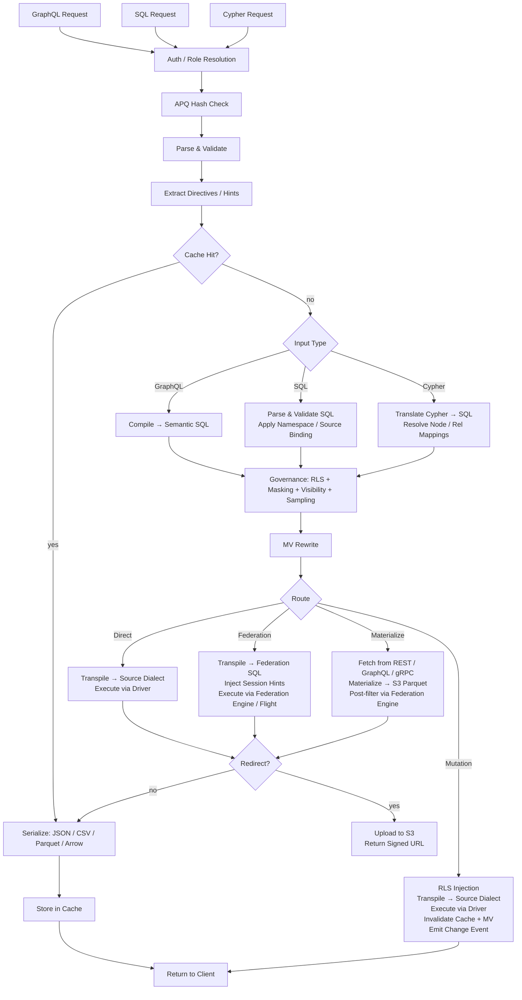

# Архитектура Provisa {: #provisa-architecture }

## Обзор {: #overview }

Provisa — это платформа виртуализации данных, управляемая конфигурацией: федерация, метрики, онтология и управление доступом из единой модели — для небольших команд и крупных предприятий. Она предоставляет единый API поверх разнородных источников данных с governance, безопасностью и оптимизацией производительности. Клиенты выполняют запросы через SQL, GraphQL или Cypher; все три — полноправные интерфейсы с идентично применяемым governance.

Модель является единственным местом, где добавляется смысл. Чтобы дополнить её, регистрируйте новые источники данных или агрегаты в слое виртуализации данных. Так сохраняется чёткое разделение, потому что ничто не может добавить семантику вне платформы, и именно это делает возможным настоящее управление данными. Это обеспечивает компилятор: каталог одобренных связей является источником истины, на каком бы языке ни был запрос.

Provisa спроектирована быть высокопроизводительной для операционных нужд и высокомасштабируемой для аналитических нужд предприятия. Одна платформа обслуживает и то, и другое без потери скорости или масштабируемости.

```text
Config YAML → PG Metadata → Federation Catalogs
                               ↓
         Federation engine metadata → Schema Generator → SDL / SQL catalog / Cypher labels / gRPC proto (per role)
                                     ↓
                     Query → Parser → SQL Compiler → Transpiler
                                     ↓
                             Router (Smart Dispatch)
                         /           |            \
                    Federation  Direct PG      Direct MySQL/etc.
                         \           |            /
                              Executor Pool
                                     ↓
                         ┌───── Inline ─────┐     ┌──── Redirect ────┐
                         │  JSON (HTTP)     │     │  CTAS → S3       │
                         │  Arrow (Flight)  │     │  (Parquet, ORC)  │
                         │  Protobuf (gRPC) │     │  Provisa → S3    │
                         └─────────────────-┘     │  (JSON, CSV, …)  │
                                                  └─────────────────-┘
```

## Интерфейсы запросов {: #query-interfaces }

Каждый интерфейс является отдельным транспортом, и все четыре применяют один конвейер безопасности (RLS, маскирование, выборка, проверки ролей). Клиенты никогда не обращаются к движку федерации напрямую. Язык запросов (SQL, GraphQL или Cypher) не зависит от транспорта, и по одному транспорту могут приходить несколько языков.

| Порт | Транспорт | Принимаемые языки запросов | Сценарий использования |
| ------ | ----------- | -------------------------- | ---------- |
| 8001 | HTTP | GraphQL, SQL, Cypher | Веб-клиенты, BI-инструменты, curl, потребители REST |
| 8815 | Arrow Flight (gRPC) | SQL (через Arrow Flight SQL) | Инструменты данных (Pandas, DuckDB, Spark, ADBC) |
| 50051 | Protobuf gRPC | Сгенерированные для каждой роли RPC на базе proto | Взаимодействие сервис-сервис с типизированными контрактами |
| настраиваемый¹ | Проводной протокол PostgreSQL (pgwire) | SQL | psql, DBeaver, SQLAlchemy, любой PG-совместимый клиент |

¹ Установите `PROVISA_PGWIRE_PORT` (например, 5433). Отключено, если не задано или равно `0`.

### HTTP (порт 8001) {: #http-port-8001 }

Несколько конечных точек на одном порту, различаются по пути:

| Путь | Язык | Примечания |
| ------ | ---------- | ------- |
| `POST /data/graphql` | GraphQL | Чтение и мутации; хеш APQ принимается через `extensions.persistedQuery` |
| `POST /data/sql` | SQL | Только чтение; без gate по возможностям (capability) — governance через видимость объектов + RLS + маскирование |
| `POST /data/query` | Cypher | Только чтение; стандартная роль |
| `GET /data/nl` | Естественный язык | Переводится в SQL/GraphQL/Cypher в зависимости от типа источника |
| `GET /data/subscribe/{table}` | GraphQL | Поток подписки SSE |
| `GET /neo4j/...` | Cypher (совместимость с Neo4j) | Прослойка совместимости с HTTP API Neo4j |
| `POST /admin/graphql` | GraphQL | Admin API (требуется роль superuser/admin) |

Все пути по умолчанию возвращают JSON. `Accept: text/csv`, `application/vnd.apache.parquet`, `application/vnd.apache.arrow.stream` и `application/octet-stream` (сырые бинарные данные) поддерживаются через согласование содержимого (content negotiation). Результаты, превышающие настроенный порог размера, автоматически перенаправляются на подписанный URL S3.

### Arrow Flight (порт 8815) {: #arrow-flight-port-8815 }

Нативный колоночный транспорт Arrow через gRPC. Клиенты отправляют JSON-тикет:

```json
{"query": "SELECT name, email FROM customers", "role": "analyst"}
```

и получают потоково, лениво, RecordBatches Arrow. Когда доступен прокси Zaychik Arrow Flight SQL, данные текут потоком Arrow record batches от начала до конца:

```text
Client ←(Arrow batches)← Provisa Flight Server ←(Arrow batches)← Zaychik ←(JDBC)← Federation Engine
```

Полный результат никогда не хранится в памяти Provisa: пакеты передаются дальше по мере поступления. Поэтому Arrow Flight является неограниченным путём, подходящим для результатов любого размера.

### Protobuf gRPC (порт 50051) {: #protobuf-grpc-port-50051 }

Автоматически сгенерированный `.proto` из схемы данных, генерируется для каждой роли. Потоковые запросы (одно сообщение на строку), унарные мутации. Включена рефлексия сервера. Роль передаётся через ключ метаданных `x-provisa-role`. Рефлексия описывает каждому вызывающему сервис его собственной роли.

### Проводной протокол PostgreSQL / pgwire (настраиваемый порт) {: #postgresql-wire-protocol-pgwire-configurable-port }

Реализует протокол frontend/backend PostgreSQL с использованием библиотеки `buenavista`. Любой PostgreSQL-совместимый клиент (`psql`, DBeaver, SQLAlchemy с `psycopg2`, JDBC) может подключиться без изменений. Принимает только SQL. Полный конвейер governance (RLS, маскирование, разрешения на домен) применяется к соединениям pgwire идентично. Включается установкой `PROVISA_PGWIRE_PORT` на ненулевой порт.

## Конвейер запроса {: #request-pipeline }

Принимаются три языка запросов, и все три сходятся в управлении после собственных шагов разбора и компиляции. Все три могут и писать: мутации GraphQL, `INSERT`, `UPDATE`, `DELETE`, `MERGE` и `TRUNCATE` в SQL, а также `CREATE`, `SET` и `DELETE` в Cypher превращаются в SQL и проходят один и тот же допуск записи. Для самих запросов нет барьера по возможностям. Любая аутентифицированная учётная запись может запрашивать на любом языке, а данные управляются только видимостью объектов, RLS и маскированием.

| Интерфейс | Чтение | Запись | Gate запроса |
| --- | --- | --- | --- |
| GraphQL (`/data/graphql`) | Да | Да (мутации) | Нет — только governance на уровне данных |
| SQL (`/data/sql`) | Да | Нет | Нет — только governance на уровне данных |
| Cypher (`/data/query`) | Да | Нет | Нет — только governance на уровне данных |



**Решения о маршрутизации:**

| Маршрут | Когда |
| --- | --- |
| **Cache** | Попадание в кеш результата — вычисляется первым, отдаёт сохранённый результат без выполнения |
| **Cheap-count** | Запрос формы `count(*)` над нематериализованным источником, предоставляющим точный нативный счётчик — маршрутизируется на нативный вызов подсчёта вместо материализации ради подсчёта |
| **Direct** | Один источник + есть нативный драйвер + есть коннектор федерации |
| **Federation** | Федерация нескольких источников, либо источник имеет коннектор, но не имеет драйвера |
| **Materialize** | У источника нет коннектора федерации — сначала выбрать и закешировать в S3/PG |
| **Mutation** | Запись: собственный драйвер источника, если он есть; иначе движок, через коннектор, который пишет в источник |

Маршрутизация использует вывод этапа оптимизации после governance, а не governed SQL до оптимизации. Governance может ДОБАВИТЬ источники (предикаты подзапроса RLS); этап оптимизации может их УБРАТЬ (встраивание горячих таблиц как VALUES-CTE, переписывание API-кеша, отсечение веток union). Федеративный запрос, который после встраивания схлопывается до одного живого источника, поэтому перемаршрутизируется как прямой.

### Запросы с несколькими корнями {: #multi-root-queries }

GraphQL-запросы с несколькими корневыми полями (например, `{ orders { id } customers { name } }`) компилируются в отдельные SQL-запросы и выполняются независимо. Запросы SQL и Cypher по определению однокорневые. Результаты объединяются в единый ответ:

- Поля ниже порога перенаправления возвращаются встроенно в `data`
- Поля выше порога перенаправляются, с записями для каждого поля в `redirects`
- Бинарные форматы (Parquet, Arrow) поддерживаются только для однокорневых запросов

## Пути выполнения федерации {: #federation-execution-paths }

| Путь | Транспорт | Через | Когда используется |
| ------ | ----------- | ----- | ----------- |
| REST | клиент движка федерации (HTTP :8080) | Прямой запрос | По умолчанию, всегда доступен |
| Flight SQL | `adbc-driver-flightsql` (gRPC :8480) | Прокси Zaychik → JDBC | Когда запущен Zaychik |
| CTAS | клиент движка федерации (HTTP :8080) | Прямая запись, Iceberg в S3 | Перенаправление Parquet/ORC |

### Прокси Zaychik Arrow Flight SQL {: #zaychik-arrow-flight-sql-proxy }

Движок федерации нативно не поддерживает протокол Arrow Flight SQL. [Zaychik](https://github.com/Raiffeisen-DGTL/zaychik-trino-proxy) — это Java-прокси, реализующий gRPC-интерфейс Arrow Flight SQL, транслирующий запросы в JDBC-запросы и потоково возвращающий результаты как Arrow record batches.

```text
ADBC client → gRPC :8480 → Zaychik → JDBC :8080 → Federation Engine → results → Arrow batches → client
```

Flight-сервер Provisa (порт 8815) подключается к Zaychik как ADBC-клиент, обеспечивая потоковую передачу Arrow от начала до конца без материализации результатов.

### Каталог результатов Iceberg {: #iceberg-results-catalog }

Перенаправление CTAS использует коннектор Iceberg (каталог `results`), опирающийся на JDBC-каталог на существующем экземпляре PostgreSQL. Iceberg пишет файлы Parquet/ORC напрямую в MinIO/S3 через нативную файловую систему S3 (`fs.native-s3.enabled=true`).

## Движки федерации {: #federation-engines }

Provisa выбирает движок федерации при запуске по переменной окружения `PROVISA_ENGINE`, по конфигурации, сохранённой в интерфейсе администратора, или по умолчанию. Если ничего не задано, по умолчанию используется DuckDB, полностью внутри процесса и без внешних сервисов. Как работает выбор, см. в разделе [Configuration](configuration.md#federation-engine).

Каждый движок — это экземпляр `FederationEngine`, определённый в `provisa/federation/engine.py`. Экземпляр владеет набором коннекторов, определяющим, какие типы источников движок может читать вживую (ATTACH), а какие сначала должны попасть в хранилище материализации движка.

### Классы драйверов {: #driver-classes }

| Класс | Значение | Примеры |
| ------- | --------- | --------- |
| `BROAD` | Достигает многих внешних типов источников через нативные коннекторы | Trino |
| `PARTIAL` | Достигает подмножества (реляционные, файлы, облачное объектное хранилище/lake), а всё остальное приземляет | DuckDB, PostgreSQL, ClickHouse, Databricks, Snowflake, BigQuery, Fabric, Synapse |
| `SELF_ONLY` | Достигает только собственного хранилища; всё остальное приземляется | SQLAlchemy |

### Доступные движки {: #available-engines }

| Ключ движка | Диалект | MPP | Механизм внешней связи | Аутентификация |
| ----------- | --------- | ----- | ------------------------ | ------ |
| `trino` / `trino-byo` | Trino SQL | Да | Каталоги Trino (широкий набор коннекторов) | Учётные данные JDBC |
| `pg` | PostgreSQL | Нет | FDW / pg_duckdb | Учётные данные PostgreSQL |
| `duckdb` | DuckDB | Нет | Нативное расширение ATTACH | Нет (в процессе) |
| `clickhouse` / `clickhouse-server` | ClickHouse | Да (шарды) | Табличные движки S3 / IcebergS3 / DeltaLake | Учётные данные ClickHouse |
| `snowflake` | Snowflake | Да | Внешний stage + внешняя таблица | `PROVISA_ENGINE_URL` |
| `databricks` | Databricks SQL | Да | Внешние таблицы Unity Catalog через REST | Bearer-токен (`http_path` в `federation_hints`) |
| `bigquery` | BigQuery | Да (Dremel) | Внешние таблицы BigQuery / BigLake | Ключ сервисного аккаунта `GOOGLE_APPLICATION_CREDENTIALS` |
| `fabric` | T-SQL | Да | Ярлыки OneLake → OPENROWSET | Azure AD (`az login` / managed identity) |
| `synapse` | T-SQL | Да | ADLS OPENROWSET / внешние таблицы | Azure AD |
| `sqlalchemy` | Любой диалект SQLAlchemy | Нет | Нет (только приземление) | Учётные данные для каждого диалекта |

### Готовый к работе без конфигурации по умолчанию: DuckDB {: #zero-config-default-duckdb }

Когда `PROVISA_ENGINE` не задан, Provisa использует полностью встроенный внутрипроцессный движок DuckDB. Хранилище материализации DuckDB — это встроенный файл DuckDB по пути `$PROVISA_DATA_DIR/materialize.duckdb` (по умолчанию `~/.provisa/materialize.duckdb`). Внешняя база данных или сервис не требуются.

DuckDB допускает только одного писателя на файл, поэтому `store_connection.py` пишет во встроенное хранилище через собственное подключение движка и никогда не открывает второе, независимое. Это единственный случай, когда движок и хранилище материализации намеренно делят один дескриптор файла.

### Нативный для Arrow транспорт чтения {: #arrow-native-read-transport }

ClickHouse, DuckDB, Snowflake, Databricks, BigQuery, Fabric и Synapse; все заявляют `EngineCapability.ARROW` и `EngineCapability.ARROW_STREAM`. Запросы к этим движкам возвращают RecordBatches Arrow напрямую — путь сериализации строк полностью минуется. Flight-сервер передаёт эти батчи клиентам потоково, не материализуя полный результат в памяти процесса Provisa. Для Trino потоковая передача Arrow опирается на прокси Zaychik; для движков хранилищ данных — на собственный Arrow-нативный API движка (Cloud Fetch для Databricks, Storage Read API для BigQuery, `fetch_arrow_table` для DuckDB и Snowflake), питающий поток Flight.

### Внешние связи с данными (ATTACH) {: #external-data-links-attach }

Каждый движок хранилища данных может сканировать облачные объектные/lake-данные на месте, не приземляя копию. Файлы Parquet, CSV, Iceberg и Delta Lake на S3, GCS или OneLake присоединяются к движку напрямую, как будто это нативные таблицы. Стратегия (ATTACH (сканирование на месте) или LAND (копирование в хранилище)) определяется объявленным `Mechanism` коннектора; в планировщике нет ветвления, специфичного для движка. Коннектор `Mechanism.ATTACH_R` запускает сканирование с нулевым копированием; `Mechanism.DIRECT` или отсутствие коннектора запускает приземление.

Attach автоматически подготавливает все предпосылки в момент присоединения:

| Движок | Форматы объектов/lake | Механизм | Автоматическая подготовка |
| -------- | ------------------- | ---------- | ---------------------------------- |
| Databricks | parquet, csv, iceberg, delta_lake | Внешняя таблица UC (`ATTACH_R`) | REST устанавливает storage credential Unity Catalog + external location, затем `CREATE TABLE … USING <format> LOCATION …` — проверено вживую поверх Cloudflare R2 |
| BigQuery | parquet, csv, json, iceberg, delta_lake | Внешняя таблица BigQuery / BigLake (`ATTACH_R`) | `CREATE OR REPLACE EXTERNAL TABLE … OPTIONS(format=…, uris=[…])` — проверено вживую |
| ClickHouse | csv, parquet, iceberg, delta_lake | Табличный движок S3 / IcebergS3 / DeltaLake (`ATTACH_R`) | Проверочный зонд выполняется в момент присоединения — проверено вживую поверх Cloudflare R2 |
| Fabric | parquet, csv, iceberg, delta_lake | Ярлык OneLake → OPENROWSET (`ATTACH_R`) | REST создаёт соединение `AmazonS3Compatible` + lakehouse + shortcut; возвращает путь `BULK` OneLake — проверено вживую при чтении R2 через Fabric |
| Snowflake | parquet, csv, json, iceberg, delta_lake | Внешний stage + внешняя таблица (`ATTACH_R`) | `CREATE STAGE … URL=… CREDENTIALS=…`, затем `CREATE OR REPLACE EXTERNAL TABLE … LOCATION=@stage FILE_FORMAT=(TYPE=…)` — реализовано; не протестировано вживую (нет доступного аккаунта) |

Учётные данные для облачного хранилища передаются в `federation_hints` источника (см. [Sources](sources.md#warehouses-as-named-sources)). Любой тип источника, который не может выполнить ATTACH, сначала приземляется в хранилище материализации движка.

### Колоночные записи материализации {: #columnar-materialization-writes }

`Connection.bulk_copy` в `provisa/core/database.py` выбирает самый быстрый путь массовой загрузки для каждого диалекта хранилища: бинарный `COPY` (`copy_records_to_table` asyncpg) для хранилищ PostgreSQL и один подготовленный запрос `executemany` для всех остальных реляционных хранилищ. Встроенное хранилище DuckDB приземляется через `land_duckdb_native` в `store_connection.py` — один вызов `executemany` на весь батч, никогда построчный цикл.

## Перенаправление больших результатов {: #large-result-redirect }

Результаты, превышающие порог по числу строк, перенаправляются в S3-совместимое хранилище (MinIO) вместо возврата встроенно.

### Режимы перенаправления {: #redirect-modes }

| Режим | Как работает | Данные проходят через Provisa? |
| ------ | ------------- | ---------------------- |
| **CTAS** (Parquet, ORC) | Движок федерации пишет напрямую в S3 через `CREATE TABLE AS SELECT` | Нет |
| **Загрузка Provisa** (JSON, NDJSON, CSV, Arrow IPC) | Provisa сериализует и загружает через boto3 | Да |

Для форматов, нативных для CTAS, Provisa вообще не касается данных: движок федерации пишет файлы прямо в MinIO/S3. Это предпочтительный путь для больших аналитических выгрузок.

### Без объектного хранилища {: #with-no-object-store }

Результат идёт в объектное хранилище, когда оно настроено (endpoint или учётные данные AWS S3) и движок сам пишет туда запрошенный формат. Иначе он записывается в файл в папке организации, `<data directory>/orgs/<org>/results/`. Настроенное хранилище, в которое пишет движок, но которое он не может достичь, приводит к ошибке запроса с указанием причины. Результат при этом не записывается в папку вместо него.

| Движок | Сам пишет файл | Форматы |
| ------ | ---------------------- | ------- |
| DuckDB | `COPY (query) TO '<file>'` | parquet, csv, json, ndjson |
| PostgreSQL | `COPY (query) TO STDOUT`, потоком в файл на хосте Provisa | csv |
| Любой другой формат или движок | Provisa пишет его из строк | parquet, orc, csv, arrow, json, ndjson |

Дескриптор имеет те же ключи, что и у объектного хранилища, с `"sink": "local"` и `redirect_url`, равным `/data/redirect-file/<name>`, — путём на ответившем сервере. Получить результат может только запросивший его пользователь. Каждое получение сравнивает собственную идентичность запроса с владельцем, записанным рядом с файлом, и отвечает 403 любому другому и 401 запросу без идентичности.

Файл старше `redirect.ttl` получает ответ 404 и удаляется. Таймер удаляет его по истечении срока, так же как удаляются результаты объектного хранилища. Каждый новый результат также очищает папку результатов организации, удаляя файлы, чей таймер прервал перезапуск.

### Заголовки перенаправления {: #redirect-headers }

| Заголовок | Эффект |
| -------- | -------- |
| `X-Provisa-Redirect-Format: <mime>` | Перенаправить в этом формате (подразумевает принудительность, если не задан порог) |
| `X-Provisa-Redirect-Threshold: N` | Перенаправлять, только если результат превышает N строк |
| `X-Provisa-Redirect: true` | Принудительное перенаправление с использованием формата по умолчанию |

Эти заголовки реализуют перенаправление, управляемое клиентом.

**Ответ:**

```json
{
  "data": {"orders": null},
  "redirect": {
    "redirect_url": "https://minio:9000/provisa-results/results/abc.parquet?...",
    "row_count": 50000,
    "expires_in": 3600,
    "content_type": "application/vnd.apache.parquet"
  }
}
```

### Конфигурация сервера {: #server-configuration }

| Переменная окружения | По умолчанию | Назначение |
| --------- | --------- | --------- |
| `PROVISA_REDIRECT_ENABLED` | `false` | Включить перенаправление по порогу на стороне сервера |
| `PROVISA_REDIRECT_THRESHOLD` | `1000` | Порог по количеству строк по умолчанию |
| `PROVISA_REDIRECT_FORMAT` | `parquet` | Формат перенаправления по умолчанию |
| `PROVISA_REDIRECT_BUCKET` | `provisa-results` | Имя бакета S3 |
| `PROVISA_REDIRECT_ENDPOINT` | | URL S3-совместимой конечной точки |
| `PROVISA_REDIRECT_TTL` | `3600` | TTL подписанного URL (секунды) |

## Дерево решений маршрутизации {: #routing-decision-tree }

```text
Multi-source query? → Federation engine
NoSQL source (MongoDB, Cassandra)? → Federation engine
Uses path columns on non-PG source? → Federation engine
Single RDBMS with driver? → Direct (sub-100ms target)
Single RDBMS without driver? → Federation engine
Steward hint "federated"? → Federation engine (override)
Steward hint "direct"? → Direct (if possible)
Redirect to Parquet/ORC? → Federation engine (CTAS, regardless of source count)
```

## Оптимизация федеративных запросов {: #federation-query-optimization }

Provisa автоматически снабжает стоимостной оптимизатор движка федерации данными, чтобы планы межисточниковых запросов опирались на реальное распределение данных, а не на зашитые значения по умолчанию.

### Автоматическая статистика (`ANALYZE`) {: #automatic-statistics-analyze }

При регистрации источника Provisa запускает `ANALYZE catalog.schema.table` для каждой опубликованной таблицы. Это собирает:

- Количество строк
- Для каждой колонки: долю null-значений, количество различных значений, min/max, гистограммы (зависит от коннектора)

Оптимизатор использует их для оценки селективности отфильтрованных запросов. Без статистики он откатывается к фиксированным значениям по умолчанию (например, 10% селективности для предикатов равенства), что даёт плохие планы join на скошенных или высококардинальных данных. Со статистикой оценки достаточно точны, чтобы правильно выбирать между broadcast- и partitioned-join для большинства нагрузок.

**Покрытие**: поддержка статистики зависит от коннектора. PostgreSQL, MySQL, Hive, Iceberg и Delta Lake полностью поддерживают `ANALYZE`; MongoDB и Cassandra поддерживают частично или не поддерживают вовсе. Каталог, коннектор которого не собирает статистику, пропускается, а неудачный `ANALYZE` записывается в журнал и пропускается, поэтому регистрация никогда не блокируется.

**Ограничения селективности**: статистика предоставляет оценки для каждой колонки отдельно. Для коррелированных предикатов (`WHERE region = 'US' AND city = 'Seattle'`) оптимизатор предполагает независимость колонок, что может занижать оценку числа строк. Это известное ограничение статистики уровня колонок во всех оптимизаторах на основе стоимости.

**Источники API**: таблицы `api_cache_{table_name}` в PostgreSQL анализируются автоматически после каждого цикла обновления кеша, так что у оптимизатора есть актуальные оценки числа строк при соединении источников на базе API с реляционными источниками.

### Admin: обновление статистики {: #admin-refresh-statistics }

Повторный запуск сбора статистики по требованию через admin API:

```graphql
mutation {
  refreshSourceStatistics(sourceId: "sales-pg") {
    tablesAnalyzed
    failures { table message }
  }
}
```

Полезно, когда источник получил значительный объём новых данных с момента регистрации.

## Материализованные представления {: #materialized-views }

MV прозрачно оптимизируют дорогие запросы, предварительно вычисляя и кешируя результаты.

### Связи как подсказки для MV {: #relationships-as-mv-hints }

Объявление связи является артефактом управления и одновременно структурным описанием формы соединения. Именно эта форма (таблицы, столбцы, тип соединения) нужна оптимизатору MV, поэтому связь может напрямую управлять материализацией.

Для **межисточниковых связей** это происходит автоматически при запуске: каждая связь с `materialize: true`, плечи которой лежат более чем в одном источнике, порождает MV `JoinPattern` (`auto-mv-<rel_id>`) без отдельной конфигурации MV. Когда компилятор видит это соединение в запросе, переписчик подставляет заранее материализованный результат незаметно для вызывающего. Связи внутри одного источника ничего не порождают, потому что такие JOIN и так быстры при прямом выполнении.

**Связь через связующую таблицу** материализует весь обход. Ассоциативная таблица является третьим плечом, поэтому шаблон несёт переход от источника, переход через связующую таблицу и дискриминатор, который закрепляет строки за одним типом ребра, а собственные столбцы связующей таблицы попадают в представление рядом со столбцами цели. Поскольку связующая таблица считается плечом, ребро, связующая таблица которого лежит в другом источнике, чем две связываемые ею таблицы, является межисточниковым, даже если те две находятся в одном источнике. Переписчик распознаёт два перехода как цепочку, где второй должен начинаться с псевдонима, введённого первым. Поэтому запрос, достигающий тех же двух таблиц без прохода через связующую таблицу, читает базовые таблицы, а представление, построенное для одного значения дискриминатора, никогда не отвечает на обход, отфильтрованный по другому.

Практическое следствие: стюарды, утверждающие связь, неявно решают, является ли join хорошим кандидатом для материализации. Акт governance и подсказка оптимизации — это одно и то же объявление.

### Режимы {: #modes }

| Режим | Конфигурация | Поведение |
| ------ | -------- | ---------- |
| **Join-pattern** | `join_pattern` в конфигурации MV | Переписывает совпадающие JOIN на чтение из таблицы MV |
| **Custom SQL** | `sql` в конфигурации MV | Произвольный SELECT, опционально раскрываемый в SDL |
| **Автоматически материализованная связь** | межисточниковая связь (автоматически) | Автоматически генерирует join-pattern MV; конфигурация не требуется |
| **Материализованная стюардом связь** | `materialize: true` на связи в пределах одного источника | Явное включение для горячих путей join в пределах одного источника |

### Автоматическая материализация {: #auto-materialization }

Межисточниковые JOIN — самые дорогие запросы (всегда федерируются). Межисточниковые связи автоматически генерируют определения MV при старте:

```yaml
relationships:
  - id: orders-to-reviews
    source_table_id: orders        # sales-pg
    target_table_id: product_reviews  # reviews-mongo
    source_column: product_id
    target_column: product_id
    cardinality: one-to-many
    materialize: true              # auto-create MV
    refresh_interval: 600          # refresh every 10 minutes
```

Только межисточниковые связи генерируют MV (JOIN в пределах одного источника уже быстры за счёт прямого выполнения). MV начинает в статусе `STALE` и обновляется фоновым циклом обновления, прежде чем его начнёт использовать оптимизатор запросов.

### Жизненный цикл обновления {: #refresh-lifecycle }

```text
STALE → (refresh loop picks up) → REFRESHING → FRESH
  ↑                                                |
  └──── mutation hits source table ────────────────┘
```

Цикл обновления запускается каждые 30 секунд, проверяет `get_due_for_refresh()` и выполняет `CREATE TABLE AS SELECT` (первый запуск) или `DELETE + INSERT` (последующие) над целевой таблицей MV через движок федерации.

## Карта модулей {: #module-map }

| Модуль | Назначение |
| -------- | --------- |
| `api/` | Приложение FastAPI, роутеры, middleware, управление жизненным циклом |
| `api/flight/` | Сервер Arrow Flight (gRPC, порт 8815) |
| `api/admin/` | Admin GraphQL API на Strawberry — конфигурация, обнаружение, представления |
| `api/rest/` | Автоматически сгенерированные REST-конечные точки из зарегистрированных таблиц |
| `api/jsonapi/` | Автоматически сгенерированные конечные точки JSON:API с пагинацией и обработкой ошибок |
| `api/data/subscribe.py` | Подписки SSE — LISTEN/NOTIFY, опрос, Debezium CDC |
| `compiler/` | Парсеры GraphQL/SQL, генератор семантического SQL, RLS, маскирование, сэмплирование, двухэтапный governance (`stage2.py`) |
| `cypher/` | Транслятор Cypher → SQL, парсер, карта меток, транслятор записи для мутаций Cypher |
| `pgwire/` | Сервер проводного протокола PostgreSQL; `catalog.py` перехватывает pg_catalog/information_schema для видимости объектов для каждой роли |
| `vector/` | Векторный поиск — реестр моделей, провайдеры эмбеддингов (openai/ollama/huggingface), трансляция `cosine_similarity()`, индекс HNSW по столбцу эмбеддингов реплики, декларативная генерация эмбеддингов |
| `compiler/federation.py` | Поддержка субграфа Apollo Federation v2 |
| `transpiler/` | Транспиляция диалектов, логика маршрутизации |
| `executor/` | Федеративное/прямое выполнение, сериализация, форматы вывода |
| `executor/drivers/` | Прямые драйверы источников (PostgreSQL, MySQL, DuckDB, Snowflake, Databricks, ClickHouse, …) |
| `executor/trino_flight.py` | ADBC-клиент Flight SQL для движка федерации |
| `executor/ctas_write.py` | Перенаправление на базе CTAS (движок федерации пишет в S3) |
| `executor/redirect.py` | Логика перенаправления S3, загрузка со стороны Provisa |
| `federation/engine.py` | `FederationEngine`, `DriverClass`, `_ENGINE_BUILDERS`, `ENGINE_REGISTRY`, `build_engine` |
| `federation/connector.py` | Абстракции коннекторов — Trino, ClickHouse; `Mechanism`, `WarehouseNativeConnector` |
| `federation/connector_duckdb.py` | Определения коннекторов DuckDB и PostgreSQL FDW |
| `federation/snowflake_connectors.py` | Коннекторы ATTACH внешнего stage + внешней таблицы Snowflake |
| `federation/databricks_connectors.py` | Коннекторы ATTACH внешней таблицы Databricks UC |
| `federation/bigquery_connectors.py` | Коннекторы ATTACH BigQuery external / BigLake |
| `federation/databricks_uc.py` | Автоматическая подготовка credential Unity Catalog + external location |
| `federation/databricks_backend.py` | Бэкенд выполнения Databricks SQL warehouse |
| `federation/snowflake_backend.py` | Бэкенд выполнения Snowflake |
| `federation/bigquery_backend.py` | Бэкенд выполнения BigQuery (Arrow-транспорт Storage Read API) |
| `federation/mssql_warehouse_backend.py` | Бэкенды выполнения Fabric Warehouse + Synapse (T-SQL через ODBC) |
| `federation/mssql_warehouse_connectors.py` | Коннекторы ATTACH OPENROWSET для Fabric / Synapse |
| `federation/fabric_shortcuts.py` | Автоматическая подготовка ярлыков OneLake (соединение → lakehouse → shortcut) |
| `federation/clickhouse_backend.py` | Бэкенд выполнения ClickHouse |
| `federation/duckdb_backend.py` | Внутрипроцессный бэкенд выполнения DuckDB |
| `federation/pg_backend.py` | Бэкенд выполнения PostgreSQL |
| `federation/store_connection.py` | Нативное для DuckDB звено записи хранилища материализации |
| `registry/` | Реестр сохранённых запросов, governance |
| `security/` | Видимость, права, маскирование колонок |
| `cache/` | Кеширование результатов запросов на базе Redis (горячий уровень) |
| `mv/` | Реестр материализованных представлений, обновление, переписыватель SQL |
| `events/` | События изменения наборов данных и диспетчеризация триггеров |
| `webhooks/` | Исходящее выполнение webhook для мутаций и событий |
| `scheduler/` | Управление фоновыми заданиями на базе APScheduler — cron- и интервальные триггеры, запускающие webhook'и и мутации, а также опросы живых выводов Kafka |
| `apq/` | Проводной протокол Apollo APQ — кеш хешей запросов на базе Redis; отдельно от кеширования результатов |
| `compiler/cursor.py` | Курсорная пагинация в стиле Relay — аргументы `first`/`after`/`last`/`before` и генерация `pageInfo` для всех запросов списков |
| `compiler/aggregate_gen.py` | Автоматически сгенерированные типы запросов `{table}_aggregate` с подполями `count`, `sum`, `avg`, `min`, `max` и доступом к отфильтрованным `nodes` |
| `compiler/enum_detect.py` | Автоматическое обнаружение enum-типов — нативные enum-типы PostgreSQL (`pg_enum`), раскрываемые как GraphQL enum-типы, а не строковые скаляры |
| `compiler/hints.py` | Подсказки производительности федерации — директивы маршрутизации на уровне запроса, встроенные как SQL-комментарии (`/* @provisa route=federated */`), переопределяющие автоматическую маршрутизацию |
| `compiler/mutation_gen.py` | Компилятор мутаций; пресеты колонок — статические значения или значения из переменных сессии на стороне сервера, применяемые при insert/update, не раскрываемые во входном типе мутации |
| `auth/approval_hook.py` | Хук утверждения ABAC — подключаемая внешняя авторизация, вызываемая перед выполнением запроса; транспорты webhook, gRPC и unix_socket; область действия для таблицы/источника/глобальная; настраиваемая политика отката |
| `subscriptions/` | Состояние и доставка подписок SSE |
| `discovery/` | Обнаружение связей на базе LLM (API Claude) |
| `grpc/` | Генерация proto, сервер gRPC, рефлексия |
| `api_source/` | Источники REST/GraphQL/gRPC API с кешем PG |
| `kafka/` | Источники тем Kafka, приёмник, Schema Registry |
| `auth/` | Подключаемые провайдеры аутентификации, middleware, отображение ролей |
| `core/` | Конфигурация, модели, БД, репозитории, секреты; модель ролей поддерживает `parent_role_id` и `flatten_roles()` для рекурсивного наследования ролей |
| `hasura_v2/` | Конвертер метаданных Hasura v2 → конфигурация Provisa |
| `ddn/` | Конвертер supergraph Hasura DDN → конфигурация Provisa |
| `mongodb/` | Коннектор источника MongoDB |
| `elasticsearch/` | Коннектор источника Elasticsearch |
| `cassandra/` | Коннектор источника Cassandra |
| `prometheus/` | Коннектор источника метрик Prometheus |
| `source_adapters/` | Общий слой адаптеров для соединений с источниками |

## Admin API

Admin GraphQL API на Strawberry монтируется по адресу `/admin/graphql` (HTTP-порт 8001). Он отделён от конечной точки данных GraphQL и требует роли superuser или admin.

| Возможность | Описание |
| ----------- | ------------- |
| Загрузка/выгрузка конфигурации | Экспорт или замена полной YAML-конфигурации Provisa |
| Редактор связей | Создание, обновление, удаление определений связей |
| AI-обнаружение FK | Запуск анализа кандидатов на внешний ключ на базе Claude |
| Интроспекция схемы | Просмотр опубликованных таблиц, колонок и ролей |
| Управление представлениями | Регистрация и управление определениями материализованных представлений |

## Конфигурация AI-моделей {: #ai-models-configuration }

`GET /admin/ai-models` и `PUT /admin/ai-models` настраивают конвейер LLM для каждой организации.

Настройки действуют **на уровне организации**: выбор каждой организации накладывается на конфигурацию развёртывания и действует со следующего запроса, без перезапуска.

**Назначения моделей для каждой операции.** Шесть операций, каждая с настраиваемым вендором и строкой модели:

| Операция | Что управляет |
| --------- | -------------- |
| `table_description` | Сгенерированные LLM описания таблиц |
| `column_description` | Сгенерированные LLM описания колонок |
| `relationship_inference` | Обнаружение кандидатов на FK |
| `sql_generation` | Генерация NL → SQL |
| `table_selection` | Выбор таблиц для включения в промпт NL |
| `mcp_chat` | Цикл использования инструментов панели чат-ассистента |

Поле вендора принимает любой вендор, совместимый с `aisuite` (`anthropic`, `openai`, `groq`, `mistral`, `cohere` и другие), либо локальную конечную точку (`ollama`, `lmstudio`). Пустая строка модели удаляет переопределение организации и возвращает к значению по умолчанию из развёртывания.

**Ограничение частоты запросов NL.** Опциональный предел запросов за период, применяемый для каждой роли. Избыточные запросы возвращают `429` с `Retry-After`.

**Реестр векторных моделей.** Список моделей эмбеддинга (поля: `id`, `provider`, `dimensions`, опционально `api_key_env` и `base_url`, флаг `enabled`). Полная замена списка: у каждой записи должны быть `id`, `provider` и `dimensions`, иначе запись на запись отклоняется с `400`.

**Ключи API.** Ключ API LLM каждого поставщика хранится зашифрованным через `provisa.core.org_secrets` (см. ниже). Ответ `GET` сообщает лишь, задан ли ключ для каждого поставщика, и никогда не возвращает значение. Пустая строка для поставщика стирает его ключ, и вызовы LLM к этому поставщику снова используют учётные данные из переменной окружения развёртывания.

## Зашифрованные секреты для каждой организации {: #per-org-encrypted-secrets }

`provisa/core/org_secrets.py` хранит учётные данные, которые никогда не должны появляться в базе данных как открытый текст. Он хранит API-ключи поставщиков ИИ (`{vendor}_api_key`) и ключ Jev (`jev_api_key`).

Значения шифруются общим для процесса `encryption_service` из `provisa.encryption.runtime`, тем же механизмом, что и `api_sources.auth`.

Поддерживаются двенадцать вендоров, совместимых с `aisuite`: `anthropic`, `openai`, `cohere`, `groq`, `mistral`, `xai`, `deepseek`, `together`, `fireworks`, `nebius`, `sambanova` и `inception`. Google, AWS и Azure исключены, поскольку требуют конфигурации сверх простого API-ключа (ID проекта, роли IAM, регион). Вендоры с локальной конечной точкой (`ollama`, `lmstudio`) не имеют ключа и исключены по той же причине.

Передача `value=None` в `write_org_secret` удаляет строку. Вызывающий код, читающий секрет, немедленно его потребляет (например, для создания клиента LLM) и не должен возвращать его эхом ни в одном ответе API.

## Автоматически сгенерированные конечные точки REST и JSON:API {: #auto-generated-rest-jsonapi-endpoints }

Зарегистрированные таблицы раскрываются как конечные точки REST и JSON:API наряду с интерфейсом GraphQL.

| Интерфейс | Путь монтирования | Спецификация |
| ----------- | ----------- | ------ |
| REST | `/rest/<table-id>` | Простой GET/POST с параметрами запроса |
| JSON:API | `/jsonapi/<table-id>` | Соответствует [jsonapi.org](https://jsonapi.org) — пагинация, связи, объекты ошибок |

Эти конечные точки применяют тот же конвейер безопасности (RLS, маскирование, проверка ролей), что и конечная точка GraphQL.

## Подписки {: #subscriptions }

Подписки SSE обслуживаются по адресу `GET /data/subscribe/{table}`. Три режима доставки:

| Режим | Механизм | Когда используется |
| ------ | ----------- | ----------- |
| **LISTEN/NOTIFY** | `LISTEN` PostgreSQL на канале | Источники PG с активностью мутаций |
| **Опрос (Polling)** | Повторное выполнение запроса с интервалом | Источники не PG или когда CDC недоступен |
| **Debezium CDC** | Тема Kafka от коннектора Debezium | Высокочастотные потоки изменений |

Клиент получает `text/event-stream` с одним JSON-событием на изменённую строку или diff.

## Система событий и webhook {: #event-webhook-system }

Мутации базы данных (INSERT/UPDATE/DELETE) могут запускать исходящие события через модули `events/` и `webhooks/`.

```text
Mutation executed → EventDispatcher → match event trigger rules
                                          ↓
                               WebhookExecutor → HTTP POST to configured URL
```

Триггеры событий определяются в конфигурации и сопоставляются по таблице, типу операции и опциональному фильтру строк. Полезная нагрузка webhook включает тип операции, изменённую строку и контекст роли.

## Фоновые сервисы {: #background-services }

Четыре фоновых цикла запускаются в течение жизненного цикла приложения (`api/app.py`):

| Сервис | Интервал | Назначение |
| --------- | ---------- | --------- |
| Цикл обновления MV | 30 с | Опрашивает `get_due_for_refresh()`, выполняет CTAS или DELETE+INSERT для устаревших MV |
| Оценка горячей репликации | `replication.hot_interval` | Продвигает таблицу, число инструкций к которой превысило её порог, и запрашивает её реплику; понижает ту, что упала ниже половины. Выполняется в единственном процессе, который держит блокировку планировщика |
| Загрузчик горячих таблиц | Настраиваемый | Загружает небольшие справочные таблицы в кеш в памяти для доступа с задержкой менее миллисекунды |
| Опросчик источников API | Интервал для каждого источника | Повторно выбирает и перекеширует удалённые источники REST/GraphQL/gRPC |

### Горячие таблицы и таблицы, реплицируемые под нагрузкой {: #hot-tables-and-replicated-when-busy-tables }

| Уровень | Хранилище | Критерий продвижения | Задержка доступа |
| ------ | --------- | ------------------- | ---------------- |
| Горячий | Внутрипроцессная память | Количество строк ниже порога, либо таблица — цель связи | <1 мс |
| Реплицируемая под нагрузкой | Реплика в хранилище движка | `replicate` равен Default или Hot-N, и регулируемые инструкции, читающие таблицу, превысили её порог | Собственное чтение движком своего хранилища |
| Холодный | Удалённый источник | По умолчанию | 50–500 мс |

Таблица находится не более чем в одном из двух: таблица, которой управляет горячий уровень, не реплицируется из-за нагрузки.

## Импорт метаданных (Hasura v2 / DDN) {: #metadata-import-hasura-v2-ddn }

Существующие развёртывания Hasura можно преобразовать в конфигурацию Provisa без ручного переписывания.

| Модуль | Вход | Выход |
| -------- | ------- | -------- |
| `hasura_v2/` | Hasura v2 `metadata.yaml` | Provisa `config.yaml` |
| `ddn/` | Hasura DDN supergraph JSON | Provisa `config.yaml` |

Оба конвертера сопоставляют отслеживаемые таблицы, связи, разрешения и удалённые схемы. Результат — полная конфигурация Provisa, готовая к развёртыванию.

## Apollo Federation

`compiler/federation.py` раскрывает Provisa как субграф Apollo Federation v2. SDL субграфа автоматически генерируется из опубликованной схемы с директивами `@key` на колонках первичного ключа и аннотациями `@external`/`@provides` на межсубграфовых связях. Provisa отвечает на запросы `_entities` и `_service`, требуемые шлюзом федерации.

## Курсорная пагинация {: #cursor-based-pagination }

Все запросы списков поддерживают курсорную пагинацию в стиле Relay через `compiler/cursor.py`. Клиенты передают аргументы `first`/`after` (вперёд) или `last`/`before` (назад). Компилятор кодирует позицию строки как непрозрачный курсор в base64 и внедряет соответствующие предложения `WHERE`/`LIMIT`. Каждый запрос списка возвращает объект `pageInfo`:

| Поле | Тип | Описание |
| ------- | ------ | ------------- |
| `hasNextPage` | Boolean | True, если после этой страницы есть ещё результаты |
| `hasPreviousPage` | Boolean | True, если есть результаты до этой страницы |
| `startCursor` | String | Курсор первого узла на этой странице |
| `endCursor` | String | Курсор последнего узла на этой странице |

## Агрегатные запросы {: #aggregate-queries }

Каждая зарегистрированная таблица получает автоматически сгенерированное корневое поле `{table}_aggregate` (`compiler/aggregate_gen.py`). Агрегатный тип раскрывает `count`, `sum`, `avg`, `min`, `max` для каждой числовой колонки и `nodes` для доступа к отфильтрованным строкам с полным выбором полей (те же RLS/маскирование, что и в базовом запросе). Агрегат по одной таблице с любой поверхности (SQL или скомпилированной) отвечается из свежего материализованного представления, которое его предварительно агрегирует, без каких-либо объявлений: представление, чей SQL — это `GROUP BY` по одной таблице с именованными `SUM`, `COUNT`, `MIN` и `MAX`, обслуживает агрегаты, которые группируют по подмножеству его колонок группировки и фильтруют только по ним. Каждый агрегат повторно агрегируется по сохранённым (`COUNT` как сумма сохранённых счётчиков, `AVG` из сохранённых суммы и счётчика той же колонки); то, на что представление не может ответить точно, остаётся таблице. Переписывание выполняется после governance, поэтому фильтр строк по одной из колонок группировки представления переносится на представление, а фильтр строк по любой другой колонке или маска на суммируемой колонке оставляет чтение таблице.

## Автоматически сохраняемые запросы (APQ) {: #automatic-persisted-queries-apq }

`apq/cache.py` реализует проводной протокол Apollo APQ. Когда клиент отправляет только хеш запроса (`extensions.persistedQuery`), Provisa ищет его в Redis. При промахе возвращается ошибка `PersistedQueryNotFound`; клиент повторяет запрос с полным телом, которое Provisa сохраняет. Это отдельно от кеширования результатов (`cache/`).

## Наследуемые роли {: #inherited-roles }

Роль называет не более одного родителя через `parent_role_id`. При сборке runtime `security/inheritance.py` проходит цепочку каждой роли от потомка вверх и сворачивает её в собственные копии загруженных данных сборки, так что каждый последующий поиск по-прежнему ведётся по id действующей роли. Возможности и доступ к доменам — это объединение цепочки. `visible_to` колонки, каждая запись её списка масок, а также `visible_to` метрики, функции или webhook действуют для роли, если называют её или её предка. Разрешения таблицы на запись разрешаются для каждой операции так же: роль без разрешения на операцию берёт разрешение ближайшего предка; собственное идёт первым. RLS разрешается для каждой таблицы с приоритетом потомка: ближайшая роль в цепочке, у которой есть правило для таблицы (сначала её собственное правило таблицы, затем правило домена), даёт единственный выполняемый предикат; правило предка никогда с ним не объединяется. Роль наследует лимит запросов родителя, если не задаёт свой. Родитель должен существовать, не может быть самой ролью и не может замыкать цикл; роль, от которой наследуют другие роли, нельзя удалить, пока они не переподчинены.

## Хук утверждения ABAC {: #abac-approval-hook }

`auth/approval_hook.py` — подключаемый хук авторизации, вызываемый перед выполнением запроса, после RLS и маскирования. Он интегрируется с внешними движками политик (OPA, пользовательские сервисы ABAC).

| Настройка | Описание |
| --------- | ------------- |
| Транспорт | `webhook` (HTTP POST), `grpc` или `unix_socket` |
| Область действия | Для таблицы, для источника или глобальная |
| Политика отката | `allow` или `deny`, когда конечная точка хука недостижима |

## Автоматическое обнаружение enum-типов {: #enum-type-auto-detection }

`compiler/enum_detect.py` изучает нативные типы enum PostgreSQL (`pg_enum`) при генерации схемы. Столбец пользовательского типа enum PostgreSQL становится типом enum GraphQL, а его значения становятся членами enum, а не строковыми скалярами.

## Запланированные триггеры {: #scheduled-triggers }

`scheduler/jobs.py` использует APScheduler для запуска фоновых заданий, определённых как cron- или интервальные триггеры. Каждое задание может выполнить POST на URL webhook или выполнить мутацию против конечной точки данных; живой вывод Kafka таблицы (`live.outputs`) опрашивается тем же планировщиком. Триггеры настраиваются через admin API (мутации `scheduledTrigger`) или ключ `scheduled_triggers` в YAML-конфигурации.

## Подсказки производительности федерации {: #federation-performance-hints }

`compiler/hints.py` разбирает подсказки стюардов, встроенные в запросы как комментарии, с использованием синтаксиса комментариев Provisa. Формат подсказки зависит от языка запроса:

```graphql
# @provisa route=federated
{ orders { id amount } }
```

```sql
/* @provisa route=federated */
SELECT id, amount FROM orders
```

```cypher
// @provisa route=federated
MATCH (o:Order) RETURN o.id, o.amount
```

| Подсказка | Эффект |
| ------ | -------- |
| `route=federated` | Принудительно федерировать через движок федерации, минуя прямую маршрутизацию через драйвер |
| `route=direct` | Принудительно выполнить напрямую через драйвер |
| `cache=true` | Включить кеш ответов для этого запроса (форма SQL-комментария: `-- @provisa cache=true`) |
| `cache_ttl=N` | Включить и хранить результат в кеше N секунд (`-- @provisa cache_ttl=N`) |

Кеш ответов включается для каждого запроса отдельно: GraphQL использует директиву `@cached(ttl: Int)`, SQL и Cypher — комментарий `cache`/`cache_ttl`, gRPC — метаданные вызова `x-provisa-cache` / `x-provisa-cache-ttl`. Подсказка действует на каждом транспорте, несущем этот язык (Cypher по HTTP, Bolt и Arrow Flight; GraphQL по HTTP и Arrow Flight). Запрос без подсказки никогда не читает кеш и не пишет в него, и ни одна из форм не читает данные свежее, чем позволяют настройки источников и таблиц оператора. См. [Кеш](configuration.md#per-request-opt-in).

## Разрешения на запись и пресеты в мутациях {: #write-grants-and-presets-in-mutations }

`write_grants` таблицы указывают для каждой роли и операции, какие колонки может называть запись, каких строк она может касаться и какие значения задаёт само разрешение. `compiler/write_admission.py` допускает каждую запись на стадии governance, поэтому GraphQL, SQL, Cypher и остальные поверхности получают один и тот же ответ: право `write`, разрешение роли на операцию, колонки, пресеты, добавленные к инструкции, предикат `rows`, присоединённый через AND к `WHERE`, и `check`, вычисленный на новых строках до того, как что-либо достигнет источника. Пресеты берутся из переменной сеанса, литерала или момента записи. Инструкция не может передать колонку с пресетом, поэтому пресетов нет в сгенерированном входном типе мутации GraphQL.

## Обозреватель схемы GraphQL Voyager {: #graphql-voyager-schema-explorer }

Интерфейс администратора (`provisa-ui/src/pages/SchemaExplorer.tsx`) встраивает GraphQL Voyager как интерактивную визуализацию схемы. Он рисует схему, ограниченную ролью, как навигируемую диаграмму «сущность-связь»: таблицы как узлы, связи как рёбра. Показываемая схема всегда отфильтрована по выбранной сейчас роли.

## Порядок применения безопасности {: #security-enforcement-order }

У запросов нет барьера по возможностям; управление целиком обеспечивается контролями на уровне данных. Запрос с сырым SQL отклоняется (HTTP 403) для любой таблицы вне области объектов роли ещё до запуска управления.

1. **Видимость объектов**: схема для каждой роли скрывает неавторизованные таблицы/колонки; таблицы вне области видимости в сыром SQL отклоняются
2. **Применение связей**: обходы должны существовать в утверждённом каталоге связей, если роль не обладает `ignore_relationships` — среди заложенных системных ролей это только `modeler`. В режиме повышенной безопасности эта возможность игнорируется, и ни один обход не выходит за пределы каталога
3. **RLS**: внедрение предложения WHERE для каждой таблицы, для каждой роли
4. **Маскирование колонок**: преобразование данных для каждой колонки, для каждой роли
5. **Ограничение строк (LIMIT)**: предел числа строк для ролей без `full_results`; случайное статистическое сэмплирование — отдельная пользовательская функция запроса

Все четыре интерфейса запросов (HTTP, Flight, gRPC, pgwire) применяют один и тот же конвейер governance этапа 2; ни один клиентский путь не может его обойти, не обойдя сервер.

## Пределы масштабируемости {: #scalability-limits }

Provisa является тонким слоем компиляции и маршрутизации и добавляет к задержке запроса единицы миллисекунд. Однако пути, на которых Provisa сериализует данные результата, ограничены памятью процесса. У двух путей ограничения нет вовсе:

| Путь | Ограничен памятью? | Подходит для |
| ------ | -------------- | ------------- |
| JSON встроенно (HTTP) | Да | Небольшие-средние результаты |
| **Потоковая передача Arrow Flight (gRPC :8815)** | **Нет** | **Неограниченно — потоковая передача через Zaychik или Arrow API хранилища данных** |
| Protobuf gRPC встроенно (:50051) | Да | Средние результаты, взаимодействие сервис-сервис |
| Перенаправление: загрузка Provisa (JSON, CSV, NDJSON, Arrow IPC) | Да | Средние результаты, скачивание файлов |
| **Перенаправление: CTAS (Parquet, ORC)** | **Нет** | **Неограниченно — движок федерации пишет в S3** |

### Пороговое зондирование {: #threshold-probing }

Для перенаправления на основе порога Provisa внедряет `LIMIT threshold + 1` в запрос в качестве зонда. Если в результате меньше строк, он возвращается встроенно (полный результат, никакой потраченной впустую работы). Если результат достигает предела, зонд отбрасывается, и полный запрос повторно выполняется через CTAS или загрузку Provisa. Это позволяет избежать `SELECT COUNT(*)` (который некоторые источники не оптимизируют) и работает для любого источника.

Для крупных аналитических нагрузок используйте один из вариантов:

- **Arrow Flight** (порт 8815) для потоковой передачи в инструменты данных — батчи проходят через Provisa без материализации
- **Перенаправление Parquet/ORC** для экспортов на основе файлов — движок федерации пишет напрямую в S3, Provisa возвращает подписанный URL

## Инфраструктура {: #infrastructure }

| Сервис | Образ | Порт | Назначение |
| --------- | ------- | ------ | --------- |
| Provisa API | (процесс хоста) | 8001 | Конечная точка HTTP/REST |
| Provisa Flight | (процесс хоста) | 8815 | Сервер Arrow Flight gRPC |
| Provisa gRPC | (процесс хоста) | 50051 | Сервер Protobuf gRPC |
| Federation Engine | `trinodb/trino` (по умолчанию) или внешнее хранилище данных | 8080 / варьируется | Движок федерации запросов — Trino для встроенного стека; Snowflake/Databricks/BigQuery/Fabric/Synapse/DuckDB для целей хранилищ данных |
| Zaychik | `provisa-zaychik` (собирается из исходников) | 8480 | Прокси Arrow Flight SQL для Trino; не требуется для движков хранилищ данных |
| PostgreSQL | `postgres:16` | 5432 | Метаданные конфигурации + каталог Iceberg |
| MongoDB | `mongo:7` | 27017 | Демонстрационный источник данных NoSQL |
| MinIO | `minio/minio` | 9000/9001 | S3-совместимое объектное хранилище |
| Redis | `redis:7-alpine` | 6379 | Кеш результатов запросов |
| PgBouncer | `edoburu/pgbouncer` | 6432 | Пул соединений для PG |
| Kafka | `confluentinc/cp-kafka:7.6.0` | 9092 | Потоковые источники данных |
| Schema Registry | `confluentinc/cp-schema-registry:7.6.0` | 8081 | Управление схемами Avro/Protobuf |
