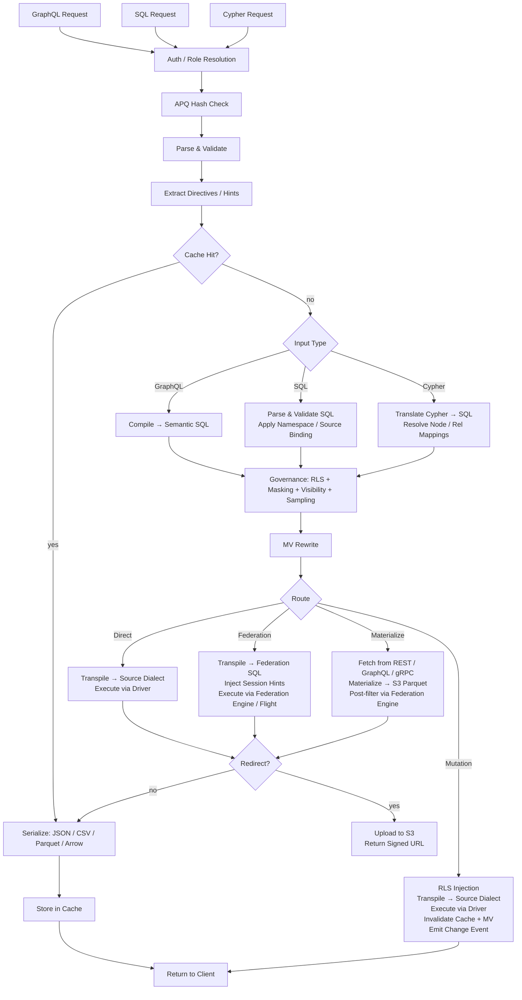

# Provisa 架构 {: #provisa-architecture }

## 概览 {: #overview }

Provisa 是一个配置驱动的数据虚拟化平台：联邦、指标、本体与治理出自单一模型，适用于小型团队和大型企业。它在异构数据源之上提供统一的 API，并具备治理、安全和性能优化能力。客户端可通过 SQL、GraphQL 或 Cypher 进行查询；三者都是一等接口，应用相同的治理机制。

模型是唯一添加语义的地方。要扩充模型，就在数据虚拟化层注册新的数据源或聚合。这保持了清晰的分隔：平台之外的任何东西都无法添加语义，也正因如此才能实现真正的数据治理。由编译器强制执行：无论使用哪种查询语言，已批准的关系目录都是唯一依据。

Provisa 的设计目标是：在运营场景下高性能，在企业分析场景下高可扩展。单一平台可同时满足两者，不牺牲速度或可扩展性。

```text
Config YAML → PG Metadata → Federation Catalogs
                               ↓
         Federation engine metadata → Schema Generator → SDL / SQL catalog / Cypher labels / gRPC proto (per role)
                                     ↓
                     Query → Parser → SQL Compiler → Transpiler
                                     ↓
                             Router (Smart Dispatch)
                         /           |            \
                    Federation  Direct PG      Direct MySQL/etc.
                         \           |            /
                              Executor Pool
                                     ↓
                         ┌───── Inline ─────┐     ┌──── Redirect ────┐
                         │  JSON (HTTP)     │     │  CTAS → S3       │
                         │  Arrow (Flight)  │     │  (Parquet, ORC)  │
                         │  Protobuf (gRPC) │     │  Provisa → S3    │
                         └─────────────────-┘     │  (JSON, CSV, …)  │
                                                  └─────────────────-┘
```

## 查询接口 {: #query-interfaces }

每个接口都是独立的传输方式，四者应用同一条安全管道（RLS、脱敏、采样、角色检查）。客户端从不直接与联邦引擎通信。查询语言（SQL、GraphQL 或 Cypher）与传输方式无关，多种语言可以经由同一种传输到达。

| 端口 | 传输方式 | 支持的查询语言 | 使用场景 |
| ------ | ----------- | -------------------------- | ---------- |
| 8001 | HTTP | GraphQL、SQL、Cypher | Web 客户端、BI 工具、curl、REST 消费者 |
| 8815 | Arrow Flight (gRPC) | SQL（经由 Arrow Flight SQL） | 数据工具（Pandas、DuckDB、Spark、ADBC） |
| 50051 | Protobuf gRPC | 按角色生成的 proto RPC | 具有类型化契约的服务间通信 |
| 可配置¹ | PostgreSQL wire protocol (pgwire) | SQL | psql、DBeaver、SQLAlchemy，任何兼容 PG 的客户端 |

¹ 设置 `PROVISA_PGWIRE_PORT`（例如 5433）。未设置或为 `0` 时禁用。

### HTTP（端口 8001） {: #http-port-8001 }

同一端口下有多个端点，通过路径区分：

| 路径 | 语言 | 说明 |
| ------ | ---------- | ------- |
| `POST /data/graphql` | GraphQL | 读取与变更；通过 `extensions.persistedQuery` 接受 APQ 哈希 |
| `POST /data/sql` | SQL | 只读；无能力门控——由对象可见性 + 行级安全 + 脱敏治理 |
| `POST /data/query` | Cypher | 只读；标准角色 |
| `GET /data/nl` | 自然语言 | 根据数据源类型翻译为 SQL/GraphQL/Cypher |
| `GET /data/subscribe/{table}` | GraphQL | SSE 订阅流 |
| `GET /neo4j/...` | Cypher（Neo4j 兼容） | Neo4j HTTP API 兼容垫片 |
| `POST /admin/graphql` | GraphQL | 管理 API（需要超级用户/管理员角色） |

所有路径默认返回 JSON。通过内容协商支持 `Accept: text/csv`、`application/vnd.apache.parquet`、`application/vnd.apache.arrow.stream` 以及 `application/octet-stream`（原始二进制）。超过配置阈值大小的结果会自动重定向到带签名的 S3 URL。

### Arrow Flight（端口 8815） {: #arrow-flight-port-8815 }

基于 gRPC 的原生 Arrow 列式传输。 客户端发送一个 JSON ticket：

```json
{"query": "SELECT name, email FROM customers", "role": "analyst"}
```

并接收惰性流式传输的 Arrow RecordBatches。当 Zaychik Flight SQL 代理可用时，数据以端到端的 Arrow record batch 流形式流动：

```text
Client ←(Arrow batches)← Provisa Flight Server ←(Arrow batches)← Zaychik ←(JDBC)← Federation Engine
```

完整结果从不保存在 Provisa 的内存中：批次一到就转发出去。这让 Arrow Flight 成为一条没有上限的路径，适合任意大小的结果。

### Protobuf gRPC（端口 50051） {: #protobuf-grpc-port-50051 }

从数据架构自动生成 `.proto`，按角色分别生成。 流式查询（每行一条消息）、一元变更。已启用服务器反射。 角色通过 `x-provisa-role` 元数据键传递。 反射向每个调用方描述其自身角色的服务。

### PostgreSQL wire protocol / pgwire（可配置端口） {: #postgresql-wire-protocol-pgwire-configurable-port }

使用 `buenavista` 库实现 PostgreSQL 前后端 wire protocol。 任何兼容 PostgreSQL 的客户端（`psql`、DBeaver、使用 `psycopg2` 的 SQLAlchemy、JDBC）无需修改即可连接。仅接受 SQL。完整的治理流水线（行级安全、脱敏、域权限）对 pgwire 连接同样适用。 通过将 `PROVISA_PGWIRE_PORT` 设置为非零端口来启用。

## 请求流水线 {: #request-pipeline }

系统接受三种查询语言，三者在各自完成解析和编译后汇合到治理阶段。三者都可以写入：GraphQL 变更、SQL 的 `INSERT`、`UPDATE`、`DELETE`、`MERGE` 和 `TRUNCATE`，以及 Cypher 的 `CREATE`、`SET` 和 `DELETE`，都会转换为 SQL 并经过同一个写入准入。查询本身没有能力关卡。任何已认证身份都可以用任何语言查询，数据仅由对象可见性、RLS 和脱敏来治理。

| 接口 | 读取 | 写入 | 查询门控 |
| --- | --- | --- | --- |
| GraphQL (`/data/graphql`) | 是 | 是（变更） | 无——仅数据层治理 |
| SQL (`/data/sql`) | 是 | 否 | 无——仅数据层治理 |
| Cypher (`/data/query`) | 是 | 否 | 无——仅数据层治理 |



**路由决策：**

| 路由 | 触发条件 |
| --- | --- |
| **Cache（缓存）** | 结果缓存命中——最先评估，直接返回已存结果，无需执行 |
| **Cheap-count（低成本计数）** | 针对未物化数据源、形如 `count(*)` 的查询，且该数据源暴露了精确的原生计数——路由到原生计数调用，而非物化后计数 |
| **Direct（直连）** | 单一数据源 + 具备原生驱动 + 具备联邦连接器 |
| **Federation（联邦）** | 多数据源联邦，或数据源有连接器但无驱动 |
| **Materialize（物化）** | 数据源没有联邦连接器——先抓取并缓存到 S3/PG |
| **Mutation（变更）** | 写入：在数据源有自己的驱动时由该驱动执行；否则由引擎经由写入该数据源的连接器执行 |

路由消费的是治理后优化阶段的输出，而不是优化前的已治理 SQL。治理可能会添加数据源（行级安全子查询谓词）；优化阶段可能会移除它们（热表 VALUES-CTE 内联、API 缓存重写、union 分支剪枝）。因此，若一个联邦查询在内联之后收敛为单一实时数据源，会被重新路由为直连。

### 多根查询 {: #multi-root-queries }

具有多个根字段的 GraphQL 查询（例如 `{ orders { id } customers { name } }`）会被编译为独立的 SQL 查询并各自执行。 SQL 和 Cypher 请求按定义是单根的。结果会被合并为单一响应：

- 低于重定向阈值的字段会内联返回在 `data` 中
- 高于阈值的字段会被重定向，在 `redirects` 中给出对应的按字段条目
- 二进制格式（Parquet、Arrow）仅支持单根查询

## 联邦执行路径 {: #federation-execution-paths }

| 路径 | 传输方式 | 经由 | 使用场景 |
| ------ | ----------- | ----- | ----------- |
| REST | 联邦引擎客户端 (HTTP :8080) | 直接查询 | 默认，始终可用 |
| Flight SQL | `adbc-driver-flightsql` (gRPC :8480) | Zaychik 代理 → JDBC | 当 Zaychik 正在运行时 |
| CTAS | 联邦引擎客户端 (HTTP :8080) | 直接写入，Iceberg 到 S3 | Parquet/ORC 重定向 |

### Zaychik Arrow Flight SQL 代理 {: #zaychik-arrow-flight-sql-proxy }

联邦引擎并不原生支持 Arrow Flight SQL 协议。[Zaychik](https://github.com/Raiffeisen-DGTL/zaychik-trino-proxy) 是一个 Java 代理，它实现了 Arrow Flight SQL gRPC 接口，将请求翻译为 JDBC 查询，并将结果以 Arrow record batch 的形式流回。

```text
ADBC client → gRPC :8480 → Zaychik → JDBC :8080 → Federation Engine → results → Arrow batches → client
```

Provisa Flight 服务器（端口 8815）以 ADBC 客户端身份连接到 Zaychik，实现端到端的流式 Arrow 传输，而无需物化结果。

### Iceberg 结果目录 {: #iceberg-results-catalog }

CTAS 重定向使用一个 Iceberg 连接器（`results` 目录），其后端是建立在现有 PostgreSQL 实例上的 JDBC 目录。 Iceberg 通过原生 S3 文件系统（`fs.native-s3.enabled=true`）将 Parquet/ORC 文件直接写入 MinIO/S3。

## 联邦引擎 {: #federation-engines }

Provisa 在启动时根据 `PROVISA_ENGINE` 环境变量、管理界面中保存的配置或默认值选择联邦引擎。如果什么都没设置，默认是 DuckDB，完全在进程内运行，无需外部服务。选择方式见[配置](configuration.md#federation-engine)。

每个引擎都是定义在 `provisa/federation/engine.py` 中的 `FederationEngine` 实例。该实例拥有一个连接器集合，决定引擎可以实时读取（ATTACH）哪些数据源类型，以及哪些必须先落地到引擎的物化存储中。

### 驱动类别 {: #driver-classes }

| 类别 | 含义 | 示例 |
| ------- | --------- | --------- |
| `BROAD` | 通过原生连接器触达众多外部数据源类型 | Trino |
| `PARTIAL` | 触达一个子集（关系型、文件、云对象/湖）；其余全部落地 | DuckDB、PostgreSQL、ClickHouse、Databricks、Snowflake、BigQuery、Fabric、Synapse |
| `SELF_ONLY` | 只能触达自身存储；其他所有数据源都要落地 | SQLAlchemy |

### 可用引擎 {: #available-engines }

| 引擎键 | 方言 | MPP | 外部链接机制 | 认证 |
| ----------- | --------- | ----- | ------------------------ | ------ |
| `trino` / `trino-byo` | Trino SQL | 是 | Trino 目录（广泛的连接器集合） | JDBC 凭据 |
| `pg` | PostgreSQL | 否 | FDW / pg_duckdb | PostgreSQL 凭据 |
| `duckdb` | DuckDB | 否 | 扩展原生 ATTACH | 无（进程内） |
| `clickhouse` / `clickhouse-server` | ClickHouse | 是（分片） | S3 / IcebergS3 / DeltaLake 表引擎 | ClickHouse 凭据 |
| `snowflake` | Snowflake | 是 | 外部 stage + 外部表 | `PROVISA_ENGINE_URL` |
| `databricks` | Databricks SQL | 是 | 经由 REST 的 Unity Catalog 外部表 | Bearer token（`federation_hints` 中的 `http_path`） |
| `bigquery` | BigQuery | 是（Dremel） | BigQuery 外部表 / BigLake 表 | `GOOGLE_APPLICATION_CREDENTIALS` 服务账号密钥 |
| `fabric` | T-SQL | 是 | OneLake shortcut → OPENROWSET | Azure AD（`az login` / 托管身份） |
| `synapse` | T-SQL | 是 | ADLS OPENROWSET / 外部表 | Azure AD |
| `sqlalchemy` | 任意 SQLAlchemy 方言 | 否 | 无（仅落地） | 按方言的凭据 |

### 零配置默认引擎：DuckDB {: #zero-config-default-duckdb }

当 `PROVISA_ENGINE` 未设置时，Provisa 使用完全内嵌的进程内 DuckDB 引擎。DuckDB 的物化存储是一个内嵌的 DuckDB 文件，路径为 `$PROVISA_DATA_DIR/materialize.duckdb`（默认 `~/.provisa/materialize.duckdb`）。不需要任何外部数据库或服务。

DuckDB 每个文件只允许一个写入者，所以 `store_connection.py` 通过引擎自身的连接写入嵌入式存储，从不另开一个独立连接。这是引擎和物化存储按设计共享文件句柄的唯一情况。

### Arrow 原生读取传输 {: #arrow-native-read-transport }

ClickHouse、DuckDB、Snowflake、Databricks、BigQuery、Fabric 和 Synapse 都声明了 `EngineCapability.ARROW` 和 `EngineCapability.ARROW_STREAM`。针对这些引擎的查询会直接返回 Arrow RecordBatches；完全绕过行序列化路径。Flight 服务器将这些批次流式传输给客户端，而不会在 Provisa 进程内存中物化完整结果。对于 Trino，Arrow 流依赖 Zaychik 代理；对于各仓库引擎，则由其自身的 Arrow 原生 API（Databricks 的 Cloud Fetch、BigQuery 的 Storage Read API、DuckDB 和 Snowflake 的 `fetch_arrow_table`）为 Flight 流供数。

### 外部数据链接（ATTACH） {: #external-data-links-attach }

每个仓库引擎都能就地扫描云对象/湖数据，而无需复制一份。S3、GCS 或 OneLake 上的 Parquet、CSV、Iceberg 和 Delta Lake 文件可直接挂载到引擎中，如同原生表一样。策略（ATTACH（就地扫描）还是 LAND（复制进存储））由连接器所声明的 `Mechanism` 决定；规划器中不存在特定引擎的分支逻辑。`Mechanism.ATTACH_R` 连接器会触发零拷贝扫描；`Mechanism.DIRECT` 或缺省连接器会触发落地。

Attach 会在挂载时自动预配所有前置条件：

| 引擎 | 对象/湖格式 | 机制 | 自动预配 |
| -------- | ------------------- | ---------- | ---------------------------------- |
| Databricks | parquet、csv、iceberg、delta_lake | UC 外部表 (`ATTACH_R`) | REST 安装 Unity Catalog 存储凭据 + 外部位置，然后 `CREATE TABLE … USING <format> LOCATION …`——已通过 Cloudflare R2 实地验证 |
| BigQuery | parquet、csv、json、iceberg、delta_lake | BigQuery 外部表 / BigLake 表 (`ATTACH_R`) | `CREATE OR REPLACE EXTERNAL TABLE … OPTIONS(format=…, uris=[…])`——已实地验证 |
| ClickHouse | csv、parquet、iceberg、delta_lake | S3 / IcebergS3 / DeltaLake 表引擎 (`ATTACH_R`) | 在挂载时执行验证探测——已通过 Cloudflare R2 实地验证 |
| Fabric | parquet、csv、iceberg、delta_lake | OneLake shortcut → OPENROWSET (`ATTACH_R`) | REST 创建 `AmazonS3Compatible` 连接 + lakehouse + shortcut；返回 OneLake 的 `BULK` 路径——已实地验证，通过 Fabric 读取 R2 |
| Snowflake | parquet、csv、json、iceberg、delta_lake | 外部 stage + 外部表 (`ATTACH_R`) | `CREATE STAGE … URL=… CREDENTIALS=…`，然后 `CREATE OR REPLACE EXTERNAL TABLE … LOCATION=@stage FILE_FORMAT=(TYPE=…)`——已实现；未实地测试（无可用账号） |

云存储凭据通过数据源的 `federation_hints` 传递（参见[数据源](sources.md#warehouses-as-named-sources)）。任何无法 ATTACH 的数据源类型都会先落地到引擎的物化存储中。

### 列式物化写入 {: #columnar-materialization-writes }

`provisa/core/database.py` 中的 `Connection.bulk_copy` 会为每种存储方言选择最快的批量写入路径：对 PostgreSQL 存储使用二进制 `COPY`（asyncpg 的 `copy_records_to_table`），对其他所有关系型存储使用单条 `executemany` 预编译语句。DuckDB 内嵌存储通过 `store_connection.py` 中的 `land_duckdb_native` 落地——对整个批次只调用一次 `executemany`，绝不逐行循环。

## 大结果集重定向 {: #large-result-redirect }

超过行数阈值的结果会被重定向到兼容 S3 的存储（MinIO），而不是内联返回。

### 重定向模式 {: #redirect-modes }

| 模式 | 工作方式 | 数据是否经过 Provisa？ |
| ------ | ------------- | ---------------------- |
| **CTAS**（Parquet、ORC） | 联邦引擎通过 `CREATE TABLE AS SELECT` 直接写入 S3 | 否 |
| **Provisa 上传**（JSON、NDJSON、CSV、Arrow IPC） | Provisa 序列化并通过 boto3 上传 | 是 |

对于 CTAS 原生支持的格式，Provisa 完全不经手数据：联邦引擎直接把文件写入 MinIO/S3。这是大型分析导出的首选路径。

### 没有对象存储 {: #with-no-object-store }

配置了对象存储（端点，或 AWS S3 的凭据）且引擎能自行写出所请求的格式时，结果进入对象存储。否则结果写入组织目录下的文件 `<data directory>/orgs/<org>/results/`。 已配置、引擎会向其写入但无法访问的存储会使请求失败并指明该存储。结果不会改为写入目录。

| 引擎 | 自行写出文件 | 格式 |
| ------ | ---------------------- | ------- |
| DuckDB | `COPY (query) TO '<file>'` | parquet, csv, json, ndjson |
| PostgreSQL | `COPY (query) TO STDOUT`，流式写入 Provisa 主机上的文件 | csv |
| 任何其他格式或引擎 | 由 Provisa 根据行写出 | parquet, orc, csv, arrow, json, ndjson |

该句柄具有与对象存储句柄相同的键，其中 `"sink": "local"`，`redirect_url` 为 `/data/redirect-file/<name>`，即应答服务器上的一个路径。 只有请求该结果的用户才能获取它。每次获取都会将请求自身的身份与文件旁记录的所有者进行比较，对其他任何人应答 403，对没有身份的请求应答 401。

超过 `redirect.ttl` 的文件以 404 应答并被删除。计时器会在到期时删除它，与对象存储的结果被删除的方式相同。每个新结果也会清理组织的结果目录，从而移除那些计时器因重启而终止的文件。

### 重定向 Header {: #redirect-headers }

| Header | 效果 |
| -------- | -------- |
| `X-Provisa-Redirect-Format: <mime>` | 以该格式重定向（除非设置阈值，否则隐含强制） |
| `X-Provisa-Redirect-Threshold: N` | 仅当结果超过 N 行时才重定向 |
| `X-Provisa-Redirect: true` | 使用默认格式强制重定向 |

这些 Header 实现了客户端可控的重定向。

**响应：**

```json
{
  "data": {"orders": null},
  "redirect": {
    "redirect_url": "https://minio:9000/provisa-results/results/abc.parquet?...",
    "row_count": 50000,
    "expires_in": 3600,
    "content_type": "application/vnd.apache.parquet"
  }
}
```

### 服务器配置 {: #server-configuration }

| 环境变量 | 默认值 | 用途 |
| --------- | --------- | --------- |
| `PROVISA_REDIRECT_ENABLED` | `false` | 启用服务端阈值重定向 |
| `PROVISA_REDIRECT_THRESHOLD` | `1000` | 默认行数阈值 |
| `PROVISA_REDIRECT_FORMAT` | `parquet` | 默认重定向格式 |
| `PROVISA_REDIRECT_BUCKET` | `provisa-results` | S3 存储桶名称 |
| `PROVISA_REDIRECT_ENDPOINT` | | 兼容 S3 的端点 URL |
| `PROVISA_REDIRECT_TTL` | `3600` | 预签名 URL 有效期（秒） |

## 路由决策树 {: #routing-decision-tree }

```text
Multi-source query? → Federation engine
NoSQL source (MongoDB, Cassandra)? → Federation engine
Uses path columns on non-PG source? → Federation engine
Single RDBMS with driver? → Direct (sub-100ms target)
Single RDBMS without driver? → Federation engine
Steward hint "federated"? → Federation engine (override)
Steward hint "direct"? → Direct (if possible)
Redirect to Parquet/ORC? → Federation engine (CTAS, regardless of source count)
```

## 联邦查询优化 {: #federation-query-optimization }

Provisa 会自动为联邦引擎的基于成本的优化器准备统计信息，让跨数据源查询计划基于数据的真实分布，而不是写死的默认值。

### 自动统计信息 (`ANALYZE`) {: #automatic-statistics-analyze }

在数据源注册时，Provisa 会为每张已发布的表运行 `ANALYZE catalog.schema.table`。 这会收集：

- 行数
- 按列：空值比例、去重值计数、最小/最大值、直方图（视连接器而定）

优化器使用这些信息来估计过滤查询的选择率。若没有统计信息，则会回退到固定默认值（例如等值谓词的选择率假设为 10%），这会在倾斜或高基数数据上产生较差的连接计划。有了统计信息，估计就足够准确，可以为大多数工作负载做出正确的广播连接与分区连接决策。

**覆盖范围**：统计信息支持因连接器而异。PostgreSQL、MySQL、Hive、Iceberg 和 Delta Lake 完全支持 `ANALYZE`；MongoDB 和 Cassandra 部分支持或不支持。连接器不收集统计信息的目录会被跳过，失败的 `ANALYZE` 会记入日志并跳过，所以注册永远不会被阻塞。

**选择率限制**：统计信息只提供按列估计。对于相关谓词（`WHERE region = 'US' AND city = 'Seattle'`），优化器假设列之间相互独立，这可能低估行数。这是所有基于成本的优化器在列级统计上的已知局限。

**API 数据源**：PostgreSQL 中的 `api_cache_{table_name}` 表会在每次缓存刷新周期后自动分析，因此在将 API 数据源与关系型数据源连接查询时，优化器能获得最新的行数估计。

### 管理端：刷新统计信息 {: #admin-refresh-statistics }

可通过管理 API 按需重新运行统计信息收集：

```graphql
mutation {
  refreshSourceStatistics(sourceId: "sales-pg") {
    tablesAnalyzed
    failures { table message }
  }
}
```

当某个数据源自注册以来接收了大量新数据时，此功能很有用。

## 物化视图 {: #materialized-views }

物化视图（MV）通过预先计算并缓存结果，透明地优化开销较大的查询。

### 关系作为物化视图提示 {: #relationships-as-mv-hints }

关系声明既是治理产物，也是联接形态的结构化描述。这个形态（表、列、联接类型）正是 MV 优化器所需要的，所以关系可以直接驱动物化。

对于**跨数据源的关系**，这一切在启动时自动发生：每个设置了 `materialize: true`、且两端落在不止一个数据源中的关系，都会生成一个 `JoinPattern` MV（`auto-mv-<rel_id>`），无需单独的 MV 配置。编译器在查询中看到这个联接时，重写器会在调用方无感知的情况下换上预物化的结果。同一数据源内的关系不会生成任何东西，因为这些 JOIN 通过直接执行已经很快。

**经由关联表的关系**会物化整条遍历。关联表是第三条腿，所以该模式包含源头一跳、关联表一跳，以及把行限定到某一种边类型的判别值，关联表自身的列会与目标的列一起落到视图中。由于关联表算作一条腿，如果关联表所在的数据源与它连接的两张表不同，即使那两张表同属一个数据源，这条边也算跨数据源。重写器把两跳作为一条链来匹配，第二跳必须从第一跳引入的别名出发。因此，不经过关联表而到达同样两张表的查询会读取基础表，为某个判别值构建的视图也永远不会回答按另一个判别值过滤的遍历。

实际影响是：审批一条关系的数据管家，同时也在隐含地决定该连接是否适合作为物化候选。治理行为与优化提示是同一份声明。

### 模式 {: #modes }

| 模式 | 配置 | 行为 |
| ------ | -------- | ---------- |
| **Join-pattern（连接形态）** | 物化视图配置中的 `join_pattern` | 将匹配的 JOIN 重写为从物化视图表读取 |
| **Custom SQL（自定义 SQL）** | 物化视图配置中的 `sql` | 任意 SELECT，可选择暴露在 SDL 中 |
| **Auto-materialized relationship（自动物化关系）** | 跨数据源关系（自动） | 自动生成 join-pattern 物化视图；无需配置 |
| **Junction-backed relationship（以关联表为基础的关系）** | 关联关系上的 `materialize: true` | 物化两跳遍历，包含判别式与边属性 |

### 自动物化 {: #auto-materialization }

跨数据源 JOIN 是开销最大的查询（始终走联邦）。跨数据源关系会在启动时自动生成物化视图定义：

```yaml
relationships:
  - id: orders-to-reviews
    source_table_id: orders        # sales-pg
    target_table_id: product_reviews  # reviews-mongo
    source_column: product_id
    target_column: product_id
    cardinality: one-to-many
    materialize: true              # auto-create MV
    refresh_interval: 600          # refresh every 10 minutes
```

只有跨数据源关系会生成物化视图（同数据源 JOIN 通过直接执行本已足够快）。 物化视图以 `STALE` 状态启动，并在被查询优化器使用之前，由后台刷新循环负责刷新。

### 刷新生命周期 {: #refresh-lifecycle }

```text
STALE → (refresh loop picks up) → REFRESHING → FRESH
  ↑                                                |
  └──── mutation hits source table ────────────────┘
```

刷新循环每 30 秒运行一次，检查 `get_due_for_refresh()`，并通过联邦引擎对物化视图的目标表执行 `CREATE TABLE AS SELECT`（首次运行）或 `DELETE + INSERT`（后续运行）。

## 模块地图 {: #module-map }

| 模块 | 用途 |
| -------- | --------- |
| `api/` | FastAPI 应用、路由、中间件、生命周期管理 |
| `api/flight/` | Arrow Flight 服务器（gRPC，端口 8815） |
| `api/admin/` | Strawberry GraphQL 管理 API——配置、发现、视图 |
| `api/rest/` | 由已注册表自动生成的 REST 端点 |
| `api/jsonapi/` | 带分页与错误处理的自动生成 JSON:API 端点 |
| `api/data/subscribe.py` | SSE 订阅——LISTEN/NOTIFY、轮询、Debezium CDC |
| `compiler/` | GraphQL/SQL 解析器、语义 SQL 生成器、行级安全、脱敏、采样、两阶段治理（`stage2.py`） |
| `cypher/` | Cypher → SQL 翻译器、解析器、标签映射、Cypher 变更的写入翻译器 |
| `pgwire/` | PostgreSQL wire-protocol 服务器；`catalog.py` 拦截 pg_catalog/information_schema，实现按角色的对象可见性 |
| `vector/` | 向量搜索——模型注册表、嵌入提供方（openai/ollama/huggingface）、`cosine_similarity()` 转换、副本嵌入列上的 HNSW 索引、声明式嵌入生成 |
| `compiler/federation.py` | Apollo Federation v2 子图支持 |
| `transpiler/` | 方言转译、路由逻辑 |
| `executor/` | 联邦/直连执行、序列化、输出格式 |
| `executor/drivers/` | 直连数据源驱动（PostgreSQL、MySQL、DuckDB、Snowflake、Databricks、ClickHouse……） |
| `executor/trino_flight.py` | 面向联邦引擎的 ADBC Flight SQL 客户端 |
| `executor/ctas_write.py` | 基于 CTAS 的重定向（联邦引擎写入 S3） |
| `executor/redirect.py` | S3 重定向逻辑，Provisa 端上传 |
| `federation/engine.py` | `FederationEngine`、`DriverClass`、`_ENGINE_BUILDERS`、`ENGINE_REGISTRY`、`build_engine` |
| `federation/connector.py` | 连接器抽象——Trino、ClickHouse；`Mechanism`、`WarehouseNativeConnector` |
| `federation/connector_duckdb.py` | DuckDB 与 PostgreSQL FDW 连接器定义 |
| `federation/snowflake_connectors.py` | Snowflake 外部 stage + 外部表 ATTACH 连接器 |
| `federation/databricks_connectors.py` | Databricks UC 外部表 ATTACH 连接器 |
| `federation/bigquery_connectors.py` | BigQuery 外部表 / BigLake ATTACH 连接器 |
| `federation/databricks_uc.py` | Unity Catalog 凭据 + 外部位置自动预配 |
| `federation/databricks_backend.py` | Databricks SQL warehouse 执行后端 |
| `federation/snowflake_backend.py` | Snowflake 执行后端 |
| `federation/bigquery_backend.py` | BigQuery 执行后端（Storage Read API Arrow 传输） |
| `federation/mssql_warehouse_backend.py` | Fabric Warehouse + Synapse 执行后端（经由 ODBC 的 T-SQL） |
| `federation/mssql_warehouse_connectors.py` | Fabric / Synapse 的 OPENROWSET ATTACH 连接器 |
| `federation/fabric_shortcuts.py` | OneLake shortcut 自动预配（连接 → lakehouse → shortcut） |
| `federation/clickhouse_backend.py` | ClickHouse 执行后端 |
| `federation/duckdb_backend.py` | DuckDB 进程内执行后端 |
| `federation/pg_backend.py` | PostgreSQL 执行后端 |
| `federation/store_connection.py` | DuckDB 原生物化存储写入面 |
| `registry/` | 持久化查询注册表、治理 |
| `security/` | 可见性、权限、列脱敏 |
| `cache/` | 基于 Redis 的查询结果缓存（热层） |
| `mv/` | 物化视图注册表、刷新、SQL 重写器 |
| `events/` | 数据集变更事件与触发调度 |
| `webhooks/` | 面向变更与事件的出站 webhook 执行 |
| `scheduler/` | 基于 APScheduler 的后台任务管理——触发 webhook 与变更的 cron 与间隔触发器，以及实时 Kafka 输出的轮询 |
| `apq/` | Apollo APQ wire protocol——基于 Redis 的查询哈希缓存；与结果缓存相互独立 |
| `compiler/cursor.py` | Relay 风格的游标分页——所有列表查询上的 `first`/`after`/`last`/`before` 参数与 `pageInfo` 生成 |
| `compiler/aggregate_gen.py` | 自动生成 `{table}_aggregate` 查询类型，含 `count`、`sum`、`avg`、`min`、`max` 子字段与经过滤的 `nodes` 访问 |
| `compiler/enum_detect.py` | 枚举类型自动检测——PostgreSQL 原生枚举类型 (`pg_enum`) 暴露为 GraphQL 枚举类型，而非字符串标量 |
| `compiler/hints.py` | 联邦性能提示——以 SQL 注释形式嵌入的查询级路由指令（`/* @provisa route=federated */`），可覆盖自动路由 |
| `compiler/mutation_gen.py` | 变更编译器；列预设——在插入/更新时应用的服务端静态值或会话变量值，不会暴露在变更输入类型中 |
| `auth/approval_hook.py` | ABAC 审批钩子——在查询执行前调用的可插拔外部授权；支持 webhook、gRPC 与 unix_socket 传输；按表/数据源/全局作用域；可配置的回退策略 |
| `subscriptions/` | SSE 订阅状态与投递 |
| `discovery/` | LLM 关系发现（Claude API） |
| `grpc/` | Proto 生成、gRPC 服务器、反射 |
| `api_source/` | 带 PG 缓存的 REST/GraphQL/gRPC API 数据源 |
| `kafka/` | Kafka 主题数据源、sink、Schema Registry |
| `auth/` | 可插拔的认证提供方、中间件、角色映射 |
| `core/` | 配置、模型、数据库、仓储、密钥；角色模型支持 `parent_role_id` 与 `flatten_roles()` 以实现递归角色继承 |
| `hasura_v2/` | Hasura v2 元数据 → Provisa 配置转换器 |
| `ddn/` | Hasura DDN supergraph → Provisa 配置转换器 |
| `mongodb/` | MongoDB 数据源连接器 |
| `elasticsearch/` | Elasticsearch 数据源连接器 |
| `cassandra/` | Cassandra 数据源连接器 |
| `prometheus/` | Prometheus 指标数据源连接器 |
| `source_adapters/` | 数据源连接的通用适配层 |

## 管理 API {: #admin-api }

管理端 Strawberry GraphQL API 挂载在 `/admin/graphql`（HTTP 端口 8001）。它与数据 GraphQL 端点相互独立，需要超级用户或管理员角色。

| 能力 | 说明 |
| ----------- | ------------- |
| 配置下载/上传 | 导出或替换完整的 Provisa YAML 配置 |
| 关系编辑器 | 创建、更新、删除关系定义 |
| AI 外键发现 | 触发由 Claude 驱动的外键候选分析 |
| 架构内省 | 浏览已发布的表、列与角色 |
| 视图管理 | 注册并管理物化视图定义 |

## AI 模型配置 {: #ai-models-configuration }

`GET /admin/ai-models` 与 `PUT /admin/ai-models` 用于配置每个组织的 LLM 流水线。

这些设置**按组织生效**：每个组织的选择叠加在部署配置之上，从下一个请求起生效，无需重启。

**按操作的模型分配。** 六种操作各自拥有可配置的厂商与模型字符串：

| 操作 | 驱动的内容 |
| --------- | -------------- |
| `table_description` | LLM 生成的表描述 |
| `column_description` | LLM 生成的列描述 |
| `relationship_inference` | 外键候选发现 |
| `sql_generation` | 自然语言 → SQL 生成 |
| `table_selection` | 选择哪些表纳入自然语言提示词 |
| `mcp_chat` | 聊天助手面板的工具调用循环 |

厂商字段接受任意兼容 `aisuite` 的厂商（`anthropic`、`openai`、`groq`、`mistral`、`cohere` 等）或本地端点（`ollama`、`lmstudio`）。空的模型字符串会移除组织的覆盖设置，恢复为部署默认值。

**自然语言速率限制。** 一个可选的、按角色应用的请求周期上限。超出的请求会返回带 `Retry-After` 的 `429`。

**向量模型注册表。** 一个嵌入模型列表（字段：`id`、`provider`、`dimensions`，可选的 `api_key_env` 与 `base_url`，以及 `enabled` 标志）。整表替换写入：每一项都必须含有 `id`、`provider` 和 `dimensions`，否则写入会被拒绝并返回 `400`。

**API 密钥。** 每个供应商的 LLM API 密钥都通过 `provisa.core.org_secrets` 加密存储（见下文）。`GET` 响应只说明每个供应商是否设置了密钥，从不返回密钥值。为某个供应商发送空字符串会清除其密钥，该供应商的 LLM 调用随即改回使用部署环境变量中的凭据。

## 按组织的加密密钥 {: #per-org-encrypted-secrets }

`provisa/core/org_secrets.py` 存储绝不能以明文形式出现在数据库中的凭据。其中保存 AI 厂商的 API 密钥（`{vendor}_api_key`）和 Jev 密钥（`jev_api_key`）。

这些值用 `provisa.encryption.runtime` 中进程级的 `encryption_service` 加密，与 `api_sources.auth` 使用同一机制。

支持十二个兼容 `aisuite` 的厂商：`anthropic`、`openai`、`cohere`、`groq`、`mistral`、`xai`、`deepseek`、`together`、`fireworks`、`nebius`、`sambanova` 和 `inception`。Google、AWS 和 Azure 被排除在外，因为它们需要超出单纯 API 密钥的配置（项目 ID、IAM 角色、区域）。本地端点厂商（`ollama`、`lmstudio`）没有密钥，出于同样的原因被排除。

向 `write_org_secret` 传入 `value=None` 会删除该行。读取密钥的调用方需立即消费它（例如用于构造 LLM 客户端），且不得在任何 API 响应中回显它。

## 自动生成的 REST 与 JSON:API 端点 {: #auto-generated-rest-jsonapi-endpoints }

已注册的表会与 GraphQL 接口并列，暴露为 REST 与 JSON:API 端点。

| 接口 | 挂载路径 | 规范 |
| ----------- | ----------- | ------ |
| REST | `/rest/<table-id>` | 带查询参数的简单 GET/POST |
| JSON:API | `/jsonapi/<table-id>` | 符合 [jsonapi.org](https://jsonapi.org) 规范——分页、关系、错误对象 |

这些端点应用与 GraphQL 端点相同的安全流水线（行级安全、脱敏、角色检查）。

## 订阅 {: #subscriptions }

SSE 订阅由 `GET /data/subscribe/{table}` 提供服务。三种投递模式：

| 模式 | 机制 | 使用场景 |
| ------ | ----------- | ----------- |
| **LISTEN/NOTIFY** | 在某个通道上使用 PostgreSQL 的 `LISTEN` | 有变更活动的 PG 数据源 |
| **Polling（轮询）** | 按间隔重新执行查询 | 非 PG 数据源，或 CDC 不可用时 |
| **Debezium CDC** | 来自 Debezium 连接器的 Kafka 主题 | 高频变更流 |

客户端接收 `text/event-stream`，每个变更行或差异对应一个 JSON 事件。

## 事件与 Webhook 系统 {: #event-webhook-system }

数据库变更（INSERT/UPDATE/DELETE）可以通过 `events/` 与 `webhooks/` 模块触发出站事件。

```text
Mutation executed → EventDispatcher → match event trigger rules
                                          ↓
                               WebhookExecutor → HTTP POST to configured URL
```

事件触发器在配置中定义，并按表、操作类型和可选的行过滤条件进行匹配。Webhook 载荷包含操作类型、变更行以及角色上下文。

## 后台服务 {: #background-services }

应用生命周期内（`api/app.py`）启动四个后台循环：

| 服务 | 间隔 | 用途 |
| --------- | ---------- | --------- |
| 物化视图刷新循环 | 30 秒 | 轮询 `get_due_for_refresh()`，对过期的物化视图执行 CTAS 或 DELETE+INSERT |
| 热复制评估 | `replication.hot_interval` | 提升语句数超过其阈值的表并请求其副本；降级降到一半以下的表。在持有调度器锁的唯一进程中运行 |
| 热表加载器 | 可配置 | 将小型参考表加载进内存缓存，实现亚毫秒级访问 |
| API 数据源轮询器 | 按数据源的间隔 | 重新抓取并重新缓存远程 REST/GraphQL/gRPC 数据源 |

### 热表与繁忙时复制的表 {: #hot-tables-and-replicated-when-busy-tables }

| 层级 | 存储 | 提升标准 | 访问延迟 |
| ------ | --------- | ------------------- | ---------------- |
| 热 | 进程内内存 | 行数低于阈值，或是某条关系的目标 | <1 毫秒 |
| 繁忙时复制 | 引擎存储中的副本 | `replicate` 为 Default 或 Hot-N，且读取该表的受治理语句超过其阈值 | 引擎对其自身存储的读取 |
| 冷 | 远程数据源 | 默认 | 50–500 毫秒 |

一张表至多属于二者之一：由热层管理的表不会因繁忙而被复制。

## 元数据导入（Hasura v2 / DDN） {: #metadata-import-hasura-v2-ddn }

现有的 Hasura 部署可以转换为 Provisa 配置，无需手动重写。

| 模块 | 输入 | 输出 |
| -------- | ------- | -------- |
| `hasura_v2/` | Hasura v2 `metadata.yaml` | Provisa `config.yaml` |
| `ddn/` | Hasura DDN supergraph JSON | Provisa `config.yaml` |

两种转换器都会映射被跟踪的表、关系、权限和远程架构。转换结果是一份完整的、可直接部署的 Provisa 配置。

## Apollo Federation

`compiler/federation.py` 将 Provisa 作为 Apollo Federation v2 子图暴露出来。 子图 SDL 由已发布架构自动生成，在主键列上带有 `@key` 指令，在跨子图关系上带有 `@external`/`@provides` 注解。Provisa 会响应联邦网关所要求的 `_entities` 与 `_service` 查询。

## 基于游标的分页 {: #cursor-based-pagination }

所有列表查询都通过 `compiler/cursor.py` 支持 Relay 风格的游标分页。 客户端传入 `first`/`after`（向前）或 `last`/`before`（向后）参数。编译器将行位置编码为不透明的 base64 游标，并注入相应的 `WHERE`/`LIMIT` 子句。每个列表查询都会返回一个 `pageInfo` 对象：

| 字段 | 类型 | 说明 |
| ------- | ------ | ------------- |
| `hasNextPage` | Boolean | 若此页之后还有更多结果，则为 true |
| `hasPreviousPage` | Boolean | 若此页之前还存在结果，则为 true |
| `startCursor` | String | 此页中第一个节点的游标 |
| `endCursor` | String | 此页中最后一个节点的游标 |

## 聚合查询 {: #aggregate-queries }

每张已注册的表都会获得一个自动生成的 `{table}_aggregate` 根字段（`compiler/aggregate_gen.py`）。 该聚合类型对每个数值列都暴露 `count`、`sum`、`avg`、`min`、`max`，并提供 `nodes` 用于带完整字段选择的过滤行访问（与基础查询相同的行级安全/脱敏）。 来自任何界面（SQL 或编译查询）的单表聚合，都可由一个预先聚合该表的新鲜物化视图应答，无需任何声明：其 SQL 为对单表按具名 `SUM`、`COUNT`、`MIN` 和 `MAX` 进行 `GROUP BY` 的视图，可服务那些按其分组列子集分组、且只对这些列进行过滤的聚合。每个聚合都在已存储的值上重新聚合（`COUNT` 为已存储计数之和，`AVG` 来自同一列已存储的总和与计数）；视图无法精确应答的部分仍由表应答。该改写在治理之后运行，因此作用于视图某个分组列的行过滤会传递给视图，而作用于任何其他列的行过滤、或作用于被汇总列的脱敏，会使读取留在表上。

## 自动持久化查询（APQ） {: #automatic-persisted-queries-apq }

`apq/cache.py` 实现了 Apollo APQ wire protocol。 当客户端只发送查询哈希（`extensions.persistedQuery`）时，Provisa 会在 Redis 中查找它。 未命中时会返回 `PersistedQueryNotFound` 错误；客户端随后携带完整查询体重试，Provisa 会将其存储。 这与结果缓存（`cache/`）相互独立。

## 继承角色 {: #inherited-roles }

一个角色通过 `parent_role_id` 至多命名一个父角色。 在运行时构建阶段，`security/inheritance.py` 会从子角色出发沿链向上遍历，并将其折叠进构建过程自身对已加载数据的副本中，因此后续所有查找都始终以执行角色 id 为键。 能力与域访问权限是整条链的并集。一列的 `visible_to`、其脱敏列表中的每一项，以及一个指标、函数或 webhook 的 `visible_to`，只要其中命名了该角色本身或其祖先角色，就对该角色生效。表的写入授权按操作以同样方式解析：对某操作没有授权的角色，采用最近祖先角色的授权，自己的授权优先。行级安全按表解析，子角色优先：链中最近一个对该表有规则的角色——其自身的表规则优先于其域规则——提供唯一生效的那条谓词；祖先角色的规则绝不会与之合并。若某角色未设置速率限制，则继承其父角色的速率限制。父角色必须存在，不能是角色自身，也不能构成环；被其他角色继承的角色，在被重新指定父角色之前不能删除。

## ABAC 审批钩子 {: #abac-approval-hook }

`auth/approval_hook.py` 是一个可插拔的授权钩子，在行级安全与脱敏之后、查询执行之前被调用。 它与外部策略引擎（OPA、自定义 ABAC 服务）集成。

| 设置 | 说明 |
| --------- | ------------- |
| 传输方式 | `webhook`（HTTP POST）、`grpc` 或 `unix_socket` |
| 作用域 | 按表、按数据源，或全局 |
| 回退策略 | 当钩子端点不可达时，`allow` 或 `deny` |

## 枚举类型自动检测 {: #enum-type-auto-detection }

`compiler/enum_detect.py` 在生成模式时检查 PostgreSQL 原生枚举类型（`pg_enum`）。使用 PostgreSQL 用户自定义枚举类型的列会成为 GraphQL 枚举类型，其取值成为枚举成员，而不是字符串标量。

## 定时触发器 {: #scheduled-triggers }

`scheduler/jobs.py` 使用 APScheduler 运行定义为 cron 或间隔触发器的后台任务。 每个任务可以向 webhook URL 发起 POST，或针对数据端点执行一次变更；表的实时 Kafka 输出（`live.outputs`）在同一调度器上轮询。触发器通过管理 API（`scheduledTrigger` 变更）或 YAML 配置中的 `scheduled_triggers` 键进行配置。

## 联邦性能提示 {: #federation-performance-hints }

`compiler/hints.py` 使用 Provisa 的注释语法解析嵌入在查询中的数据管家提示。 提示格式因查询语言而异：

```graphql
# @provisa route=federated
{ orders { id amount } }
```

```sql
/* @provisa route=federated */
SELECT id, amount FROM orders
```

```cypher
// @provisa route=federated
MATCH (o:Order) RETURN o.id, o.amount
```

| 提示 | 效果 |
| ------ | -------- |
| `route=federated` | 强制经由联邦引擎走联邦路径，绕过直连驱动路由 |
| `route=direct` | 强制走直连驱动执行 |
| `cache=true` | 为该查询启用响应缓存（SQL 注释形式：`-- @provisa cache=true`） |
| `cache_ttl=N` | 启用并将缓存结果保留 N 秒（`-- @provisa cache_ttl=N`） |

响应缓存按请求选择启用：GraphQL 使用 `@cached(ttl: Int)` 指令，SQL 和 Cypher 使用 `cache`/`cache_ttl` 注释，gRPC 使用调用元数据 `x-provisa-cache` / `x-provisa-cache-ttl`。该提示在承载该语言的每种传输上都生效（Cypher 经 HTTP、Bolt 和 Arrow Flight；GraphQL 经 HTTP 和 Arrow Flight）。没有提示的请求从不读取或写入缓存，且任何形式都不会读取比运营方的数据源和表设置所允许的更新的数据。请参阅[缓存](configuration.md#per-request-opt-in)。

## 变更中的写入授权与预设 {: #write-grants-and-presets-in-mutations }

表的 `write_grants` 按角色和操作声明：写入可以指定哪些列、可以触及哪些行，以及授权自己设置哪些值。`compiler/write_admission.py` 在治理阶段准入每次写入，因此 GraphQL、SQL、Cypher 及其他界面得到相同的答案：`write` 权利、角色对该操作的授权、列、添加到语句中的预设、以 AND 并入 `WHERE` 的 `rows` 谓词，以及在任何内容到达数据源之前对新行评估的 `check`。预设来自会话变量、字面量或写入时间。语句不得提供预设列，因此预设不会出现在生成的 GraphQL 变更输入类型中。

## GraphQL Voyager 架构浏览器 {: #graphql-voyager-schema-explorer }

管理界面（`provisa-ui/src/pages/SchemaExplorer.tsx`）嵌入了 GraphQL Voyager，作为交互式的模式可视化工具。它把按角色限定的模式绘制成可平移、缩放和点击浏览的实体关系图，表是节点，关系是边。显示的模式始终按当前选中的角色过滤。

## 安全强制执行顺序 {: #security-enforcement-order }

查询没有能力关卡；治理完全由数据层的控制实现。对于角色对象范围之外的任何表，原始 SQL 请求会在治理运行之前就被拒绝（HTTP 403）。

1. **对象可见性**：按角色的架构会隐藏未授权的表/列；原始 SQL 中超出范围的表会被拒绝
2. **关系强制执行**：遍历必须存在于已批准的关系目录中，除非该角色持有 `ignore_relationships`。在预置的系统角色中，只有 `modeler` 拥有此权限。在高安全模式下，该能力会被忽略，没有任何遍历能逃脱目录约束
3. **行级安全**：按表按角色注入 WHERE 子句
4. **列脱敏**：按列按角色的数据转换
5. **行数上限（LIMIT）**：对不持有 `full_results` 的角色施加的行数上限；随机统计采样是一项独立的用户查询功能

所有四种查询接口（HTTP、Flight、gRPC、pgwire）都强制执行相同的第二阶段治理流水线；任何客户端路径都无法在不绕过服务器的情况下绕过它。

## 可扩展性限制 {: #scalability-limits }

Provisa 是一个很薄的编译与路由层，只给查询延迟增加个位数毫秒。不过，Provisa 需要序列化结果数据的路径会受进程内存限制。有两条路径完全不受限：

| 路径 | 是否受内存限制？ | 适用场景 |
| ------ | -------------- | ------------- |
| JSON 内联（HTTP） | 是 | 中小型结果 |
| **Arrow Flight 流式传输（gRPC :8815）** | **否** | **无界——经由 Zaychik 或仓库 Arrow API 流式传输** |
| Protobuf gRPC 内联（:50051） | 是 | 中等规模结果，服务间通信 |
| 重定向：Provisa 上传（JSON、CSV、NDJSON、Arrow IPC） | 是 | 中等规模结果，文件下载 |
| **重定向：CTAS（Parquet、ORC）** | **否** | **无界——联邦引擎直接写入 S3** |

### 阈值探测 {: #threshold-probing }

对于基于阈值的重定向，Provisa 会向查询中注入 `LIMIT threshold + 1` 作为探测。 若结果行数少于该值，则直接内联返回（完整结果，无额外浪费的工作）。若结果达到上限，探测结果会被丢弃，完整查询会通过 CTAS 或 Provisa 上传重新执行。这避免了 `SELECT COUNT(*)`（部分数据源对其优化不佳），并且适用于任何数据源。

对于大型分析工作负载，可使用以下任一方式：

- **Arrow Flight**（端口 8815）用于向数据工具流式传输，批次流经 Provisa 时不会被物化
- **Parquet/ORC 重定向** 用于基于文件的导出：联邦引擎直接写入 S3，Provisa 返回预签名 URL

## 基础设施 {: #infrastructure }

| 服务 | 镜像 | 端口 | 用途 |
| --------- | ------- | ------ | --------- |
| Provisa API | (host process) | 8001 | HTTP/REST 端点 |
| Provisa Flight | (host process) | 8815 | Arrow Flight gRPC 服务器 |
| Provisa gRPC | (host process) | 50051 | Protobuf gRPC 服务器 |
| Federation Engine | `trinodb/trino`（默认）或外部仓库 | 8080 / 视情况而定 | 查询联邦引擎——内嵌技术栈用 Trino；仓库目标用 Snowflake/Databricks/BigQuery/Fabric/Synapse/DuckDB |
| Zaychik | `provisa-zaychik`（从源码构建） | 8480 | 面向 Trino 的 Arrow Flight SQL 代理；仓库引擎不需要 |
| PostgreSQL | `postgres:16` | 5432 | 配置元数据 + Iceberg 目录 |
| MongoDB | `mongo:7` | 27017 | 演示用 NoSQL 数据源 |
| MinIO | `minio/minio` | 9000/9001 | 兼容 S3 的对象存储 |
| Redis | `redis:7-alpine` | 6379 | 查询结果缓存 |
| PgBouncer | `edoburu/pgbouncer` | 6432 | PG 连接池 |
| Kafka | `confluentinc/cp-kafka:7.6.0` | 9092 | 流式数据源 |
| Schema Registry | `confluentinc/cp-schema-registry:7.6.0` | 8081 | Avro/Protobuf 架构管理 |
